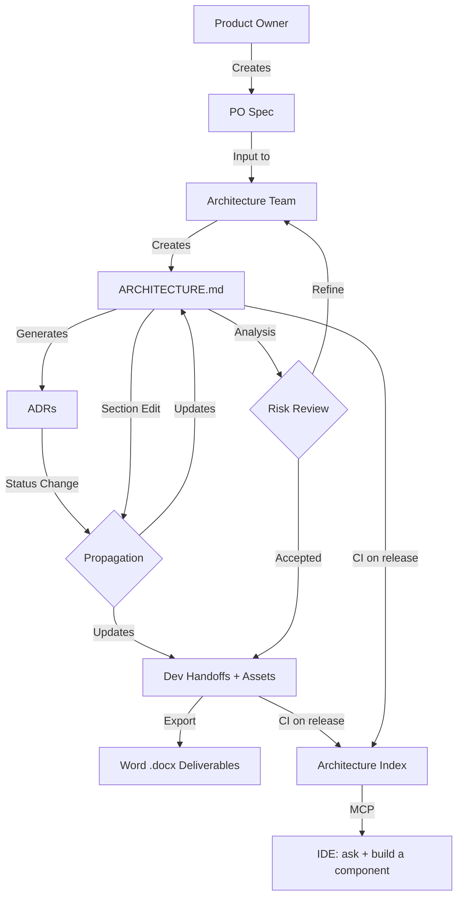

# Solutions Architect Skills

[](https://github.com/shadowx4fox/solutions-architect-skills/releases)
[](LICENSE)
[](https://claude.com/claude-code)

Professional architecture documentation workflow for Claude Code: Transform business requirements into technical architecture, and development handoffs.


## Step 1 — Install the full suite

The suite is six plugins from one marketplace: **sa-skills** (architecture, component index),
**sa-records** (ADRs, TDRs), **sa-requirements** (the PO Spec and its capability alignment — BIAN for banking, a cross-industry map, or a pack's framework), **sa-analysis** (risk analyses, traceability),
**sa-delivery** (handoff kit, Word export, IcePanel) and **sa-visualization** (the 3D command center).
Installing sa-skills installs the other five. What belongs to one organization ships separately, as an
[institution pack](docs/INSTITUTION_PACKS.md). Requires [Bun](#installing-bun-by-os).

**From a terminal:**

```bash
claude plugin marketplace add shadowX4fox/solutions-architect-skills
claude plugin install sa-skills@shadowx4fox-solution-architect-marketplace --scope user
claude plugin list   # sa-skills, sa-records, sa-requirements, sa-analysis, sa-delivery, sa-visualization — all ✔ enabled
```

Then, in Claude Code: `/reload-plugins`, and `/sa-skills:setup` once in each project (permissions, `.gitignore`,
`CLAUDE.md` pointers, docgen and judge checks).

**Or paste this into another Claude Code instance** — it installs, repairs what is missing and verifies:

```text
Install the Solutions Architect Skills suite for me, from a shell (the `claude` CLI):
1. If `claude plugin marketplace list` does not show shadowx4fox-solution-architect-marketplace, run
   `claude plugin marketplace add shadowX4fox/solutions-architect-skills`; if it does, run
   `claude plugin marketplace update shadowx4fox-solution-architect-marketplace`.
2. If `claude plugin list` does not show sa-skills@shadowx4fox-solution-architect-marketplace, run
   `claude plugin install sa-skills@shadowx4fox-solution-architect-marketplace --scope user` (it brings sa-records,
   sa-requirements, sa-analysis, sa-delivery and sa-visualization). If it does, run `claude plugin update <name>@shadowx4fox-solution-architect-marketplace --scope user`
   for each of sa-skills, sa-records, sa-requirements, sa-analysis, sa-delivery and sa-visualization — an update touches only the plugin it names.
3. Run `claude plugin list`. For any "Dependency <name>@… is not installed", run
   `claude plugin install <name>@shadowx4fox-solution-architect-marketplace --scope user`; if sa-adr is listed, run
   `claude plugin uninstall sa-adr@shadowx4fox-solution-architect-marketplace` (it was renamed sa-records).
   Repeat until all five show ✔ enabled.
4. Run `bun --version`; if Bun is missing, tell me the install command for my OS and stop.
5. Report the six plugins with their versions, then tell me to run /reload-plugins and, in each project, /sa-skills:setup.
```

Only part of the suite: `sa-records` alone for an institutional ADR catalog repository, `sa-requirements` alone for a
Product Owner — `claude plugin install <plugin>@shadowx4fox-solution-architect-marketplace --scope user`.

## Overview

This Claude Code plugin provides a complete four-phase workflow for enterprise architecture documentation, and an index that brings the released architecture into developers' IDEs:

```
Phase 1: Business Requirements (PO Spec)
    ↓
Phase 2: Technical Architecture (ARCHITECTURE.md)
    ↓
Phase 3: Compliance Documentation (organization-specific, from an institution pack)
    ↓
Phase 4: Development Handoff & Export (.md + .docx)
    ↓
Phase 5: Architecture Index — an MCP server for IDEs (search + build packs)
```

## Claude Code Marketplace & Plugin System

This project is distributed as **Claude Code Plugins** via the **shadowX4fox Marketplace** (`shadowx4fox-solution-architect-marketplace`):

- **Marketplace**: A catalog of available plugins ([Learn more](https://docs.anthropic.com/claude/docs/claude-code-plugins))
- **Plugins**: seven, published from this repository — `sa-skills`, the five it depends on, and the optional `sa-ux`
- **Skills**: fifteen, split across the six plugins

| Plugin | Source | Version | Skills | Agents |
|---|---|---|---|---|
| `sa-skills` | repo root | 10.1.0 | `architecture-docs`, `architecture-component-guardian`, `architecture-explorer-headers` | `segment-runner`, `docs-export-generator`, the five handoff generators, `principle-quality-reviewer` — plus the judge (`scripts/judge.js`), the shared read layer (`scripts/shared/`), docgen (`tools/docgen/`), the routing hook and the slash commands |
| `sa-records` | `plugins/sa-records/` | 10.1.0 | `architecture-definition-record` (ADRs, including catalog mode), `technical-debt-records` (TDRs) | `adr-writer` |
| `sa-requirements` | `plugins/sa-requirements/` | 10.1.0 | `architecture-readiness` (the Product Owner Specification), `architecture-capability-alignment` (the PO Spec on a capability framework: BIAN, the cross-industry map, or a pack's) | `acceptance-test-writer` |
| `sa-analysis` | `plugins/sa-analysis/` | 10.1.0 | `architecture-analysis` (ten risk analyses and the Security Posture), `architecture-traceability` (PO Spec coverage) | `architecture-analysis-agent` — reads the architecture through sa-skills' read layer and judge |
| `sa-delivery` | `plugins/sa-delivery/` | 10.1.0 | `architecture-dev-handoff` (the four-part handoff kit and its validated assets), `architecture-docs-export` (Word exports), `architecture-icepanel-sync` (C4 import YAML and drift), `architecture-index-export` (the MCP index bundle and build packs) | `ekonte-generator`, `settei-generator`, `seam-generator`, `cutsheet-generator`, `handoff-asset-generator`, `docs-export-generator` — reads the architecture through sa-skills and renders through its `tools/docgen` |
| `sa-visualization` | `plugins/sa-visualization/` | 10.1.0 | `architecture-command-center` (the 3D Architecture Command Center, Alia, the load simulation) | — reads the architecture through sa-skills |
| `sa-ux` | `plugins/sa-ux/` | 0.4.0 — its own cadence, **optional** ([changelog](plugins/sa-ux/CHANGELOG.md)) | — (Claude Code mods: *next steps* above the prompt box, `/arch` explorer pane with an in-scope / out-of-scope filter, risk radar in the status line and `/radar`) | — |

**Dependencies and standalone use.** `sa-skills` declares `sa-records`, `sa-requirements`, `sa-analysis`, `sa-delivery` and `sa-visualization` as dependencies, so a fresh install of `sa-skills` installs all six. `sa-records` installs alone for an institutional ADR catalog repository (catalog mode, no `ARCHITECTURE.md`), and `sa-requirements` alone for a Product Owner before any architecture exists; their optional steps that use sa-skills' tools (prose checks, the PO Spec PDF, the PO Spec sync, the judge behind capability alignment) warn, skip or fall back without it — capability alignment then leaves every claim undecided and says so. `sa-analysis`, `sa-delivery` and `sa-visualization` need sa-skills at runtime (the judge and the architecture reader; for delivery also `tools/docgen` and the contract checks' npm packages) and locate it themselves. `sa-skills`, `sa-records`, `sa-requirements`, `sa-analysis`, `sa-delivery` and `sa-visualization` move together on one version.

Skill invocation names carry the plugin that ships the skill: `sa-skills:architecture-docs`, `sa-records:architecture-definition-record`, `sa-records:technical-debt-records`, `sa-requirements:architecture-readiness`, `sa-analysis:architecture-analysis`, `sa-analysis:architecture-traceability`, `sa-delivery:architecture-dev-handoff`, `sa-delivery:architecture-docs-export`, `sa-delivery:architecture-icepanel-sync`, `sa-visualization:architecture-command-center`.

For detailed information about Claude Code's plugin system, see the [official Claude Code documentation](https://docs.anthropic.com/claude/docs/claude-code).

---

### What's Included

- **15 Integrated Skills** (across the six plugins above)
  - `architecture-readiness` (sa-requirements): Requirements Elicitation + Product Owner Specifications
  - `architecture-capability-alignment` (sa-requirements): Maps the PO Spec onto the **capability framework** the project declares — **BIAN** (the Service Landscape v14.0.0 as published: 8 Business Areas, 43 Business Domains, 341 Service Domains → `BIAN_ALIGNMENT.md`), **CROSS-INDUSTRY** (the Turbo EA cross-industry map: 9 Domains, 41 Capability Groups, 223 Capabilities → `CAPABILITY_ALIGNMENT.md`) or a framework an institution pack provides. **Gate before `architecture-docs` Workflow 1** (Step 0.3, Capability Alignment Gate): mandatory, with no `SKIP` override, once a framework is declared (`.sa-skills/project.json`, the pack's default, or asked once; `none` passes); cascades-skip only if the PO Spec gate was skipped. Corpora are bundled under `references/`. BIAN alone emits `DOM`/`CAP` Diagram ID Segments and an **API Surface** table of the published BIAN semantic APIs. The Summary and impacted-capability lists are lifted into Section 1.5 of `docs/01-system-overview.md` during architecture creation.
  - `architecture-docs`: ARCHITECTURE.md creation and maintenance (with diagram generation)
  - `architecture-lifecycle`: Release status, release check, release (`/release-architecture`), tag recovery and deprecation — git only, the tag `architecture-v{version}`
  - `architecture-component-guardian`: Single owner of `docs/components/README.md` index + C4 migration
  - `architecture-definition-record` (sa-records): Create, update, and manage Architecture Decision Records (ADRs); in catalog mode, maintains an institutional ADR catalog repository
  - `technical-debt-records` (sa-records): Create and manage Technical Debt Records (TDRs) — the only sanctioned writer for `tdr/`, and the recorder behind Section 13 (Risks and Technical Debt)
  - `architecture-traceability` (sa-analysis): PO Spec use cases vs architecture coverage report (markdown, portable)
  - `architecture-analysis` (sa-analysis): 10-analysis risk & design-characteristics dashboard (SPOF, Blast Radius, Bottleneck, Cost Hotspots, STRIDE, Vendor Lock-in, Latency Budget, Tech Debt/EOL, Coupling, Data Sensitivity)
  - `architecture-dev-handoff` (sa-delivery): Component development handoffs (C4 L2 only) with deliverable assets
  - `architecture-docs-export` (sa-delivery): On-demand Word (.docx) export. Solution Architecture mode produces a **role-routed stakeholder briefing** for the people who receive an architecture rather than author it — Product Owners, chapter leads, technical owners. Any export can be produced in a language the architecture was not written in
  - `architecture-command-center` (sa-visualization): **Architecture Command Center** — an interactive 3D model (Three.js, single HTML file) of the architecture — one floor per layer, every C4 L2 container as a block, the ownership boundary, external-system zones, connections colored by route kind and animated use-case walkthroughs with per-phase budgets. A **View** switch flips to the **physical view** built from the same scene's `deployment` block: instances on deployment nodes nested region › cluster › namespace, stacked by trust-zone tier, undirected transport-form paths colored by Path Class, use cases projected onto the real ingress chain, and *No declared path* links as findings. Two themes — `holo` (default, retro sci-fi hologram) and `atlas` (neutral corporate, `--theme atlas`), switchable in the viewer. Output under `visualizations/`; read-only over the docs
  - `architecture-icepanel-sync` (sa-delivery, beta): Sync C4 model to IcePanel via import YAML or REST API
  - `architecture-index-export` (sa-delivery): The index bundle an architecture MCP server loads — search chunks, the facts ledger and one build pack per container (with `BUILD.md`), what changed between releases, and CI publication (GitHub Actions, Gitea Actions, Azure Pipelines)
  - `architecture-explorer-headers` (v3.14.0): Backfill `<!-- EXPLORER_HEADER -->` blocks into legacy docs so the architecture explorer (`explorer-cli.ts`) can classify them accurately. Slash command: `/sa-skills:regenerate-explorer-headers` (with `--dry-run`, `--force`, scope glob)

- **Architecture Explorer (code — `scripts/shared/explorer-cli.ts`)**
  - Front door for every doc-consuming workflow (analysis, dev-handoff, command center); no model tokens
  - Walks the canonical layout (`ARCHITECTURE.md` + `docs/` + `adr/`) and emits an `EXPLORE_MANIFEST` listing every file in the corpus along with its `<!-- EXPLORER_HEADER -->` metadata (`key_concepts`, `technologies`, `related_adrs`, …); `findings --query` locates terms by file, line and heading
  - **No ranking, no cache, no per-task configs.** Downstream skills consume the manifest and pick what to read using their own file lists (e.g. hardcoded base file lists per analysis lens).
  - `<!-- EXPLORER_HEADER -->` blocks in `docs/NN-*.md` and `docs/components/**/*.md` files (5–10 lines after the H1, listing key concepts, technologies, components, scope, related ADRs) maximize downstream filtering accuracy. Legacy docs without a header are listed in the manifest with `has_header: false` and treated conservatively by downstream filters.

- **C4 Model Integration (IcePanel)**
  - Components follow C4 Level 2 (Container diagram) rules — every component must be a separately deployable unit (App or Store)
  - 5 architecture types with reference docs + C4 translation guides: ENTERPRISE (default), Microservices, 3-Tier, N-Layer, BIAN, plus any an institution pack adds
  - C4 L1 systems become folder structure, C4 L2 containers become component files
  - Component guardian enforces C4 boundary test and IcePanel naming conventions (`[Technology in brackets]`)

- **Automatic Validation**
  - External validation system (0-10 scoring) for all 10 contracts
  - Template-specific validation configurations
  - Metric consistency checking
  - Design Drivers calculation

- **Optional MCP Integration — [context7](https://context7.com)**
  - Fetches current library/framework documentation during asset generation and component documentation
  - Used by `architecture-dev-handoff` (spec validation for OpenAPI, AsyncAPI, K8s, etc.) and `architecture-docs` (technology context briefs)
  - Fully optional — all skills degrade gracefully without it

- **Complete Documentation**
  - Installation guide, Quick Start tutorial, Workflow guide, Troubleshooting

## Skill Categories

Six categories, by what a skill works on. **Standalone** means the skill starts without an `ARCHITECTURE.md`. The catalog behind this table is `scripts/skill-catalog.json`; `bun run check:catalog` holds its dependencies to the code, and `bun scripts/check-skill-catalog.ts --report` lists the files each skill loads from another.

| Category | Skill | Standalone | Needs to start |
|---|---|---|---|
| **Intake** — business input | `architecture-readiness` | Yes | Nothing (PO Spec sync needs the architecture) |
| | `architecture-capability-alignment` | Yes | `PRODUCT_OWNER_SPEC.md` |
| **Records** — decisions and debt | `architecture-definition-record` | Yes | Nothing. In a repository marked `.sa-skills/adr-catalog.json` it maintains the institutional catalog itself (catalog mode: amend in place, language editions, `catalog-check.js`) |
| | `technical-debt-records` | Yes | Nothing |
| **Authoring** — the architecture itself | `architecture-docs` | Yes | PO Spec, the capability alignment report (when a framework is declared) and an HLD to create; `ARCHITECTURE.md` for every other workflow |
| | `architecture-lifecycle` | No | `ARCHITECTURE.md` in a git repository — status, release check, release (`/release-architecture`), tag recovery, deprecation |
| | `architecture-component-guardian` | Internal | `docs/components/` |
| | `architecture-explorer-headers` | Internal | `docs/` |
| **Governance** — checks over the architecture | `architecture-analysis` | No | `ARCHITECTURE.md` |
| | `architecture-traceability` | No | PO Spec + `ARCHITECTURE.md` |
| **Delivery** — artifacts for other teams | `architecture-dev-handoff` | No | `ARCHITECTURE.md` + `docs/05-integration-points.md` |
| | `architecture-index-export` | No | `ARCHITECTURE.md`; a handoff kit of the same version for build packs |
| | `architecture-docs-export` | No | `ARCHITECTURE.md` |
| | `architecture-icepanel-sync` | No | `ARCHITECTURE.md` |
| **Visualization** | `architecture-command-center` | No | `ARCHITECTURE.md` |

Categories do not map to plugins one to one: `architecture-readiness` ships in `sa-requirements`, the records skills in `sa-records`, `architecture-analysis` and `architecture-traceability` in `sa-analysis`, the five delivery skills in `sa-delivery`, `architecture-command-center` in `sa-visualization`, and the authoring skills in `sa-skills`; installing `sa-skills` brings all six. Code more than one category uses moves to `scripts/shared/`; a skill that runs without another declares it optional (`optional_depends_on`) — `technical-debt-records` and `architecture-definition-record` run without `architecture-docs`, skipping the prose and qualifier checks; the record size budgets are shared code (`scripts/shared/record-budgets.js`). The intake, governance, delivery and visualization skills read the architecture through the shared read layer (`scripts/shared/`: explorer, component facts, facts ledger, Mermaid and flow checks) and load nothing from the authoring skills.

## Quick Start

### Installation

**See [Installation Guide](docs/INSTALLATION.md) for detailed instructions.**

#### Step 0 — Install Bun (one-time prerequisite)

The plugin requires Bun (v1.0+) for template expansion, contract validation, and the cross-platform helper scripts (`scripts/today.ts`, `scripts/ensure-dir.ts`, `scripts/remove-glob.ts`). As of v3.25.2 the UserPromptSubmit hook layer is pure-native shell/cmd/PowerShell with **zero JS-runtime dependency** — if you only want the hook (architecture-routing context injection) and not the full skill suite, you can install the plugin without Bun. Pick the install path that matches your OS:

**Windows (native cmd / PowerShell)** — recommended path:

```powershell
npm install -g bun
```

This is the most reliable Windows-native install. Requires Node.js (which is already on most Windows dev machines because of the broader JavaScript tooling). The official `irm bun.sh/install.ps1 | iex` one-liner also works on PowerShell, but it occasionally trips on execution-policy restrictions, corporate proxies, or signed-script enforcement — `npm install -g bun` sidesteps all three because npm is already trusted in your PowerShell profile if Node is installed.

**macOS / Linux**

```bash
curl -fsSL https://bun.sh/install | bash
```

Or, on macOS only, via Homebrew:

```bash
brew install bun
```

**WSL2 or Git Bash on Windows** — use the Linux/macOS curl one-liner above. The plugin works identically inside WSL or Git Bash because both expose a POSIX userland; v3.21.1's native wrappers also work natively in either, so you don't have to choose between them.

**Verify** (any OS):

```bash
bun --version
# 1.0.0 or higher
```

If `bun` is not on `PATH` after install, restart your terminal (or, on Windows, sign out and back in so the system PATH update takes effect).

#### Step 1 — Install the plugin

**Quick Start (Using Marketplace — Recommended on every OS):**

```bash
# Register marketplace (one-time)
/plugin marketplace add shadowX4fox/solutions-architect-skills

# Install plugin — brings its dependencies sa-records (ADRs, TDRs), sa-requirements (PO Spec, capability alignment), sa-analysis (analyses, traceability), sa-delivery (handoff, export, IcePanel, index export), and sa-visualization (command center)
/plugin install sa-skills@shadowx4fox-solution-architect-marketplace

# Verify installation — six plugins, all 10.1.0: sa-skills, sa-records, sa-requirements, sa-analysis, sa-delivery and sa-visualization
/plugin list

# Optional — the UX layer: mods drawn inside Claude Code (needs a build with function-hook mods)
/plugin install sa-ux@shadowx4fox-solution-architect-marketplace
```

**Upgrading.** `claude plugin update` updates only the plugin named: it neither updates the dependencies already
installed nor installs one a newer version adds — sa-skills then shows `✘ failed to load — Dependency "…" is not
installed`, and none of its skills loads. Update each plugin, and install whatever `claude plugin list` names:

```bash
claude plugin marketplace update shadowx4fox-solution-architect-marketplace
claude plugin update sa-skills@shadowx4fox-solution-architect-marketplace --scope user
claude plugin update sa-records@shadowx4fox-solution-architect-marketplace --scope user
claude plugin update sa-requirements@shadowx4fox-solution-architect-marketplace --scope user
claude plugin update sa-analysis@shadowx4fox-solution-architect-marketplace --scope user
claude plugin update sa-delivery@shadowx4fox-solution-architect-marketplace --scope user
claude plugin update sa-visualization@shadowx4fox-solution-architect-marketplace --scope user
claude plugin install sa-records@shadowx4fox-solution-architect-marketplace --scope user        # added in 8.97.0
claude plugin install sa-requirements@shadowx4fox-solution-architect-marketplace --scope user   # added in 8.98.0
claude plugin install sa-analysis@shadowx4fox-solution-architect-marketplace --scope user       # added in 8.125.0
claude plugin install sa-delivery@shadowx4fox-solution-architect-marketplace --scope user       # added in 8.128.0
claude plugin install sa-visualization@shadowx4fox-solution-architect-marketplace --scope user  # added in 8.129.0
claude plugin uninstall sa-adr@shadowx4fox-solution-architect-marketplace                       # 8.96.0 only; renamed sa-records
```

**8.129.0 moves the command center into `sa-visualization`** (`sa-visualization:architecture-command-center`): install `sa-visualization`, or the skill is gone. It has no agents, so no grant changes; a project's rendered HTML keeps working.

**8.128.0 moves the delivery skills into `sa-delivery`** (`sa-delivery:architecture-dev-handoff`, `sa-delivery:architecture-docs-export`, `sa-delivery:architecture-icepanel-sync`): install `sa-delivery`, or the four skills are gone, and re-run `/sa-skills:setup` — the six agent grants are now `Agent(sa-delivery:generators:<name>)`. The contract checks still use sa-skills' npm packages, so `bun install` stays in sa-skills' directory.

**8.125.0 moves the analyses and traceability into `sa-analysis`** (`sa-analysis:architecture-analysis`, `sa-analysis:architecture-traceability`): install `sa-analysis`, or both skills are gone, and re-run `/sa-skills:setup` — the agent grant is now `Agent(sa-analysis:reviewers:architecture-analysis-agent)`.

**8.100.0 moves BIAN alignment into `sa-requirements`** (`sa-requirements:architecture-bian-alignment`, renamed `architecture-capability-alignment` in 10.1.0): update `sa-requirements`, or the skill is gone — sa-skills 8.100.0 no longer carries it.

Then `/reload-plugins`, and `/sa-skills:setup` to refresh the agent permission grants. A catalog repository needs only `sa-records`; a Product Owner only `sa-requirements`:

```bash
/plugin install sa-records@shadowx4fox-solution-architect-marketplace        # ADR catalog repository
/plugin install sa-requirements@shadowx4fox-solution-architect-marketplace   # Product Owner
```

**Installed layout.** Each plugin is copied to `~/.claude/plugins/cache/shadowx4fox-solution-architect-marketplace/<plugin>/<version>/`; `bun ~/.claude/plugins/marketplaces/shadowx4fox-solution-architect-marketplace/scripts/plugin-root.ts [--plugin <name>]` prints the directory a plugin runs from (it honours `CLAUDE_CONFIG_DIR`). The older direct clone into `~/.claude/plugins/solutions-architect-skills/` is a legacy layout and does not set up the three dependency plugins — use the marketplace.

**Important:** Marketplace registration is a security feature — you must explicitly add marketplaces before installing plugins. See [docs/INSTALLATION.md](docs/INSTALLATION.md) for detailed setup instructions.

#### Step 2 — Configure for your platform with `/sa-skills:setup`

> **Plugin slash-command namespace:** Claude Code namespaces every plugin's slash commands under the plugin name. The four commands shipped by `sa-skills` (`commands/setup.md`, `commands/release-architecture.md`, `commands/regenerate-explorer-headers.md`, `commands/restyle-architecture.md`) appear after install as:
>
> - `/sa-skills:setup`
> - `/sa-skills:release-architecture`
> - `/sa-skills:regenerate-explorer-headers`
> - `/sa-skills:restyle-architecture`
>
> Older docs and changelog entries refer to the bare names (`/setup`, `/release-architecture`, `/regenerate-explorer-headers`, `/restyle-architecture`); read those as shorthand for the namespaced form. Type `/` in Claude Code to see the namespaced commands in autocomplete.

**The routing hook is the plugin's.** `hooks/hooks.json` declares a UserPromptSubmit hook that runs `sh "${CLAUDE_PLUGIN_ROOT}/hooks/route-architecture-docs.sh"`. Claude Code resolves `${CLAUDE_PLUGIN_ROOT}` to the installed version on every load, so a plugin update never leaves it on an old path, and nothing is written to your settings for it. When the project root holds `ARCHITECTURE.md`, a prompt you type gets the skill-routing context (`route-architecture-docs.payload.json`); elsewhere it prints nothing. It needs POSIX `sh` only — on Windows, the Git Bash Claude Code runs hooks through — and no Bun.

Up to 8.100.0, `/sa-skills:setup` wrote the wrapper's absolute path, a versioned cache directory, into `.claude/settings.json` and then treated it as installed, so every plugin update left a stale path. `/sa-skills:setup` now removes any sa-skills routing hook from the project's settings and reports it under `Hooks: … retired`.

**Windows without Git Bash.** Git for Windows is optional in Claude Code; without it, hooks run in PowerShell, where the plugin's `sh` hook cannot start. On that machine `/sa-skills:setup` writes the PowerShell wrapper into the project's settings — `"shell": "powershell"`, `& '<claude-dir>\plugins\marketplaces\shadowx4fox-solution-architect-marketplace\hooks\route-architecture-docs.ps1'` — by the marketplace clone's path, which `claude plugin marketplace update` refreshes in place, so it does not go stale. Its `Hook:` line says which case it found; `SA_HOOK_SHELL=powershell|sh` overrides the detection. Where `sh` runs, `/setup` removes that entry again.

### Optional: Enable context7

[context7](https://context7.com) provides up-to-date library documentation to improve generated assets (OpenAPI specs, K8s manifests, DDL, etc.). Two skills use it when available:

| Skill | Usage |
|-------|-------|
| `architecture-dev-handoff` | Fetches current spec docs (OpenAPI, AsyncAPI, Kubernetes, Protobuf, Avro, DDL, Redis) to validate generated asset syntax |
| `architecture-docs` | Fetches framework docs for technologies in new component files; presents a Technology Context Brief |

**MCP server setup (recommended):**

Add to your Claude Code MCP settings (`~/.claude.json` or project `.mcp.json`):

```json
{
  "mcpServers": {
    "context7": {
      "command": "npx",
      "args": ["@upstash/context7-mcp"]
    }
  }
}
```

**Alternative — automatic setup via CLI:**

```bash
npx ctx7 setup --claude
```

This authenticates via OAuth, generates an API key, and configures context7 automatically.

For headless/remote environments, pass your API key directly:

```bash
npx ctx7 setup --claude --api-key YOUR_API_KEY
```

Generate your API key at the [context7 dashboard](https://context7.com).

> context7 is fully optional. All skills complete successfully without it — no errors or warnings.

### First Workflow

**Phase 1 — Business Requirements (Product Owner)**

```bash
/skill sa-requirements:architecture-readiness
```

The skill ships in `sa-requirements`, which a Product Owner can install on its own. It has 4 modes (ordered by priority):

1. **Async Intake** — provide a file (ticket, email, requirements doc) → gap report with email-ready questions → STOPS (never enters elicitation)
2. **Requirements Elicitation** — guided discovery interview (4 phases):
   - Foundation → Value & Boundaries → Behavior → Experience & Measurement
   - Discovery Summary → draft PO Spec → self-scored to ≥ 7.5/10 → `PRODUCT_OWNER_SPEC.md`
3. **PO Spec Creation** — template-guided document creation
4. **PO Spec Evaluation** — score existing PO Spec (0-10 weighted rubric)

**Phase 2 — Technical Architecture**

```bash
/skill architecture-docs
```

Hand off `PRODUCT_OWNER_SPEC.md` to your architecture team. The skill produces a multi-file structure:

```
ARCHITECTURE.md          ← navigation index (~130 lines)
docs/                    ← all section content
└── components/          ← one file per architectural component
adr/                     ← Architecture Decision Records
```

**Phase 2.5 — Presentation (optional)**

```bash
/skill architecture-command-center
```

Turns the Phase 2 docs into a navigable command center (`visualizations/architecture-command-center.html`, rewritten in place on every run): one floor per layer, every C4 L2 container as a block, the ownership boundary, external-system zones, connections colored by route kind and animated use-case walkthroughs with per-phase budgets. The same file carries a **Physical** view when Section 11 documents where the system runs: the containers as instances on deployment nodes (region › cluster › namespace, appliances, managed services, the customer's device) stacked by trust-zone tier, paths undirected and labelled in transport form (`TLS:443`) by Path Class, every use case animated through the real ingress chain, and a *No declared path* filter that turns undocumented connectivity into findings. Read-only over `ARCHITECTURE.md`, `docs/` and `adr/` — the Workflow 8 Mermaid diagrams stay canonical; this is what you put in front of a committee. It opens in `holo`, the retro sci-fi hologram look (cyan wireframe blocks on holodeck grid floors, HUD chrome); render with `--theme atlas` for the neutral corporate look and `--view physical` to open on the deployment — the viewer switches both at runtime either way. Regenerate it whenever Sections 4–6 or Section 11 change.

**Phase 3 — Compliance Documents**

Compliance contracts are organization-specific. They come from the compliance plugin an [institution pack](docs/INSTITUTION_PACKS.md) installs, when the organization has one; the base ships none.

**Phase 4 — Development Handoff**

```bash
/skill architecture-dev-handoff
```

Generates the four-part Service Handoff Kit into `handoffs/` — a shared System Runtime View and Cross-Cutting Standards, one Interface Contract per adjacent service pair, and one Component Specification per component — plus type-specific assets (OpenAPI specs, DDL scripts, K8s manifests, and more). Scoped to C4 Level 2 (Container) components only.

**Phase 4.5 — Word Export (optional)**

```bash
/skill architecture-docs-export
```

Exports architecture documents to professional Word (.docx) files: the role-routed stakeholder briefing, individual ADRs, or the handoff kit. Each export can target the architecture’s own language or a translation of it.

**Quality Gates (recommended after Phase 2)**

```bash
/skill architecture-analysis          # Risk review — 10 lenses, run one, a group, or all in parallel
/skill architecture-traceability      # PO Spec coverage check — generates TRACEABILITY_REPORT.md
```

### Supporting Skills

| Skill | When to Use |
|-------|-------------|
| `/skill architecture-traceability` | Check if architecture covers all PO Spec requirements — generates portable markdown report |
| `/skill architecture-analysis` | Risk and design-characteristics dashboard — 10 analyses (SPOF, Blast Radius, Bottleneck, Cost Hotspots, STRIDE, Vendor Lock-in, Latency Budget, Tech Debt/EOL, Coupling, Data Sensitivity) run individually or all-ten in parallel |
| `/skill architecture-component-guardian` | Adding, removing, updating components, or migrating flat components to C4 multi-system structure |
| `/skill sa-records:architecture-definition-record` | All ADR write operations — create, update, supersede; catalog mode in an institutional ADR catalog repository |
| `/skill sa-records:technical-debt-records` | All TDR write operations — create, update status, audit, compact |
| `/skill architecture-command-center` | Presenting the architecture to stakeholders — navigable 3D model with logical and physical views, use-case, route and path filters (`visualizations/*.html`); onboarding and compliance portfolio questions go to Alia |
| `/skill architecture-icepanel-sync` | Sync architecture C4 model to IcePanel (beta) |
| `/skill sa-delivery:architecture-index-export` | Export the architecture for an MCP server — developers ask the architecture from their IDE and build a component from its build pack |

## Features

### Phase 1: Architecture Readiness (Product Owner)

Create comprehensive Product Owner Specifications before technical design begins. Includes a structured discovery interview when starting from scratch. The skill (`sa-requirements:architecture-readiness`, source `plugins/sa-requirements/skills/architecture-readiness/`) ships in the `sa-requirements` plugin, which installs alone for a Product Owner; the PO Spec PDF and the PO Spec sync use sa-skills' tools and are skipped with a warning when sa-skills is absent.

**Key Features:**
- **Requirements Elicitation** — 4-phase guided discovery interview (Foundation → Value & Boundaries → Behavior → Experience & Measurement)
  - Probing techniques: scenario walking, quantification, negative probing, assumption surfacing
  - Industry defaults when PO is unsure; unknowns logged as Open Questions
  - Discovery Summary checkpoint before drafting; self-scoring gap loop until ≥7.5
- **Async Intake** — file-based requirements extraction from tickets, emails, or documents
  - Scores input against the PO Spec rubric (same 8 sections, same weights)
  - Produces `PO_SPEC_GAP_REPORT.md` with ready-to-send questions per gap, prioritized by section weight
  - No interactive interview — output is a written gap report the architect forwards to the requester
  - If score ≥ 7.5, also drafts `PRODUCT_OWNER_SPEC.md` automatically
- 8-section template (Business Context, User Personas, Use Cases, Success Criteria, etc.)
- Weighted scoring methodology (0-10 scale)
- Readiness threshold: ≥7.5 for architecture handoff
- Focus: Business requirements, no technical implementation
- Bilingual interview support (language auto-detected from user's first message)

**Output:** `PRODUCT_OWNER_SPEC.md`

### Phase 1.5: Capability Alignment Gate (Architecture Governance)

Maps the accepted PO Spec onto the **capability framework** the project declares **before** technical design begins. The base ships **BIAN** (banking: Service Landscape v14.0.0 → `BIAN_ALIGNMENT.md`) and **CROSS-INDUSTRY** (Turbo EA Capabilities → `CAPABILITY_ALIGNMENT.md`); an institution pack can add frameworks and set the organization's default. The framework is declared in `.sa-skills/project.json` (`bun scripts/shared/frameworks.js --declare <id|none> --project <root>`), else the pack's default, else inferred from an existing `BIAN_ALIGNMENT.md`, else asked once. **Gate** — once a framework is declared, `architecture-docs` Workflow 1 Step 0.3 blocks new ARCHITECTURE.md creation until its report exists (no skip override; cascades-skip only when the PO Spec gate itself was skipped); `none` passes and Section 1.5 is omitted. Run `/sa-requirements:architecture-capability-alignment [--framework <id>]`. The rest of this section describes BIAN.

**Key Features:**
- **BIAN as published, unadapted** — nothing renamed, merged, added or dropped: 8 Business Areas (Business Management, Resource Management, Finance And Risk Management, Operations, Products, Customers, Channels, Business Development), 43 Business Domains, 341 Service Domains
- The open corpus is bundled at `references/bian-v14/`: the taxonomy, with each Service Domain described by its published API (Apache License 2.0); an institution pack's full Service Landscape replaces it (`docs/INSTITUTION_PACKS.md`)
- Status taxonomy: 🟢 Impacted / 🟡 Partial / ⚪ Not Applicable, applied at all three levels
- Every claim carries BIAN's own published role definition, quoted verbatim, plus the BIAN id
- **Diagram ID Segments** — the `DOM` (Business Area) and `CAP` (Business Domain) codes a C4 view will carry, looked up in the design language's `bian-registry.json`, never composed
- **API Surface** — the published OpenAPI 3 specification for every impacted Service Domain that has one; those without one are named rather than omitted
- Lifts Summary + impacted Business Domains + Service Domains + Diagram ID Segments + API Surface into Section 1.5 of `docs/01-system-overview.md` after the gate passes
- **No governance rules, cross-cutting findings or owner counterparts** — BIAN publishes none, and this skill invents none. Those belonged to the internal enterprise model withdrawn at design-language v0.5 (RFC-028)

**Output:** `BIAN_ALIGNMENT.md` (BIAN) or `CAPABILITY_ALIGNMENT.md` (another framework) at the project root. Another framework's report has no Diagram ID Segments and no API Surface.

### Phase 2: Architecture Documentation

Create and maintain technical architecture documentation following enterprise standards.

**Key Features:**
- **Multi-file structure** — `ARCHITECTURE.md` at project root is a navigation index (~130 lines); all content lives in `docs/` as numbered section files; components in `docs/components/` (one file per component); see [RESTRUCTURING_GUIDE.md](skills/architecture-docs/RESTRUCTURING_GUIDE.md)
- **5 architecture types** with reference docs + C4 translation guides:
  - `STANDARD`: Microservices, 3-Tier, N-Layer
  - `ENTERPRISE`: ENTERPRISE (default), BIAN
  - `scripts/shared/arch-types.js` prints the list in force, including types an institution pack adds
- **C4 component process**: C4 L1 systems → confirm → select focus system → C4 L2 boundary test → create component files
- Interactive Mermaid diagrams in `docs/03-architecture-layers.md`
- Metric consistency validation across document
- Design Drivers calculation (Value Delivery %, Scale, Impacts)
- 9 mandatory Architecture Principles + 1 optional
- ADR (Architecture Decision Record) templates with automatic file generation
- **ADR ID Format Gate** (v3.25.1, BLOCKING) — `^ADR-\d{3,}$` regex enforced at every ADR write; phase-prefixed forms (`ADR-P1-001`, `ADR-Phase1-001`, `ADR-001-P1`, etc.) abort with a documented error. Project ADRs start at `ADR-101`; institutional range `001–100` is reserved
- **Phase Catalog mode** (v3.23.0, default for Section 6 — `docs/04-data-flow-patterns.md`) — multi-UC architectures compose shared phases via a phase × UC matrix instead of duplicating flows. Mode is auto-selected when the doc has 2+ UCs sharing components, or 1 UC with ≥4 phases; Single-Flow mode is preserved as the fallback. Mode-awareness propagates through Workflow 7 (diagram gate counts P phase mini-flows + U UC wire sequences), and dev-handoff `Flows` payload extraction
- **Connection Naming Rule** (v3.21.9 / v3.21.10) — every C4 L1 + L2 edge's 4th `Rel()` parameter follows the canonical normal form `<PROTOCOL>/<STYLE> [Action Type]` (e.g. `HTTPS/JSON [Data]`, `gRPC/PROTOBUF [Internal]`, `TLS/AVRO [Event]`, `JDBC/SQL [Query]`); via-hop / topic / queue / async metadata moves to the 3rd parameter (description). 10-tag closed action vocabulary. Sequence-diagram message labels are explicitly **exempt** — reviewers and audit gates skip the rule on `sequenceDiagram` blocks
- **Infrastructure-as-via Rule** (v3.21.7) — APIM, brokers, topics, queues, service mesh, load balancers, and iPaaS collapse onto edge labels in C4 L1 + L2 diagrams rather than appearing as standalone nodes; `ContainerQueue()` is reserved for the rare case where an owned/custom broker IS the architectural unit
- **DIAGRAMS_GATE** (v3.21.8, BLOCKING) — Workflow 1 Step 7.3 will not print `✅ Architecture creation complete` until every mandatory diagram (Logical View, C4 L1, C4 L2, Detailed View, plus mode-aware sequence diagrams) is verified present and Pre-Write-Validation-clean. No `SKIP DIAGRAMS` override. Since v4.3.0 the Logical View is Mermaid `flowchart TB`, and a residual ASCII block under `#### Diagram: Logical View` is a gate FAIL
- **Component Naming Fidelity Rule** (v3.24.1) — every user-visible artifact (analysis reports, dev handoffs, `.docx` exports, traceability reports, prose summaries, diagrams) references documented components by their **canonical full name** from `docs/components/README.md` Column 2 — never an abbreviation, alias, or truncation, even when source `docs/**/*.md` files use a shortened form inline. Enforced via dedicated blocks in all 10 agents that write about the architecture (`agents/**/*.md` and `plugins/*/agents/**/*.md`), three templates, and the setup-managed CLAUDE.md block
- **Documentation Language — EN / ES** (v4.4.0, LATAM-neutral since v5.1.0) — the architect picks `en` or `es` at Workflow 1 Step 0.1, the very first gate. The answer is stamped as `<!-- DOC_LANGUAGE: xx -->` in `ARCHITECTURE.md` and governs every artifact produced downstream in Phases 2–4. Skill and agent files stay English permanently; only the documents written into your project localize. **Every structural heading carries an English anchor** — `## 1. Resumen Ejecutivo <!-- SECTION: Executive Summary -->` — so gates and validators match the anchor and never the visible text, and a Spanish architecture is never reported as missing its sections. A fixed machine layer stays English in both languages: requirement codes, ADR/TDR ids, status enum values, table column headers, filenames, marker names, Mermaid keywords. `es` means **Latin American neutral** Spanish (`ustedes` not `vosotros`, `computadora` not `ordenador`); dates format as `es-419`. See [LANGUAGE_POLICY.md](skills/architecture-docs/references/LANGUAGE_POLICY.md)
- **Export language independent of authoring language** (v5.1.0) — any of the four export modes can produce a deliverable in a language the architecture was **not** written in, for a stakeholder who does not read the authoring language. Native export (the default) stays verbatim; a translated export preserves structure exactly, keeps the machine layer literal — canonical component names, technology names, metrics, status values, requirement codes and quoted evidence — adds nothing, stamps a `Translation` notice on the cover naming the source language, and writes to a suffixed filename so it never overwrites the native deliverable. Translation renders into the export only: your `.md` files are never touched and no downstream gate ever sees translated content
- **Section 13 — Risks and Technical Debt** (mandatory since v5.0.0) — `docs/10-risks-and-technical-debt.md` is created by Workflow 1 and enforced by Content Hygiene **Check 0**, a file-presence test with no override. It is a summary view over the full Technical Debt Records in `tdr/`, which the `technical-debt-records` skill owns. Architectures created before v5.0.0 are missing the file; Workflow 11 Case B backfills it
- **Foundational Context Anchor Protocol** — dependency-aware editing workflow that loads required upstream context before any downstream section edit
- **Downstream Documentation Propagation** — after any substantive section edit, detects affected downstream files via reverse dependency table, presents a user-approval checklist, and cascades updates in tier order following the Context Anchor Protocol
- No file-length cap — sentences and paragraphs are capped; section files carry byte budgets reported by `docs-stats.js`

**Output structure:**
```
<project-root>/
├── ARCHITECTURE.md          (~130 lines — navigation index only)
├── adr/                     (ADR files — canonical 10-section template)
└── docs/
    ├── 01-system-overview.md
    ├── 02-architecture-principles.md
    ├── 03-architecture-layers.md
    ├── 04-data-flow-patterns.md
    ├── 05-integration-points.md
    ├── 06-technology-stack.md
    ├── 07-security-architecture.md
    ├── 08-scalability-and-performance.md
    ├── 09-operational-considerations.md
    ├── 10-risks-and-technical-debt.md   (S13 — summary over tdr/; mandatory)
    ├── 11-references.md                 (ADR index, technology links, glossary)
    └── components/
        ├── README.md                (5-column index grouped by system)
        ├── <system-name>.md         (C4 L1 system descriptor)
        └── <system-name>/           (C4 L1 folder per system)
            └── NN-<name>.md         (C4 L2 containers inside system folder)
```

Each component file includes a **C4 metadata header**: Type, Technology `[in brackets]`, C4 Level, Deploys as, Communicates via. All architectures use **grouped tables** with `### System Name` headers in README.md.

#### Risk Review (Quality Gate)

Use `/skill architecture-analysis` after ARCHITECTURE.md is complete, before handing off.

- **10 analysis lenses** in two groups — runtime/security (SPOF, Blast Radius, Bottleneck, Cost Hotspots, STRIDE) and strategic/sustainability (Vendor Lock-in, Latency Budget, Tech Debt/EOL, Coupling, Data Sensitivity). Run one, a group, or all ten in parallel
- **Consolidated Security Posture** merges the STRIDE and Data Sensitivity reports into one reviewer-fillable validation checklist
- **Markdown or interactive HTML** — chosen at runtime; the same findings populate either

**Output:** `analysis/<TYPE>-<YYYY-MM-DD>.md` (or `.html`)

> **`architecture-peer-review` was removed in v5.0.0.** It reviewed the *document*; analysis reviews
> the *system*. Nine of its fifteen categories — structural completeness, naming, coherence, metric
> realism, ADR quality, trade-off honesty, prose, design-language conformance — have no analysis
> equivalent, so document-quality review is no longer automated. The gates that run during
> authoring still hold: the Section 3 Enforcement Gate, the Step 5.7 Content Hygiene Gate
> (placeholders, anchors, prose, and section-file completeness) and the release-time prose scope.

#### Architecture Type Selection & C4 Model

When creating a new architecture, the user selects from 5 types. Each type comes with two reference documents that govern the architecture and component structure:

```
📐 Architecture Type Selection

── Industry Standard ─────────────────────────────
  1. Microservices    STANDARD  RECOMMENDED
  2. 3-Tier           STANDARD
  3. N-Layer          STANDARD

── Enterprise / Domain-Specific ──────────────────
  4. ENTERPRISE       ENTERPRISE  DEFAULT
  5. BIAN             ENTERPRISE  BANKING
```

Each type loads:
- **Section 4 + 5 templates** — structure and component format
- **Architecture Rules** (`references/{TYPE}-ARCHITECTURE.md`) — defines the pattern, layers, principles
- **C4 Translation** (`references/{TYPE}-TO-C4-TRANSLATION.md`) — maps the architecture to C4 levels

Types without both reference docs are **greyed out** and cannot be selected.

After type selection, the C4 component process runs:

```
Step 4a: C4 Level 1 — Identify systems → confirm with user
Step 4b: C4 Level 2 — Confirm focus system
Step 4c: C4 Level 2 — Identify containers per system (boundary test)
Step 4d: Create component files with C4 metadata headers
Step 4e: Create README.md index (5-column, grouped by system)
```

### Phase 3: Compliance Documentation

Compliance contracts are organization-specific: they come from the compliance plugin an [institution pack](docs/INSTITUTION_PACKS.md) installs, when the organization has one. The base ships no compliance skill, contracts or scoring. Ask Alia in `/skill architecture-command-center` about contract health when a pack's contracts exist — her dossier reads them.

### Architecture Analysis (Risk & Design Dashboard)

Use `/skill architecture-analysis` to run risk and design-characteristics analyses over the architecture documentation — the kind of assessments that come out of a release-readiness review, pre-incident audit, or annual architecture review.

**10 analyses** across two groups, each producing a date-stamped report in `analysis/`. Run individually, by group (1–5 or 6–10), or all ten in parallel via a single-message parallel spawn.

#### HIGH-priority (runtime / security risk)

| # | Analysis | Key output | Invocation |
|---|----------|-----------|-----------|
| 1 | **SPOF** — Single Points of Failure | Critical (C) / Degradation (D) / Operational (O) tables + ASCII heat map (Impact × Likelihood) + Top-5 remediations | `/skill architecture-analysis` → `1` |
| 2 | **Blast Radius** — Downstream cascade impact | S1–S4+Isolated severity tiers, fan-out depth (direct+indirect), cascade vs. bulkhead vs. fail-open, Mermaid cascade path flowcharts for top-3 worst scenarios, ⚡ SPOF+Blast cross-reference | `2` |
| 3 | **Bottleneck** — Throughput chokepoints | B1–B4 tier model (B1=critical chokepoint), capacity metrics table (Max RPS / HPA / connection pool / queue depth), ASCII capacity headroom bar chart, ADR-driven bottleneck tracking | `3` |
| 4 | **Cost Hotspots** — Cost concentration | Q1–Q4 cost quality tiers, Pareto 80% rule, over-provisioning candidates, vendor concentration (≥60% flag), normalization to USD/month, ADR cost decision table | `4` |
| 5 | **STRIDE** — Security threats per trust boundary | Trust boundary inventory (TB-xx), per-boundary S/T/R/I/D/E matrix, High-Priority Threats table | `5` |

#### Strategic / sustainability

| # | Analysis | Key output | Invocation |
|---|----------|-----------|-----------|
| 6 | **Vendor Lock-in** — Portability risk | L1 (locked) / L2 (lock-prone) / L3 (portable) tiers, per-vendor concentration table (≥60% flag), exit cost ranking (proprietary surface × replacement effort × data export), heat map (lock severity × strategic importance) | `6` |
| 7 | **Latency Budget** — Per-hop SLO decomposition | Per-flow p95 decomposition into hops (Within / Tight / Over Budget / Untracked), ASCII Gantt-style budget bars per flow, Hops Over Budget summary, tail-latency variance flag (p99/p95 > 3×) | `7` |
| 8 | **Tech Debt / EOL** — Technology currency | T1 (EOL now) / T2 (EOL ≤6mo) / T3 (deprecated) / T4 (current) / T5 (unknown) tiers, EOL Hotlist, deprecated SDK keyword scan, ADR architectural debt table (superseded ADRs whose replacement is not implemented), heat map (severity × effort) | `8` |
| 9 | **Coupling** — Fan-in/fan-out, cycles | Fan-in (Ca) / Fan-out (Ce) / Instability (I = Ce/(Ca+Ce)) per component, K1 critical hubs (fan-in ≥5) / K2 volatile leaves (fan-out ≥5) / K3 god objects (both) / K4 cycles with Mermaid subgraphs, ASCII distribution histograms | `9` |
| 10 | **Data Sensitivity** — PII flow & encryption gaps | S1–S4 data classification per store/queue/cache, G1 (unencrypted transit) / G2 (unencrypted at rest) / G3 (retention breach) / G4 (cross-boundary leakage) / G5 (undocumented) gaps, Mermaid sequence diagrams for top-3 S1 flows, compliance cross-reference | `10` |

**Key principles:**
- **Documentation Fidelity Rule** — every finding cites the source file and section; ungrounded findings are marked `[NOT DOCUMENTED — add to <source-file>]` rather than estimated
- **Parallel spawn** — all selected agents issue in a single message (no serial bottleneck)
- **Date-stamped output** — `analysis/<TYPE>-<YYYY-MM-DD>.md`; re-running same day overwrites, new day preserves history

**Output location:** `analysis/` at project root

**Permissions required** (add to `.claude/settings.json`):
```json
"Edit(analysis/*)", "Read(analysis/*)", "Bash(mkdir *)", "Bash(rg *)", "Agent(sa-analysis:reviewers:architecture-analysis-agent)"
```

### Phase 4: Development Handoff & Export

#### Dev Handoff

Use `/skill architecture-dev-handoff` when handing off a component to the development team for implementation.

**Key Features:**
- **Four-part Service Handoff Kit** (TEMPLATE_VERSION 4.0.0, v4.0.0+) — the single per-component document was replaced by four artifacts at their natural scopes:
  - **`handoffs/SYSTEM_RUNTIME_VIEW.md`** (once) — whole-system storyboard: flows with per-hop budget decomposition, edge rationale, failure posture, return-path convention
  - **`handoffs/CROSS_CUTTING_STANDARDS.md`** (once) — institution-wide rules synthesized from institutional ADRs (error semantics, versioning, identity, idempotency, observability, data, resilience), every rule citing its source
  - **`handoffs/interfaces/<upstream>→<downstream>.md`** (per adjacent pair) — the continuity contract: mutual assumptions, entry/exit state, failure semantics, ownership, observability
  - **`handoffs/components/NN-<slug>.md`** (per C4 L2 component) — intent and constraint, deliberately **not** execution
  - Each carries a `### Role Quick Index`, and `handoffs/README.md` renders a whole-kit reading order across Dev / QA / Ops / Architect. Existing v1/v2 handoffs auto-migrate on the next run
- **Scoped to C4 Level 2 (Container) components only** — C4 L1 system descriptors are excluded
- **Component Naming Fidelity Rule** enforced (v3.24.1) — canonical full component names from `docs/components/README.md` Column 2
- **7 component-type-specific assets** (no Kubernetes manifests since 8.104.0 — Deployment and CronJob are the platform team's):

| Component Type | Asset Generated |
|---------------|-----------------|
| API / REST / Service | `openapi.yaml` (OpenAPI 3.1) |
| Relational data store | `ddl.sql` in the engine's own dialect (tables, indexes, constraints — only what the docs state) |
| Redis / Cache | `redis-key-schema.md` — three fixed tables: keys, settings, behaviour on failure |
| GraphQL service | `schema.graphql` (GraphQL SDL) |
| Message Consumer/Producer | `asyncapi.yaml` (AsyncAPI 3.0) |
| Kafka + Avro (the default when no format is documented) | `<RecordName>.avsc`, one per message (Avro schema for Schema Registry) |
| gRPC service, or Kafka + Protobuf | `schema.proto`, one per component (messages, and the gRPC `service` and `rpc`s) |

- **Gap detection** — fields not found in architecture docs are marked `[NOT DOCUMENTED]` and collected as a remediation checklist
- **Managed index** at `handoffs/README.md` — 6-column table tracking all handoff docs

**Output location:** `handoffs/` — `SYSTEM_RUNTIME_VIEW.md`, `CROSS_CUTTING_STANDARDS.md`, `interfaces/<upstream>→<downstream>.md`, `components/NN-<slug>.md`, `assets/NN-<slug>/`, `README.md` and `.manifest.json`

#### Doc Export

Use `/skill architecture-docs-export` when professional Word deliverables are needed.

| Mode | What it exports | Output |
|------|----------------|--------|
| **Solution Architecture** | Two documents. The **briefing** opens on *In One Page* (the C4 L1 picture and four plain-language statements), then a reader guide, a section per role (Product Owner, Chapter Leads, Technical Owners) with one storyboard per use case, and *Decisions Pending* last. The **reference** carries the detail the briefing cites — structural diagrams, full principles, per-phase flows, security, traceability evidence, the ADR index. Assembled by code from `docs/` plus `TRACEABILITY_REPORT.md`, `BIAN_ALIGNMENT.md`, `analysis/TECH_DEBT-*.md` and the compliance manifest where present. Plus one `.docx` per ADR | `exports/SA-<name>.docx` + `exports/SA-<name>-reference.docx` + `exports/ADR-NNN-<title>.docx` |
| **Handoff Kit** | The four-part kit in `handoffs/`. The two shared documents export once each; every component package carries only that component's Interface Contracts + Component Specification, cross-referencing the shared pair | `exports/KIT-01-runtime-view-<solution>.docx` + `exports/KIT-02-standards-<solution>.docx` (once each) + `exports/HANDOFF-<component>.docx` per component; optional `exports/INTERFACE-<up>-to-<down>.docx` |

Mermaid diagrams render as pictures when mermaid-cli and a browser are installed (`bun scripts/setup-docgen.ts` reports the chain); otherwise they export as source. Every mode honours the export language.

**Document styling**: Corporate blue (`#1F4E79`) for SA, Amber/Gold (`#8B6914`) for ADRs, Teal (`#0D7377`) for handoffs, Forest green (`#2E6B3A`) for the PO Spec PDF.

**Output location:** `exports/` at project root

### Phase 5: Architecture Index (MCP for IDEs)

Use `/skill sa-delivery:architecture-index-export` to make a released architecture available to developers inside VS Code, JetBrains or any MCP client: they ask the architecture questions while they work, and build one microservice from its spec. The plugin writes a bundle; a separate server, Alia (Spring AI, Qdrant or its `file` engine, Qwen3-Embedding 0.6B on Ollama), loads it and serves the MCP tools.

| Bundle part | What it holds | What the server does with it |
|---|---|---|
| `chunks.jsonl` | One chunk per unit of meaning — sections, principles, flows, phases, integrations, components, ADRs, TDRs — each opening with a context line; ids stable across releases | Embeds only the chunks whose text changed; `search_architecture`, `get_chunk`, `get_document` |
| `ledger.json` | The facts ledger: components, integrations, flows, phases, ADRs, TDRs | The exact tools: lists, counts, relations |
| `buildpacks/<slug>/` | Per container, from a handoff kit of the same version that passes `kit-check.js`: spec, interface contracts, assets byte for byte, flows and budgets, governing ADRs, open questions, an ordered plan, and `BUILD.md` — the IDE agent's instructions | `get_build_pack`, `get_build_part`, `get_build_instructions` |
| `changes.json` | Per container since the previous bundle: contracts, interfaces, integrations, flows and budgets, facts; `action_required` where code must move | `what_changed` |

**Publication is CI's** (`ci/publish-index.sh`, with GitHub Actions, Gitea Actions and Azure Pipelines examples). A release publishes twice: at the tag `architecture-v<version>` the chunks and the ledger, so search goes live; when the regenerated handoff kit is committed, the same version with its build packs. A component whose kit is not of that exact version has no build pack. Nothing compliance writes is read, and the plugin calls no model and no vector store.

**A microservice repository binds itself** with `.architecture.json` (server, project, component, architecture version, the pack revision it built from), which `BUILD.md` tells the agent to write.

## Architecture Types & Visualization

### 5 Supported Architecture Types

Choose the architecture type that best fits your system:

**1. ENTERPRISE (5-Layer Enterprise, default)** - Large enterprise platforms with complex integrations
- Layers: Channels → Experience → Process → Domain Services → Systems of Record & Data, with cross-cutting Integration, Identity & Security, Observability and Shared Platform Services
- Best for: Enterprise platforms in any industry
- Template: Section 4 ENTERPRISE
- **BIAN**: an optional Service Domain tag on Domain Services components when the project has a BIAN alignment

**2. 3-Tier (Classic Web Application)** - Standard web applications and REST APIs
- Tiers: Presentation → Application/Business Logic → Data
- Best for: Web apps, line-of-business applications, standard CRUD systems
- Template: Section 4 3-Tier with tier separation enforcement

**3. Microservices (Cloud-Native)** - Distributed systems with independent services
- Components: API Gateway, Service Mesh, Event Bus, independent services
- Best for: Cloud-native systems, event-driven architectures, polyglot environments
- Template: Section 4 Microservices with service catalog

**4. N-Layer (DDD/Clean Architecture)** - Flexible custom patterns
- Patterns: Classic DDD (4-Layer), Extended (5-Layer), Clean Architecture
- Best for: Domain-Driven Design, Hexagonal Architecture, testable systems
- Template: Section 4 N-Layer with dependency inversion

**5. BIAN (Full BIAN v14.0.0 Certification)** - Pure BIAN Service Landscape architecture
- Layers: Channels → BIAN Business Scenarios → BIAN Business Capabilities → BIAN Service Domains → Core Systems
- Best for: Banking, financial services requiring full BIAN certification
- Template: Section 4 BIAN and Section 5 BIAN with comprehensive metadata
- **Compliance**: Mandatory full BIAN v14.0.0 compliance (12 metadata fields, 7 standard operations)
- **Validation**: All service domain names validated against the bundled [BIAN Service Landscape v14.0.0](https://bian.org/servicelandscape-14-0-0/views/view_54486.html) (341 Service Domains, 43 Business Domains, 8 Business Areas)
- **Traceability**: Full BIAN hierarchy (Service Domain → Business Domain → Business Area)

**How to Choose**: See [ARCHITECTURE_TYPE_SELECTOR.md](skills/architecture-docs/templates/ARCHITECTURE_TYPE_SELECTOR.md) for decision tree and comparison matrix.

### Diagram Generation & Enforcement (Workflow 8)

Architecture diagrams are generated by the `architecture-docs` skill with strict placement enforcement. Grouping and naming adapt to the detected architecture type (ENTERPRISE, BIAN, 3-Tier, N-Layer, Microservices).

**Two modes.** When an organization's design language standard is in force — it comes with that organization's institution pack (`docs/INSTITUTION_PACKS.md`) — every diagram runs in **governed mode** under its Mermaid contract (`llms-mermaid.txt`, `M-01`…`M-21`): `flowchart TB` views in the standard notation, the §9 palette directive in every block, no theme question. Without one, **fallback mode** uses Mermaid's `C4Context` / `C4Container` / `graph TB`.

**Mandatory diagrams** (always generated, 4 standard + data flow):

All 4 standard diagrams live in `docs/03-architecture-layers.md` under `## Architecture Diagrams`:

| # | Diagram | Governed mode | Fallback mode | Audience |
|---|---------|---------------|---------------|----------|
| 1 | Logical View | `flowchart TB` | `flowchart TB` | Executives, architects |
| 2 | C4 Level 1 — System Context | `flowchart TB` | `C4Context` | Non-technical stakeholders |
| 3 | C4 Level 2 — Container | `flowchart TB` | `C4Container` | Development teams |
| 4 | Detailed View | `flowchart TB` | `graph TB` | Architects, SREs |

Diagrams 1 and 4 share one fixed four-role palette — `zone` / `unit` / `store` / `ext` — assigned by drawing role, with no dark variant.

Plus **Data Flow Diagrams** — Mermaid `sequenceDiagram` blocks in `docs/04-data-flow-patterns.md`, in both modes:
- **Phase Catalog mode** (default for 2+ UCs sharing components, or 1 UC with ≥4 phases): one `sequenceDiagram` per phase in `## Phase Catalog`, and one wire sequence per use case in `## End-to-End Wire Sequences` — **derived by code** (`flow-compose.js`) from the phase panels each flow's `**Phases**:` line names, never drawn by hand; `flow-check.js` holds the two to each other
- **Single-Flow mode** (trivial 1-UC, ≤3-flow systems): one `sequenceDiagram` per H3 flow subsection

**On-request diagrams** (opt-in):
- Infrastructure / Deployment → `docs/09-operational-considerations.md`
- HA / Failover + Performance → `docs/08-scalability-and-performance.md`
- Integration → `docs/05-integration-points.md`
- Security → `docs/07-security-architecture.md`

**Enforcement rules**:
- 🛑 **DIAGRAMS_GATE (BLOCKING)** — Workflow 1 Step 7.3 audits every mandatory diagram and the mode-aware sequence-diagram count. Creation does not complete until all are present and clean. No `SKIP DIAGRAMS` override
- 🔗 **Connection labels** — every edge on Diagrams 2, 3 and 4 follows the standard's protocol normal form `<PROTOCOL>/<STYLE> [Action Type]` (`llms-rules.txt` §5.3, fifteen Action Types in §5.4). `label-check.js` checks every label against the registries it reads from the bundled standard, and `integration-check.js` holds the `docs/05` Protocol cells the diagrams are drawn from to the same grammar
- 🚇 **Infrastructure-as-via Rule** — APIM, brokers, topics, queues, service mesh, load balancers and iPaaS collapse onto edge labels rather than appearing as separate nodes; an API gateway is Deployment-only, never a C4 L2 container
- 🧾 **Sequence diagrams** — numbered business-intent step labels; the Connection Naming Rule does not apply. In governed mode no `Note`, `loop`, `alt`, `opt`, `par`, activation or `rect`
- ✅ **Every diagram write ends with `mermaid-check.js`** — the pre-write checklist as code (`;` in labels, HTML, emoji, quotes, the palette, edge rules) plus a render through mermaid-cli when installed
- ⛔ **Non-canonical placement is denied** — diagrams go to their designated `docs/` file, no override
- 🎨 **Theme** — never asked: governed mode uses the standard's palette directive; fallback mode honours an existing `<!-- DIAGRAM_THEME: light|dark -->` marker and otherwise defaults to light
- 📥 **External diagram reconciliation** — diagrams from external files are classified, matched against architecture docs, and either relocated or discarded (no undocumented flows)

**Target**: Mermaid v11.4.1 (VS Code Mermaid Chart extension 2.1.0+).

**Comprehensive Guide**: See [DIAGRAM-GENERATION-GUIDE.md](skills/architecture-docs/references/DIAGRAM-GENERATION-GUIDE.md) for Design Language Governance (governed mode), the 4 standard diagrams with architecture-type-specific templates, the Connection Naming Rule + Infrastructure-as-via Rule, `sequenceDiagram` syntax reference, and generation workflow. See [MERMAID_DIAGRAMS_GUIDE.md](skills/architecture-docs/MERMAID_DIAGRAMS_GUIDE.md) for authoring reference (syntax patterns, component guidelines, common scenarios).

## Documentation

- **[Installation Guide](docs/INSTALLATION.md)** - Detailed installation instructions
- **[Quick Start](docs/QUICK_START.md)** - 5-minute getting started tutorial
- **[Workflow Guide](docs/WORKFLOW_GUIDE.md)** - Complete end-to-end workflow
- **[Migration Guide](docs/MIGRATION.md)** - v1.9.0 → v2.0.0 compliance-agent consolidation
- **[Troubleshooting](docs/TROUBLESHOOTING.md)** - FAQ and common issues
- **[Design Notes](docs/DESIGN_NOTES.md)** - The measurements behind the rules `CLAUDE.md` states

Skill references live beside each skill: `skills/<skill>/SKILL.md` for sa-skills, `plugins/sa-records/skills/{architecture-definition-record,technical-debt-records}/SKILL.md`, and `plugins/sa-requirements/skills/architecture-readiness/SKILL.md`.

## Examples

### Real-World Example Repository

**[Task Scheduling Platform Example](https://github.com/shadowX4fox/job-platform-example)**

Complete end-to-end demonstration of the four-phase workflow:

**Phase 1: Product Owner Specification**
- Business requirements and user personas
- Use cases and success criteria
- Weighted readiness scoring (8.3/10)

**Phase 2: Technical Architecture (ARCHITECTURE.md)**
- Multi-file structure: navigation index + `docs/` section files + `docs/components/`
- Microservices architecture pattern
- Interactive Mermaid diagrams in `docs/03-architecture-layers.md`
- Technology stack documentation
- Complete with metrics, SLOs, and ADRs

**Phase 4: Development Handoff**
- Per-component handoff documents with deliverable assets
- Type-specific scaffolded artifacts (OpenAPI, DDL, K8s manifests)

**Repository**: https://github.com/shadowX4fox/job-platform-example

---

**Additional Examples in This Repository:**

The `examples/` directory contains reference templates:

- **PRODUCT_OWNER_SPEC_example.md** - PO Spec template (Job Scheduling Platform)
- **ARCHITECTURE_example.md** - Full ARCHITECTURE.md example (multi-file structure: navigation index + `docs/` section files)

---

**Want More Examples?**

To request specific examples or use cases, [open an issue](https://github.com/shadowX4fox/solutions-architect-skills/issues/new).

## Requirements

- **Claude Code** (latest version)
- **Bun** (v1.0.0 or later) — the runtime of every script the skills run (see *Why Bun?* below). Not required for the UserPromptSubmit hook, which is native shell / cmd / PowerShell
- **Platform:** macOS, Linux, or Windows (native cmd / PowerShell, WSL2, or Git Bash — all supported as of v3.21.1)

### Why Bun?

Bun is the one runtime of every script the skills run — `node` is not supported. Most workflow steps are code, not model passes:

1. **The architecture reader** — the component facts, the facts ledger, the explorer and its header gate (`scripts/shared/`)
2. **The gates** — prose, principle, diagram (`mermaid-check.js`, `label-check.js`), flow and integration checks that run after every write
3. **The payload cutters and renderers** — section payloads for Workflow 1, analysis payloads and `render-analysis.js`, the handoff kit, the command center scene, the SA export assembler
4. **The judge** (`scripts/judge.js`) — every semantic verdict a script asks
5. **Document export** — `tools/docgen` (Word, PDF, Mermaid pictures)
6. **The cross-platform helpers** (`scripts/today.ts`, `ensure-dir.ts`, `remove-glob.ts`) — dates, directories and file operations without POSIX shell-outs

The routing hook (UserPromptSubmit) does not need Bun — it is native shell / cmd / PowerShell.

### Installing Bun by OS

| OS / Shell | Recommended install command | Notes |
|---|---|---|
| **Windows (native cmd / PowerShell)** | `npm install -g bun` | Most reliable Windows-native path. Requires Node.js. Sidesteps PowerShell execution-policy and proxy issues that the official PowerShell installer occasionally hits in corporate environments. |
| Windows + WSL2 | `curl -fsSL https://bun.sh/install \| bash` (inside WSL) | Same as Linux. |
| Windows + Git Bash | `curl -fsSL https://bun.sh/install \| bash` (inside Git Bash) | Same as Linux. |
| macOS | `brew install bun` or `curl -fsSL https://bun.sh/install \| bash` | Either works; `brew` integrates with the rest of your formula updates. |
| Linux | `curl -fsSL https://bun.sh/install \| bash` | The official one-liner. |

After install, verify with `bun --version` (must be `1.0.0` or higher). If `bun` is not on PATH, restart your terminal — or on Windows, sign out and back in so the user PATH update takes effect.

For full Bun installation troubleshooting, see [INSTALLATION.md](docs/INSTALLATION.md#installing-bun).

## Recommended VS Code Setup

For the best experience working with this plugin, install these VS Code extensions:

| Extension | Publisher | Purpose |
|-----------|-----------|---------|
| [Claude Code for VS Code](https://marketplace.visualstudio.com/items?itemName=anthropic.claude-code) | Anthropic | Run Claude Code skills directly from the editor |
| [Mermaid Chart](https://marketplace.visualstudio.com/items?itemName=MermaidChart.vscode-mermaid-chart) | Mermaid Chart | Live preview of Mermaid diagrams (v11.4.1) with pan, zoom, and export |

### Why these extensions?

- **Claude Code** is required to run the plugins' 15 skills from VS Code
- **Mermaid Chart** lets you validate architecture diagrams (`docs/*.md`) in real-time as they are generated — supports native C4 diagrams, sequence diagrams, and all diagram types used by this plugin

## Use Cases

Perfect for:
- Enterprise architects documenting solution designs
- Product Owners preparing requirements for architecture teams
- Technical leads maintaining architecture documentation
- Development teams receiving component handoffs for implementation
- Developers asking the architecture from their IDE and building a component from its build pack
- Teams needing standardized architecture workflows

## Workflow Integration



## Releases

### v10.1.0 (Current Release) ✅

**The first public release, for any industry.** Before an architecture is written, the PO Spec is aligned to the **capability framework the project declares**: **BIAN** for banking, a bundled **cross-industry** capability map (Turbo EA Capabilities, CC BY 4.0), or one an institution pack adds — or none. The skill is now `architecture-capability-alignment`. The base is generic: anything that belongs to one organization (its design language, a licensed BIAN landscape, compliance contracts, forms, its own architecture types and frameworks) comes with that organization's **institution pack** (`docs/INSTITUTION_PACKS.md`), and the default architecture type is the domain-neutral **ENTERPRISE**. Details and upgrade notes: [CHANGELOG.md](CHANGELOG.md).

Every release, with its full detail: [CHANGELOG.md](CHANGELOG.md).

---

## Contributing

Contributions are welcome! Please feel free to submit issues or pull requests.

### Reporting Issues

If you encounter problems:
1. Check the [Troubleshooting Guide](docs/TROUBLESHOOTING.md)
2. Search [existing issues](https://github.com/shadowx4fox/solutions-architect-skills/issues)
3. Open a new issue with detailed description

### Feature Requests

Have an idea for improvement? Open an issue with the `enhancement` label.

## Version History

See [CHANGELOG.md](CHANGELOG.md) for detailed version history.

## License

This project is licensed under the MIT License - see the [LICENSE](LICENSE) file for details.

## Author

**shadowx4fox**
- GitHub: [@shadowx4fox](https://github.com/shadowx4fox)
- Repository: [solutions-architect-skills](https://github.com/shadowx4fox/solutions-architect-skills)

## Acknowledgments

- BIAN Service Landscape v14.0.0 taxonomy and published APIs (Apache License 2.0), bundled at `references/bian-v14/`
- Turbo EA Capabilities by Vincent Verdet — Turbo EA, https://github.com/vincentmakes/turbo-ea-capabilities, CC BY 4.0 (cross-industry corpus, converted to Markdown; names, ids and descriptions unchanged), bundled at `plugins/sa-requirements/skills/architecture-capability-alignment/references/cross-industry/`
- Built for [Claude Code](https://claude.com/claude-code) by Anthropic
- Follows enterprise architecture best practices

---

**Get Started:** Download the [latest release](https://github.com/shadowX4fox/solutions-architect-skills/releases) and transform your architecture workflow today!
