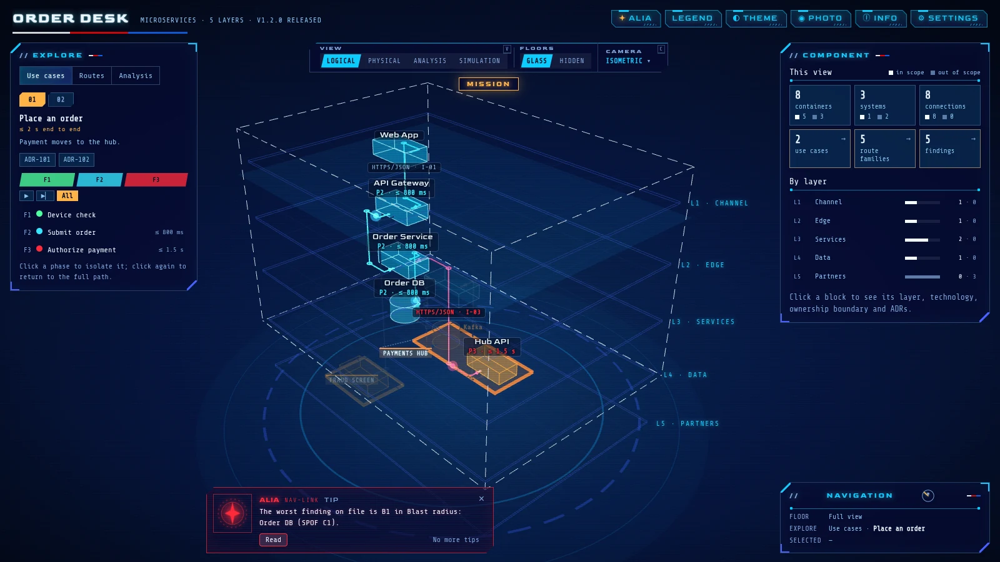
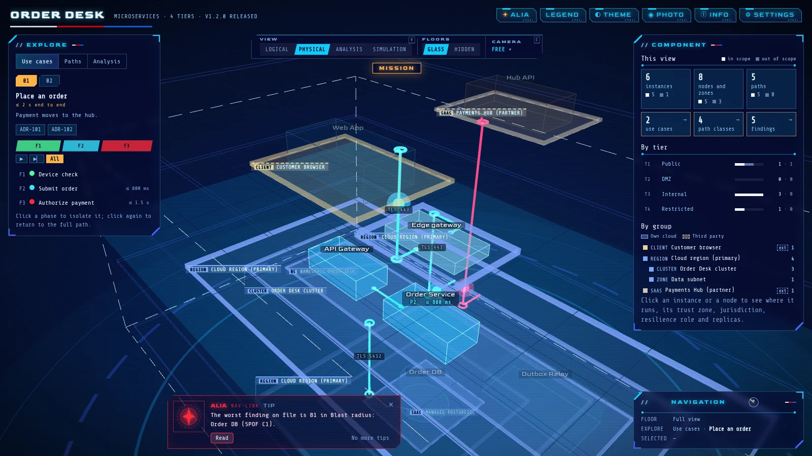
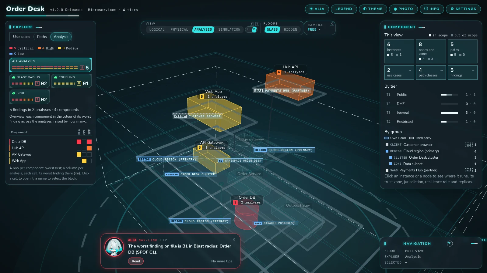
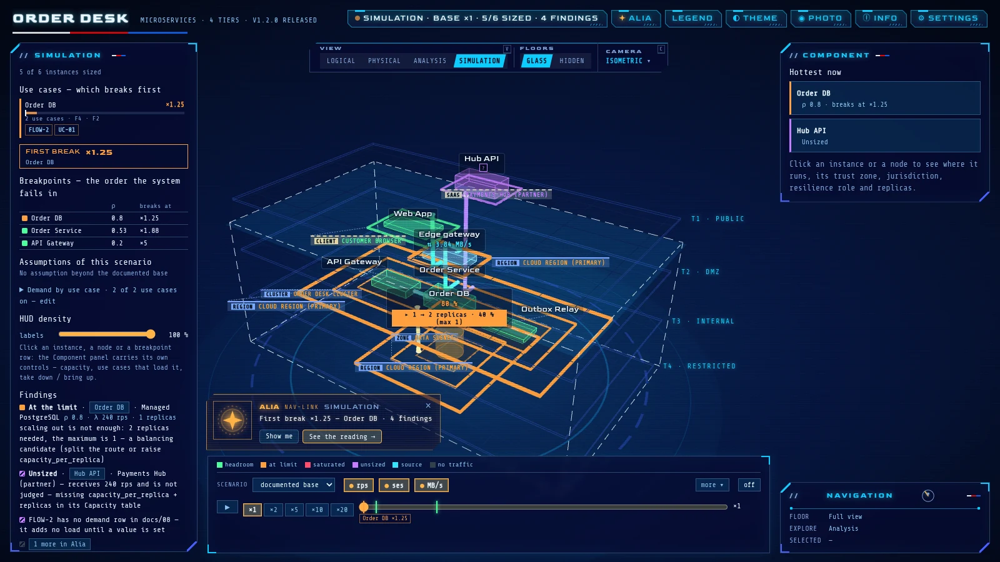
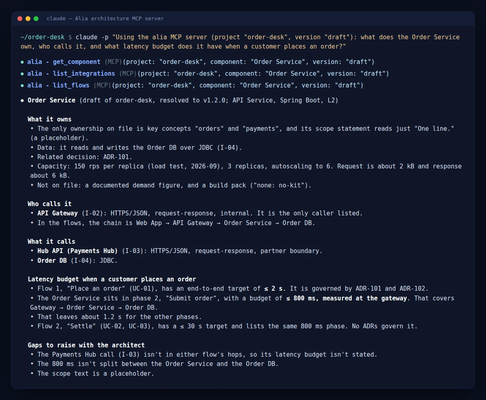
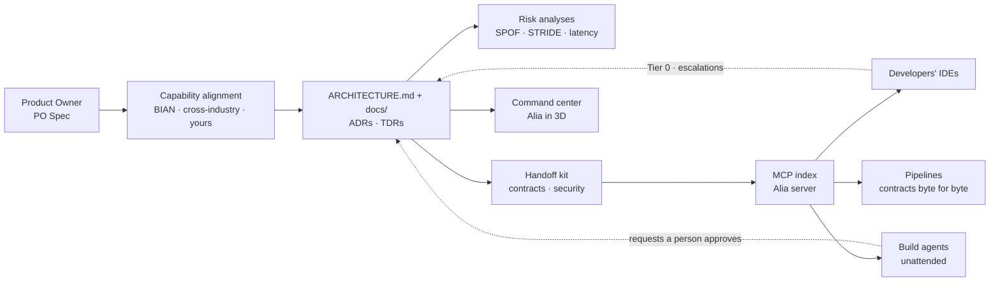

# Solutions Architect Skills

**Architecture documentation that stays true to itself — written with Claude Code, checked by code, delivered to the people who build it.**

[](https://github.com/shadowX4fox/solutions-architect-skills/actions/workflows/check.yml)
[](CHANGELOG.md)
[](LICENSE)
[](https://claude.com/claude-code)
[](CONTRIBUTING.md)

A suite of [Claude Code](https://claude.com/claude-code) plugins for solutions architects. It takes an initiative from a
Product Owner's requirements to a versioned `ARCHITECTURE.md`, decision records, risk analyses, a development handoff kit,
Word briefings, an interactive 3D model — and an MCP server your developers' IDEs can ask.

The model writes; **code holds it to the rules**. Every gate — prose, principles, diagrams, integrations, contracts — is a
script with tests, so a document either passes or names the line to fix.

---

## Contents

- [Showcase](#showcase) · [Why](#why) · [What you get](#what-you-get) · [Quick start](#quick-start)
- [Meet Alia](#meet-alia) — the 3D navigator and the architecture MCP server
- [Any industry, any organization](#any-industry-any-organization)
- [Skill Categories](#skill-categories) · [Documentation](#documentation)
- [Get involved](#get-involved) · [Acknowledgments](#acknowledgments)

---

## Showcase

<p align="center">
  
  <br><em>The command center — every layer a floor, every container a block, a use case walked phase by phase with its latency budget.</em>
</p>

<table>
  <tr>
    <td width="50%" valign="top"><br><b>Physical view</b> — where each container runs.</td>
    <td width="50%" valign="top"><br><b>Analysis</b> — SPOFs, blast radius and coupling on the blocks they concern.</td>
  </tr>
  <tr>
    <td width="50%" valign="top"><br><b>Simulation</b> — documented load against documented capacity: what breaks first.</td>
    <td width="50%" valign="top"><br><b>Alia over MCP</b> — Claude Code asking the architecture from a console.</td>
  </tr>
</table>

All screenshots come from the synthetic *Order Desk* example — see [docs/ALIA.md](docs/ALIA.md).

## Why

Architecture documents rot. They are written once, drift from the system, contradict themselves across sections, and
reach developers as a PDF nobody can query. This project treats the architecture as **source**:

- **One source, many readers.** Business, architects, governance and developers each get the view they need, generated
  from the same documents — never retyped.
- **Gates, not guidelines.** A principle without a trade-off, a diagram edge no integration backs, an OpenAPI operation
  the docs never mention: each is a finding with a line number, from a script you can run in CI.
- **Versioned like code.** Every architecture carries a semantic version and a git tag; downstream artifacts state the
  version they were cut from, and a release says what changed.
- **Delivered where people work.** The handoff kit and an MCP index put the right slice of the architecture in each
  developer's IDE, or in a build agent that works unattended: interfaces, budgets, security obligations, open questions.
- **Kept by the team that runs it.** Once released, a RUN team records its workarounds and small decisions itself
  (Tier 0). Anything that needs an architect becomes an escalation, so the documents never change without someone seeing it.

## What you get



| Stage | Skill | Produces |
|---|---|---|
| Requirements | `architecture-readiness` | `PRODUCT_OWNER_SPEC.md`, scored for checkability and coherence, plus a PDF for review |
| Capability alignment | `architecture-capability-alignment` | The PO Spec mapped onto a capability framework — BIAN for banking, a cross-industry map, or your own |
| Architecture | `architecture-docs` | `ARCHITECTURE.md` + `docs/` (13 sections), C4 and data-flow diagrams, in English or Spanish |
| Decisions & debt | `architecture-definition-record`, `technical-debt-records` | ADRs and TDRs, including an imported institutional ADR catalog |
| Release | `architecture-lifecycle` | Status, release gates, changelog, `architecture-v<version>` tags, delivery increments |
| Risk & design | `architecture-analysis`, `architecture-traceability` | Ten analyses (SPOF, blast radius, bottlenecks, cost, STRIDE, vendor lock-in, latency, tech debt, coupling, data sensitivity) and PO Spec coverage |
| Delivery | `architecture-dev-handoff`, `architecture-docs-export`, `architecture-icepanel-sync`, `architecture-index-export` | The four-part handoff kit with validated OpenAPI / AsyncAPI / GraphQL / Avro / DDL / Protobuf assets, Word briefings, an IcePanel C4 import, the MCP bundle |
| Visualization | `architecture-command-center` | A navigable 3D model with Alia as guide |
| Operation | `architecture-lifecycle` CI · `technical-debt-records` · `architecture-definition-record` | Tier 0 writes (a workaround TDR, a TDR move, a Proposed ADR, a doc fix) requested from an IDE or a build agent and written by CI; escalations as records and issues — [docs/RUN_TEAMS.md](docs/RUN_TEAMS.md) |

### Automatic mode

Once a project copies the `ci/` workflows, a release runs without anyone at the keyboard:

1. **The release PR is gated.** Its merge tags `architecture-v<version>` and publishes the index: chunks and ledger.
2. **The handoff kit is regenerated into a pull request.** It is edited in place: only the parts whose sources moved go to
   the model, the rest keep their text and their version row moves by code, and each component's technical debt is written
   into its specification by code.
3. **Merging that PR publishes the build packs**, and every consumer's `what_changed` reports what moved.
4. **A Tier 0 request is written, verified and gated**, then merged without an architect (`SA_TIER0_AUTOMERGE`). Its key,
   the `architecture-tier0` label, is always applied by a person.
5. **Build agents consume the packs unattended** (`"supervision": "unattended"` in the service's `.architecture.json`).
   A question becomes a `TODO(architecture)`, a request goes to the architecture repository, and the work ends in a pull
   request a person reviews.

Who consumes the index, and what changes without a person: [docs/RUN_TEAMS.md](docs/RUN_TEAMS.md#who-consumes-the-index).

Five built-in architecture types — **Enterprise** (the domain-neutral default), Microservices, 3-Tier, N-Layer and BIAN —
and an organization can add its own.

## Quick start

**Requirements:** [Claude Code](https://claude.com/claude-code) and [Bun](https://bun.sh) ≥ 1.0.

```bash
claude plugin marketplace add shadowX4fox/solutions-architect-skills
claude plugin install sa-skills@shadowx4fox-solution-architect-marketplace --scope user
```

Installing `sa-skills` brings the other five plugins (`sa-records`, `sa-requirements`, `sa-analysis`, `sa-delivery`,
`sa-visualization`). In Claude Code run `/reload-plugins`, then once per project:

```text
/sa-skills:setup
```

It grants the permissions the skills need, sets up the judge and checks the export toolchain. Word / PDF export and the
handoff kit's contract checks also need the plugin's npm packages, installed once:

```bash
cd "$(bun ~/.claude/plugins/marketplaces/shadowx4fox-solution-architect-marketplace/scripts/plugin-root.ts --quiet)" && bun install
```

Then just ask:

```text
Elicit the requirements for a parcel-tracking service   → architecture-readiness
Create the architecture                                 → architecture-docs
Run all analyses                                        → architecture-analysis
Generate the dev handoff                                → architecture-dev-handoff
Open the command center                                 → architecture-command-center
```

Full guide: [docs/INSTALLATION.md](docs/INSTALLATION.md) · a first architecture, step by step:
[docs/QUICK_START.md](docs/QUICK_START.md). Optional: `sa-ux`, a small UX layer drawn inside Claude Code (next-step
prompts, an architecture radar) — `claude plugin install sa-ux@shadowx4fox-solution-architect-marketplace --scope user`.

## Meet Alia

**Alia** is the architecture's navigator. She lives in two places.

### In the command center — a 3D model of your architecture


`/sa-visualization:architecture-command-center` renders the documented architecture as one self-contained HTML file: a
floor per layer, every C4 container a block, every integration a route. Alia walks you through it.

- **Logical and Physical views** — the C4 model, and where each container runs (zones, nodes, replicas).
- **Use-case walkthroughs** — each flow played phase by phase, with its latency budget.
- **Analysis on the stage** — every SPOF, threat or bottleneck lit on the block it concerns, ranked by residual severity.
- **Load simulation** — documented capacity against documented demand; find the first thing that breaks, save scenarios,
  export them to `.xlsx`.
- **Ask Alia** — she answers from a dossier of the architecture baked into the page: sections, ADRs, TDRs, findings.
- **Skins** — `holo`, `atlas`, a neutral `corporate`, or your organization's own.

Read-only by design: it never edits a document; it hands the architect Markdown to paste.

### In the IDE and in unattended builds — the architecture as an MCP server

`/sa-delivery:architecture-index-export` turns a released architecture into an `sa-index/1` bundle: every section, flow,
integration, ADR and TDR as a searchable chunk, the facts ledger, and a **build pack** per component — its spec, security
obligations, interface contracts both ways, assets byte for byte, budgets and an ordered build plan.

The **[Alia architecture server](https://github.com/shadowX4fox/solutions-architect-knowledge-base)** (Spring AI MCP,
Qdrant, Qwen3-Embedding on Ollama) serves those bundles to any MCP client: VS Code, JetBrains, Claude Code, or a build agent in CI.

| Ask | Tools |
|---|---|
| "What does this component own, and who calls it?" | `get_component`, `list_integrations` |
| "Why did we choose Kafka here?" | `search_architecture`, `list_decisions` |
| "Walk me through checkout." | `list_flows`, `get_flow` |
| "Build this service." | `get_build_pack`, `get_build_instructions`, `get_build_part` |
| "What changed since I built it?" | `what_changed` |
| "Record this shortcut as technical debt." | `preview_tier0`, `record_tier0` |
| "This blocks me: ask the architect." | `preview_escalation`, `record_escalation` |


CI publishes each release (`ci/publish-index.sh`, with GitHub Actions, Gitea and Azure Pipelines examples). On GitHub,
`architecture-lifecycle`'s `ci/` adds the rest of the pipeline: release gates on every pull request, and on the merge of a
release PR the tag, the index and the handoff kit edited by Claude into a pull request; on a RUN-team project, a Tier 0
workflow writes the requests that arrive as issues ([docs/RUN_TEAMS.md](docs/RUN_TEAMS.md)). While you write, `publish-index.js --up` runs a local server in Docker so you can try the draft from your IDE.

## Any industry, any organization

The base is **generic by construction**: it never assumes one industry or one company.

- **Capability frameworks.** Before design, the PO Spec is aligned to the framework your project declares:
  **BIAN** (banking), the bundled **cross-industry** capability map (Turbo EA Capabilities, CC BY 4.0), a framework your
  organization adds — or none (`frameworks.js --declare <id|none>`).
- **Institution packs.** What belongs to one organization — its design language standard, a licensed reference model,
  brand skins, compliance contracts, internal forms, its own architecture types and frameworks — ships as a separate
  (usually private) plugin the base finds on its own. The base never names a pack. Contract:
  [docs/INSTITUTION_PACKS.md](docs/INSTITUTION_PACKS.md).
- **Languages.** Documents are written in English or Spanish; every structural heading carries an English anchor, so the
  checks work in both.

## Skill Categories

Fifteen skills in six categories. **Standalone** means the skill starts without an `ARCHITECTURE.md`. The catalog is
`scripts/skill-catalog.json`; `bun run check:catalog` holds it to the code.

| Category | Skill | Plugin | Standalone | Needs to start |
|---|---|---|---|---|
| **Intake** — business input | `architecture-readiness` | sa-requirements | Yes | Nothing |
| | `architecture-capability-alignment` | sa-requirements | Yes | `PRODUCT_OWNER_SPEC.md` |
| **Records** — decisions and debt | `architecture-definition-record` | sa-records | Yes | Nothing (catalog mode maintains an institutional ADR catalog) |
| | `technical-debt-records` | sa-records | Yes | Nothing |
| **Authoring** — the architecture | `architecture-docs` | sa-skills | Yes | PO Spec, the alignment report (when a framework is declared) and an HLD to create |
| | `architecture-lifecycle` | sa-skills | No | `ARCHITECTURE.md` in a git repository |
| | `architecture-component-guardian` | sa-skills | Internal | `docs/components/` |
| | `architecture-explorer-headers` | sa-skills | Internal | `docs/` |
| **Governance** — checks over it | `architecture-analysis` | sa-analysis | No | `ARCHITECTURE.md` |
| | `architecture-traceability` | sa-analysis | No | PO Spec + `ARCHITECTURE.md` |
| **Delivery** — for other teams | `architecture-dev-handoff` | sa-delivery | No | `ARCHITECTURE.md` + `docs/05-integration-points.md` |
| | `architecture-index-export` | sa-delivery | No | `ARCHITECTURE.md` (a handoff kit for build packs) |
| | `architecture-docs-export` | sa-delivery | No | `ARCHITECTURE.md` |
| | `architecture-icepanel-sync` | sa-delivery | No | `ARCHITECTURE.md` |
| **Visualization** | `architecture-command-center` | sa-visualization | No | `ARCHITECTURE.md` |

## Documentation

| Guide | For |
|---|---|
| [Installation](docs/INSTALLATION.md) | Install, permissions, upgrades, Bun per OS, context7, VS Code |
| [Quick start](docs/QUICK_START.md) | A first architecture, end to end |
| [Workflow guide](docs/WORKFLOW_GUIDE.md) | Every phase and what it produces |
| [Alia](docs/ALIA.md) | The 3D command center and the architecture MCP server |
| [RUN teams](docs/RUN_TEAMS.md) | Operating a released architecture: Tier 0 writes, escalations, unattended build agents |
| [Institution packs](docs/INSTITUTION_PACKS.md) | Adding an organization's standards, frameworks, types and skins |
| [Troubleshooting](docs/TROUBLESHOOTING.md) | Common problems and fixes |
| [Design notes](docs/DESIGN_NOTES.md) | Why the rules are what they are — with the measurements |
| [Changelog](CHANGELOG.md) | What changed, release by release |

Each skill's full reference is its `SKILL.md` (`skills/<name>/` or `plugins/<plugin>/skills/<name>/`).

## Get involved

This is a community project, and every kind of help counts — a bug report from a real run is worth as much as code.

- **Ask, share, propose.** Questions, ideas and what you built go to
  [Discussions](https://github.com/shadowX4fox/solutions-architect-skills/discussions).
- **Report a bug.** Open an [issue](https://github.com/shadowX4fox/solutions-architect-skills/issues) with what you ran,
  what you expected and what happened.
- **Bring your industry.** A capability framework for telecom, insurance, health or the public sector — as a pack, or
  bundled when its licence allows it ([docs/INSTITUTION_PACKS.md](docs/INSTITUTION_PACKS.md)).
- **Add an architecture type**, a handoff asset format, an analysis lens, a command-center skin.
- **Add a language.** The documents speak English and Spanish today; the anchor scheme is ready for more.
- **Improve the docs.** If something confused you, it will confuse the next person.

Before a pull request: `bun install && bun run check` (typecheck, structure checks, 1,000+ tests). Read
[CONTRIBUTING.md](CONTRIBUTING.md) for the few rules every change follows — above all, **synthetic examples only** and
**nothing organization-specific in the base**. Security issues: [SECURITY.md](SECURITY.md).

## Acknowledgments

- [BIAN](https://bian.org) — the Service Landscape v14.0.0 taxonomy, with the semantic API descriptions under the Apache
  License 2.0 (`references/bian-v14/`).
- Turbo EA Capabilities by Vincent Verdet — Turbo EA, https://github.com/vincentmakes/turbo-ea-capabilities, CC BY 4.0
  (the cross-industry corpus, converted to Markdown; names, ids and descriptions unchanged).
- The [C4 model](https://c4model.com), [Mermaid](https://mermaid.js.org), [Three.js](https://threejs.org),
  [Redocly](https://redocly.com) and every tool this stands on.
- Built for [Claude Code](https://claude.com/claude-code) by Anthropic.

Third-party notices: [NOTICE](NOTICE).

## License

[MIT](LICENSE) © 2025-2026 shadowx4fox
