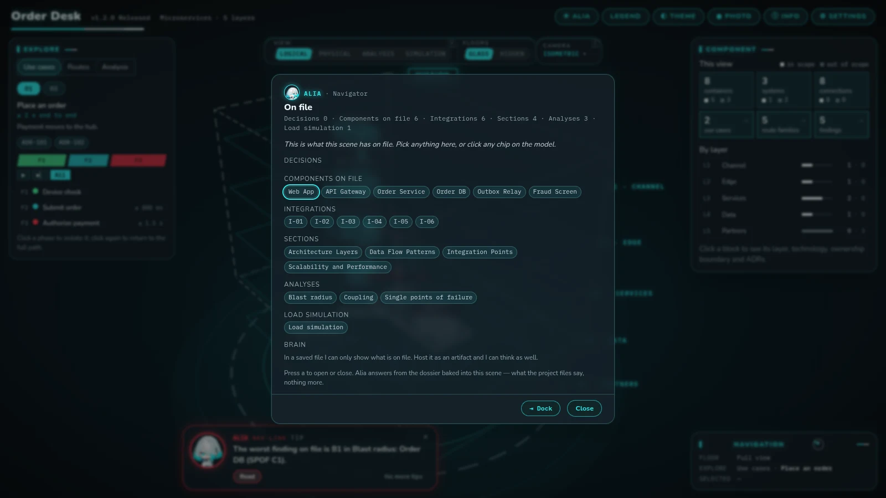
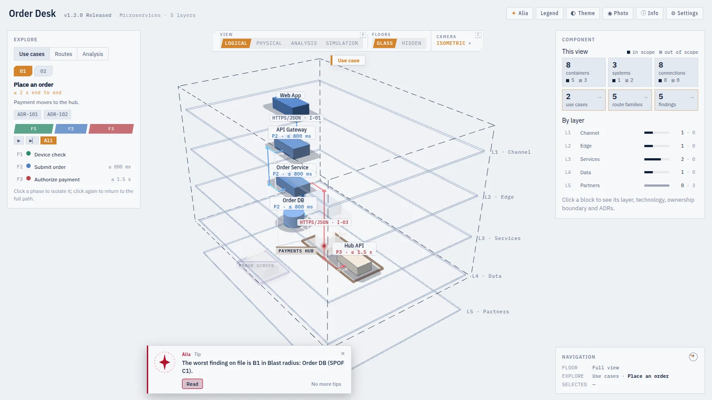
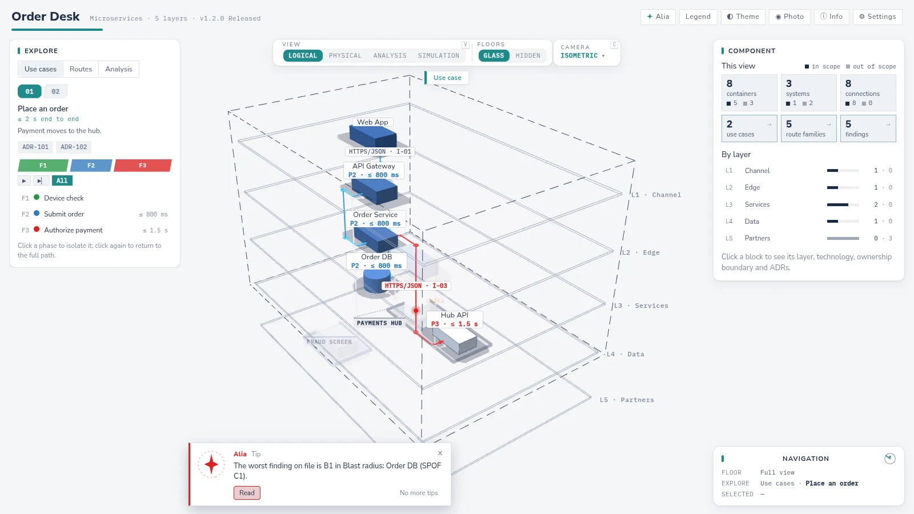

# Alia — the architecture's navigator

**Alia** is the guide to a documented architecture. She lives in two places:

| Where | What it is | Produced by | For |
|---|---|---|---|
| **The command center** | An interactive 3D model of the architecture, one self-contained HTML file | `sa-visualization:architecture-command-center` | Architects, product owners, reviewers, new team members |
| **The MCP server** | The architecture served to IDEs: search, exact facts, build packs | `sa-delivery:architecture-index-export` + the [Alia server](https://github.com/shadowX4fox/solutions-architect-knowledge-base) | Developers and their coding agents |

Both read only what the architecture documents state and write to none of them. Examples use **Order Desk**, a
synthetic order-taking system with a container named **Hub API**.

---

# Part 1 — The command center


*The synthetic Order Desk example in the default `holo` skin — the Logical view, walking the "Place an order" use case.*

## What it renders

The command center turns the written architecture into a model you can orbit, pan, filter and click. The Mermaid
diagrams in `docs/` stay canonical; the model is regenerated from the documents.

| On the stage | Comes from |
|---|---|
| **A floor per layer**, top to bottom | `docs/03` § 4.1 layer table (or whatever Section 4 groups containers by) |
| **A block per C4 L2 container**, with its canonical full name | `component-cli.ts list` over `docs/components/**` |
| **External systems** (`owned: false`) and their containers | the external descriptors' `## Containers` tables |
| **Connections**, labelled with protocol and `I-nn` id | `docs/05` `I-nn` rows and each descriptor's Communication table |
| **Routes** by kind: `local`, `online`, `async`, `control`, `batch` (dashed) | the phase kinds that travel each connection |
| **Use cases**, each a sequence of phases with a p95 budget | `docs/04` Flow Inventory and Phase Catalog |
| **Actors** — chain participants that are not containers — as small octahedra | the Phase Catalog; badged "phase actor" so nobody mistakes them for architecture |

## Generate it

Ask in Claude Code — *command center*, *show me the architecture in 3D*, *vista 3D*, *physical view* — or run
`/sa-visualization:architecture-command-center`. Requirements: `ARCHITECTURE.md`, `docs/03-architecture-layers.md` and
`docs/components/README.md`; without `docs/04-data-flow-patterns.md` the model builds with no use cases. The skill runs:

```bash
bun <skill_dir>/scripts/scene-from-docs.js <project_root> [--overrides <overrides.json>]   # the scene, from the documents
bun <skill_dir>/scripts/dossier.js . visualizations/architecture-command-center.scene.json --write   # Alia's dossier
bun <skill_dir>/scripts/render.js visualizations/architecture-command-center.scene.json \
    visualizations/architecture-command-center.html --lang en [--theme <skin id>] [--view logical|physical]
```

One pair of files per project, rewritten in place: the scene (nodes, edges, phases, use cases, deployment, capacity,
dossier) and the viewer, which loads Three.js r128 from cdnjs when opened. **Regeneration keeps your layout.** `scene-from-docs.js` takes the current scene as its base: node ids, positions, the
thesis, phase kinds and the `deployment` block carry over, so the model does not reshuffle. What the documents cannot
state — the thesis sentence, a phase's colour family, an edge described only in prose, project scenarios — goes in an
**overrides file** (`--overrides`), merged last and kept on every regeneration. A hand edit of the scene JSON is not
kept; never patch the JSON or the HTML. `--no-base` starts fresh.

The generator's report on stderr — actors created, edges synthesized, phase kinds inferred, rows unresolved — is the
review checklist: each line is a documentation finding or an overrides entry.

## Logical and Physical views


- **Logical** — the C4 model: containers on layers, connections by route and phase.
- **Physical** — the deployment: instances on nodes (region › cluster › namespace, appliances, managed services, the
  customer's device), stacked by trust-zone tier, joined by undirected paths in transport form (`TLS:443`) by Path Class.

The Physical view appears only when the scene carries a `deployment` block, authored from Section 11 (Operational
Considerations), the technology stack, the security architecture and the ADRs — never from what a typical cloud looks
like. A logical connection with no declared deployment path is not hidden: **Paths → No declared path** lists it as a
dashed link, a finding for the deployment documentation.

**Use-case walkthroughs**: pick a use case and everything outside it dims, each hop takes its phase kind's colour, and
pulses travel the phases in order; the phase list shows each phase's latency budget, and a click isolates a phase.
**Routes** shows the model by connection kind, and **Paths** (physical) by Path Class.

## The increment filter

When `docs/01` declares **Delivery Increments**, a row under the Explore tabs — *Target* · *Inc 1* · *Inc 2* … — picks
one. In both views and every mode but the simulation, what that increment does not ship fades out; the line under the row
names its use cases, blocks, additions, temporary elements and retirements; in Routes, a block a later increment adds
carries *new in N*, a temporary one *until N · TDR-NNN*. The slices come from code (`scripts/shared/increments.js`).

## Analysis mode — findings on the stage


When `analysis/` holds reports from `sa-analysis:architecture-analysis` (SPOF, Blast Radius, STRIDE, Bottleneck …), the
view ring gains **Analysis**, with one entry per report.

- A finding is painted on its **subject** — the component or deployment node it is named after; the other components it
  names are its **reach**, lit in a neutral tone.
- Colour, rank and order follow the **residual severity**: one step below the report's severity when the lens's
  mitigation column documents a mitigation. The tag under a block reads `C1 · S→A · <what it is about>` — id, the
  report's rank, then the residual.
- **Open or mitigated**: a block with at least one open finding is drawn filled; one whose findings are all mitigated is
  drawn hollow. The rail filters by severity and by *Open · Mitigated*.
- Selecting a block stacks its findings as flags over it (up to eight, then `+N`); each opens the finding in Alia.
- Findings that name no container (a process, a missing control) stay in the list, marked with a dash.
- `holo` ranks findings `LV S · A · B · C · D`; `atlas` and `corporate` state priorities `P1 … P5`.

## Simulation mode — load against capacity


Open it with `s`, or Alia's *Load simulation* chip. It runs on the Physical view and asks one question: **with the
documented demand, what breaks first?**

### The capacity contract

Two tables in the documents feed it. Every L2 descriptor carries a `## Capacity` section:

```markdown
## Capacity <!-- LABEL: Capacity -->

| Metric | Value | Unit | Source |
|---|---|---|---|
| capacity_per_replica | 250 | rps | Load test 2026-08 |
| replicas | 3 | count | HPA minReplicas |
| max_replicas | 10 | count | HPA maxReplicas |
```

and `docs/08` carries the demand that enters the system, one row per use case:

```markdown
### Demand by Use Case <!-- LABEL: Demand by Use Case -->

| Use Case | Value | Unit | Peak factor | Source |
|---|---|---|---|---|
| UC-01 | 76 | tps | 3 | Product metrics |
| UC-04 | Not documented | sessions | | |
```

`Metric` is one of `capacity_per_replica` · `replicas` · `max_replicas` · `requests_per_transaction` ·
`documented_demand` · `request_size` · `response_size` · `session_transfer`; `Unit` one of `rps` · `rpm` · `tps` · `tpm` ·
`sessions` · `count` · `ratio` · `B` · `KB` · `MB` · `KB/s` · `MB/s`; `Value` a number or the literal `Not documented`.
Everything is normalized to requests per second (`tps × requests_per_transaction`, `tpm / 60`, `rpm / 60`; sessions stay
a gauge). `scene-from-docs.js --capacity-check` prints the normalized table with every gap.

### The model

Each use case's demand walks its phases' hops onto the receiving containers and splits over their live instances:
**ρ = λ ÷ (replicas × capacity per replica)** — one pure script, `scripts/simulation.js`, shared by the viewer, Alia's
tools and the tests.

Blocks are **green** under the threshold (0.7 by default), **amber** at the limit, **red** at a chokepoint, and **faint
grey** when they receive nothing. **Violet means pending**: the block receives load but its capacity is `Not documented`
— the load is shown, the block is never judged, nothing is assumed.

On the stage, a block's height is its load with a limit frame at ρ 1; a path's thickness is what it carries; a fixable
container shows the replicas that would balance it (`▸ 3 → 15 replicas`), and a click applies the fix to the scenario.
With sizes documented, paths and nodes carry bytes per second, and a traffic-billed node shows GB a month — always
labelled an assumption. A receiver with no sizes makes its paths pending, never zero.

### Scenarios

- **Controls**: global scale (`×1 ×2 ×5 ×10 ×20`, a fine slider, a ramp), the threshold, demand per use case, capacity per
  container, instances up or down (an interrupted use case is painted red where it stops), *Compare with the base*.
- **Breakpoints**: every sized container with load, ordered by the scale that saturates it — the order the system fails in.
- **Saved scenarios** live in your browser (`localStorage`); **project scenarios**, marked `·`, come from
  `capacity.scenarios[]` in the overrides file. **Propose rows** turns a scenario's assumptions into Markdown rows to paste.
- **`⬇ xlsx`** (or *Export to Excel* on Alia's page) writes one workbook in the page — a reading sheet, then each scenario
  opening on an *at a glance* block. No library, no server.

## Ask Alia



Header button **Alia**, or the `a` key. She answers at two speeds and always says which one answered.

| Speed | Works in | Answers from |
|---|---|---|
| **Dossier** | every copy, offline | `scene.dossier`, baked by `dossier.js`: the ADRs the scene cites, every TDR, each container's descriptor section by section, the `I-nn` integrations, every `analysis/` finding, each `docs/NN-*.md` section's header and outline, and the compliance manifest and its requirement rows |
| **Channel to Claude** | only a hosted artifact copy that declares the `sample` capability | Claude, given the scene as text, the dossier index and the page in focus; it may open dossier pages, search the dossier, play a storyboard on the stage and build simulation scenarios with its tools |

Every chip — an ADR, a TDR, a descriptor, an integration row, a finding — opens what is on file, or says it is not.
**The channel is never opened on your behalf.** The skill opens the HTML locally and never publishes it. Only when you
ask does it publish a private copy declaring `capabilities: { "sample": {}, "downloads": true }` — `sample` for the
channel, `downloads` for the Excel export. Each question then runs on the **viewer's** own Claude usage, and the first
one asks for consent. A local file has no channel, and Alia's index says so.

With the channel open, she can answer *"how does an order reach the ledger?"* by playing a two-to-six-step storyboard
on the stage. Her voice (browser speech synthesis) is off until switched on in Settings.

## Skins

| `atlas` | `corporate` |
|---|---|
|  |  |

| Skin | Look |
|---|---|
| `holo` (default) | Retro sci-fi hologram: self-lit cyan blocks over an indigo grid, game ranks. Dark only |
| `atlas` | Neutral and formal, IBM Plex, priorities. Light and dark |
| `corporate` | Neutral business palette, slate and teal, rounded cards. Light only; the base to copy for a brand |

A skin changes colour, type, chrome and lighting — never geometry, layout or what a colour means. Skins load from the
plugin, then an **institution pack** ([INSTITUTION_PACKS.md](INSTITUTION_PACKS.md); a pack may also set the default
theme), then the **project** — `visualizations/skins/<id>/` beside the scene, or `render.js --skins <dir>` — a later one
replacing an earlier one of the same id. A skin is a folder: `skin.json` (palette per mode, fonts, engine flags, look, name) and an optional `skin.css` scoped to
`[data-skin="<id>"]`. Every mode defines every token in `skins/schema.json`. To start one, copy the closest plugin skin,
rename the folder and the `id`, and validate:

```bash
bun <skill_dir>/scripts/skins.js --check visualizations/skins
bun <skill_dir>/scripts/render.js <scene.json> <out.html> --theme <id>
```

The **Theme** menu (`t`) switches skins at runtime without a re-render.

## Keys

| Key | Action | Key | Action |
|---|---|---|---|
| `a` | Alia's index | `s` | Simulation mode |
| `v` / Shift+`v` | View ring: Logical · Physical · Analysis · Simulation | `w` | Logical / Physical inside Analysis |
| `c` | Camera dock | `1`–`4` | Isometric, front, side, plan presets |
| `r` | Rotate on / off | `o` | Perspective / parallel projection |
| `z` | Zoom to the selection, and back | `f` | Focus on Alia's marks on / off |
| `t` | Theme menu | `l` | Legend |
| `i` | Info: thesis, sources, controls | `g` | Settings |
| ← → | Previous / next page in Alia | `Esc` | Close a dialog, else clear the selection |

Right-click, middle button, Shift-drag, two fingers and the arrow keys pan. In the plan preset, PgUp / PgDn turn floors.

## Read-only, by design

The command center writes only under `visualizations/`. It never edits a document: where a figure is missing, it shows
the gap (violet, *Not documented*, *No declared path*) and hands the architect Markdown to paste. Publishing a copy
online is always your decision.

---

# Part 2 — The MCP server

The MCP server hands the architecture to the developer's IDE: search over every section and decision, exact answers
from the facts ledger, and a **build pack** per component.

```text
architecture repo ──tag──▶ CI: export-index.js ──POST /bundles──▶ Alia server ──▶ embeddings (Ollama) + store
IDE (VS Code · JetBrains · Claude Code) ◀──── MCP, Streamable HTTP /mcp ────┘
```

The plugin produces data only. The [Alia server](https://github.com/shadowX4fox/solutions-architect-knowledge-base)
(Spring AI MCP, Qdrant or a file engine, Qwen3-Embedding 0.6B on Ollama) embeds, stores and serves.

## What the export contains

```bash
bun <plugin_dir>/skills/architecture-index-export/scripts/export-index.js <project_root> \
    [--out <dir>] [--project-key <key>] [--server <mcp_url>] [--previous <bundle>] [--draft]
```

Or ask Claude Code: *export architecture index*. The bundle (`sa-index/1`) lands in `.cache/sa-skills/index/<version>/`
(or `…/index/draft/`):

| File | Holds |
|---|---|
| `manifest.json` | schema, project, architecture, channel, git, counts, build packs, skipped components with the reason, warnings, every file with its `sha256` |
| `chunks.jsonl` | one chunk per unit of meaning — `ARCHITECTURE.md` by H2, each H2 / H3 of a section file, every principle, flow, phase and `I-nn` block, each component descriptor, each ADR / TDR — opening with a context line, comments dropped, Mermaid named. Ids are stable across releases, so a server re-embeds only what changed |
| `ledger.json` | the facts ledger: systems, components, layers, integrations, flows, phases, ADRs, TDRs |
| `changes.json` | with `--previous`: what changed for each container since that bundle |
| `buildpacks/<slug>/` | one build pack per container the handoff kit covers |

### A build pack

A pack is cut only from a handoff kit (`sa-delivery:architecture-dev-handoff`) of the same architecture version that
passes `kit-check.js`. A developer never builds from an outdated or failing kit.

| Part | What it is |
|---|---|
| `BUILD.md` | the IDE agent's instructions: the repository binding, eight rules, the build plan, security, interfaces, flows and budgets, open questions, a done list |
| `spec.md` | the Component Specification: responsibility, contracts, invariants, budgets, acceptance |
| `security.md` | the **security obligations**, second in the plan: every caller and each interface's authentication, the Security by Design principle, the institutional ADRs, the STRIDE findings and mitigations, data sensitivity flows, security tests |
| `assets/` | the contracts byte for byte: `openapi.yaml`, `asyncapi.yaml`, `schema.graphql`, `*.avsc`, `ddl.sql`, `schema.proto`, `redis-key-schema.md` |
| `interfaces/` · `adrs/` · `cross-cutting-standards.md` · `runtime-view.md` | the Interface Contracts both ways, the governing ADRs, the shared kit documents |
| `pack.json` | the index: parts, ordered plan, flows, interfaces, ADRs, open questions |

Every `[NOT DOCUMENTED` line of the spec, security obligations, interfaces and assets becomes an **open question**: the
builder asks; it never fills a gap.

## Released and draft

A bundle is **`released`** when the tag `architecture-v<version>` exists, `ARCHITECTURE.md`, `docs/`, `adr/` and `tdr/`
equal the tag's, the status is Released, and nothing there or in `handoffs/` is uncommitted; anything else, or
`--draft`, is a **`draft`**. A server serves the newest released version by default; `draft` is asked for by name. A laptop never publishes a
released version — that is CI's job.

## Publishing from CI

`ci/publish-index.sh` is the one step every pipeline runs: the plugin at a pinned tag, the previous bundle from the
server, the export, `--check`, then `POST` to the server. Copy an example from
`plugins/sa-delivery/skills/architecture-index-export/ci/` into the architecture's repository: `github-actions.yml` →
`.github/workflows/architecture-index.yml`, `gitea-actions.yml` → `.gitea/workflows/architecture-index.yml`,
`azure-pipelines.yml` → `azure-pipelines/architecture-index.yml` (variable group `architecture-index`).

| Variable | |
|---|---|
| `SA_INDEX_PROJECT_KEY` | required — the project's key on the server, the same on every release; else read from a committed `.sa-skills/index.json` |
| `SA_PLUGIN_REF` | required — the plugin tag the bundle is built with |
| `SA_INDEX_SERVER` | the server's base URL (the writer instance); without it the bundle is built and checked, not published |
| `SA_INDEX_TOKEN` | bearer token, a pipeline secret |
| `SA_INDEX_MCP_URL` | the MCP endpoint written into each pack's binding — a stable DNS name, never one instance |
| `SA_INDEX_ALLOW_DRAFT` | `true` publishes a draft |

A release publishes **twice**: at the tag `architecture-v<version>` (chunks and ledger — search goes live), then when
the regenerated handoff kit is committed (`handoffs/**` on `main`) — the same version with its build packs, the same
chunks and ledger, every pack the server holds kept. CI never generates the kit; that needs Claude's agents.

## Testing while writing

To try the architecture in your IDE before it is released, say *test the architecture index*, or:

```bash
bun <plugin_dir>/skills/architecture-index-export/scripts/publish-index.js <project_root> --up
```

The script exports the bundle as a draft, checks it, posts it to the server's draft slot and waits until search is ready.
`--up` starts a local server when nothing answers at `http://localhost:8080`:

- `local/compose.yaml` runs the Alia server from its published image (`ghcr.io/shadowx4fox/alia-mcp-server`, pinned; `SA_INDEX_SERVER_REF` builds a branch from source) in Docker (Compose 2.20 or later) with the `file`
  engine: no Qdrant, vectors on disk, so a restart re-embeds nothing. The first start takes minutes.
- It embeds through **the host's Ollama** — the GPU when there is one, about twenty chunks a second; on Linux Ollama must
  listen beyond localhost (`OLLAMA_HOST=0.0.0.0`). Otherwise it says so and starts the **`cpu` profile**'s Ollama
  container (about one chunk a second). `SA_INDEX_OLLAMA` overrides the choice.

Options: `--server <url>` or `SA_INDEX_SERVER` (a shared test server), `SA_INDEX_TOKEN` (bearer token),
`SA_INDEX_PUBLIC_URL` (the base of each part's `download_url`, default `http://localhost:8080`), `--project-key <key>`,
`--no-wait`, `--timeout <seconds>` (default 1800). Exit codes: `1` the bundle failed its check or the server refused it · `3` no server · `4` still indexing at the timeout.
The first publish writes `.sa-skills/index.json` (`server`, `project_key`) — commit it, so the key never changes. Stop
the local server with `docker compose -f <plugin_dir>/skills/architecture-index-export/local/compose.yaml down` (`-v`
also drops its data).

## Connecting an IDE

From the server's README. The MCP endpoint is Streamable HTTP at `/mcp`, with a bearer token (`ARCHINDEX_MCP_TOKEN` on
the server).

**VS Code** — `.vscode/mcp.json`:

```json
{ "servers": { "alia": { "type": "http", "url": "https://alia-mcp.internal/mcp",
  "headers": { "Authorization": "Bearer ${input:alia-token}" } } },
  "inputs": [ { "id": "alia-token", "type": "promptString", "description": "Alia MCP token", "password": true } ] }
```

**Claude Code**:

```bash
claude mcp add --transport http alia https://alia-mcp.internal/mcp --header "Authorization: Bearer $TOKEN"
```

**JetBrains**: in the AI Assistant MCP settings, add a Streamable HTTP server with the same URL and header. For the local test server, the URL is `http://localhost:8080/mcp`; ask with the project key and version `"draft"`.

## The tools


*A real `claude -p` session against a local Alia server holding the synthetic Order Desk draft.*

| Tool | Answers from | Ask, for example |
|---|---|---|
| `list_projects` | store | "Which architectures and versions does the server hold?" |
| `get_architecture` | ledger | "Give me Order Desk 1.4.0 at a glance — which components have a build pack?" |
| `get_component` | ledger | "What is Hub API's technology, and which flows does it take part in?" |
| `list_integrations` | ledger | "Who calls Hub API, and over what protocol?" |
| `list_flows` · `get_flow` | ledger | "Walk me through UC-02, phase by phase, with budgets." |
| `list_decisions` | ledger | "Which ADRs are Accepted? Which TDRs are open?" |
| `search_architecture` | search index | "Why did we choose an event log for order history?" · "Where is `I-07` described?" |
| `get_chunk` | bundle | "Show me the whole text of that hit." |
| `get_document` | bundle | "Show me ADR-112 in full." |
| `get_build_pack` | pack | "What do I need to build Hub API?" |
| `get_build_instructions` | pack | "Give me the build instructions for Hub API." |
| `get_build_part` · `get_asset` | pack | "Give me Hub API's `openapi.yaml`." |
| `what_changed` | bundles | "What changed for Hub API since 1.3.0?" |

Version: omitted or `latest` is the newest released version; `draft` is the unreleased draft. The server never falls
back to another version on its own.

## The service repository binding

A service repository binds itself to its component with `.architecture.json` at its root, written from `BUILD.md`:

```json
{ "server": "https://alia-mcp.internal/mcp", "project": "order-desk", "component": "hub-api",
  "architecture_version": "1.4.0", "pack_revision": "<pack_revision from get_build_pack>" }
```

`pack_revision` is the revision of the pack the code was built from, returned by `get_build_pack`. When a new version
is released, or the pack is revised within its version, the agent calls `what_changed(project, component, from,
from_revision, to)` with the values of that file. It lists, per container, facts, contracts, interfaces, ADRs, flows and budgets, integrations and open questions that
moved, with `action_required` only where the code must change. A component version bump alone is listed, not an action.

## How a developer's agent builds a component

`get_build_instructions` returns `BUILD.md`. The agent binds the repository (`.architecture.json`, with the
`pack_revision`), then follows the build plan part by part. Contracts are copied **byte for byte** to
`architecture/<file>` — with `curl` from the part's `download_url` (MCP token, `?pack_revision=`), or from every page of
`get_build_part` unchanged — and each `sha256` checked; the copies are read-only, and code is generated from them. The
eight rules:

| # | Rule |
|---|---|
| 1 | Contracts are implemented exactly — never rename, add or drop an element; a contract that looks wrong is a question, implemented as written |
| 2 | Names are the architecture's — this component and every other by its canonical name |
| 3 | Never fill a gap — ask; else leave a `TODO(architecture)` that quotes the open question |
| 4 | **Security is never a gap.** Deny by default: only the listed callers reach the component. An interface without documented authentication fails closed — it rejects every call, and its tests prove it |
| 5 | The cross-cutting standards and governing ADRs apply to every line |
| 6 | Budgets are requirements — measure the component against its share of each phase |
| 7 | The stack comes from the team's service template, not from the pack |
| 8 | Every commit names the architecture version and the `pack_revision` |

On an update, the agent overwrites the copies under `architecture/` first and commits them alone
(`architecture: contracts <version> (pack_revision <revision>)`), so the IDE and the pull request show the contract diff
before any code moves.

**See also**: every viewer behaviour in
[VIEWER_REFERENCE.md](../plugins/sa-visualization/skills/architecture-command-center/VIEWER_REFERENCE.md), the scene
contract in [SCENE_SCHEMA.md](../plugins/sa-visualization/skills/architecture-command-center/references/SCENE_SCHEMA.md),
the export's rules in [its SKILL.md](../plugins/sa-delivery/skills/architecture-index-export/SKILL.md), and deployment
and settings in [the Alia server's README](https://github.com/shadowX4fox/solutions-architect-knowledge-base).
