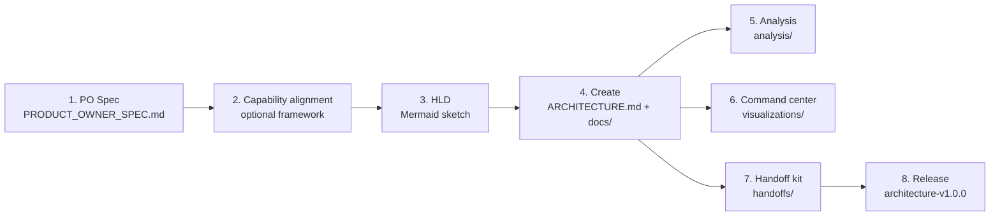
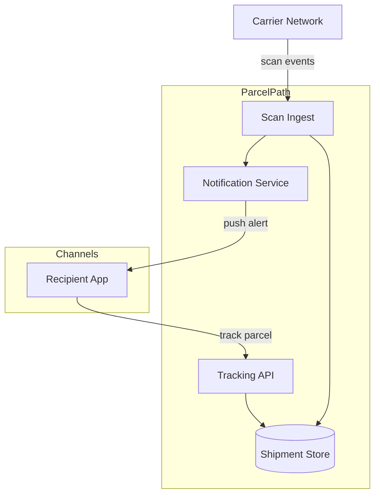

# Quick Start — your first architecture in an afternoon

This walkthrough takes one invented initiative, **ParcelPath** — a parcel-tracking service for a delivery company —
from a Product Owner's idea to a released, versioned architecture with diagrams, a risk analysis, a 3D model and a
handoff kit for developers. Every step shows what you type, what happens and what you get.



You talk to Claude Code in plain language; the phrases below are ones the skills listen for. A skill can also be called
by its slash name, such as `/sa-requirements:architecture-readiness`.

## 0. Install and set up

You need [Claude Code](https://claude.com/claude-code) and [Bun](https://bun.sh) ≥ 1.0. Installation, upgrades and
per-OS notes are in [INSTALLATION.md](INSTALLATION.md). In short:

```bash
claude plugin marketplace add shadowX4fox/solutions-architect-skills
claude plugin install sa-skills@shadowx4fox-solution-architect-marketplace --scope user
```

`sa-skills` brings its five companions (`sa-records`, `sa-requirements`, `sa-analysis`, `sa-delivery`,
`sa-visualization`). In Claude Code run `/reload-plugins`, then `/sa-skills:setup` inside an empty git repository.

**What happens:** it merges the permissions the skills need into `.claude/settings.json`, writes a pointer block into
`CLAUDE.md`, adds `exports/` and `.cache/sa-skills/` to `.gitignore`, checks the Word/PDF export toolchain, ripgrep
and the API-contract validator, and sets the **judge** — the component that answers the yes/no and multiple-choice
questions scripts cannot decide by themselves (by default a small Claude sub-agent answers a worksheet).

## 1. Requirements — the PO Spec

```text
Elicit the requirements for ParcelPath, a parcel-tracking service
```

**What happens:** `architecture-readiness` interviews the Product Owner across eight sections — Business Context,
Stakeholders & Users, Business Objectives, Use Cases, User Stories, UX Requirements, Business Constraints, Success
Metrics. Already have a ticket or an email? Say `async intake` and give the file instead: you get a gap report with a
ready-to-send message of follow-up questions, and a draft spec only when the material already scores high enough.

Two checks decide whether the spec is ready. The **score** (0–10, weighted) asks whether each section is complete —
**7.5** or more is ready. **Checkability** asks whether someone who was not in the room could test each requirement: it
must be named, closed, dated, observable and measured.

"Customers see where their parcel is, fast" fails checkability; "a recipient sees the latest scan within 60 seconds of
the depot scanning it" passes. A failing requirement costs its section points; one in Use Cases, Objectives,
Constraints or Metrics caps the score at 7.4. Wishes not yet concrete move to **Appendix → Aspirations**. A coherence
check also finds objectives no use case serves, states nothing sets and statements that cannot both hold.

**You get:** `PRODUCT_OWNER_SPEC.md` and `exports/PO-SPEC-<slug>.pdf` for review.

## 2. Capability alignment — pick a framework, or none

Before design, the PO Spec can be mapped onto an industry capability framework. Two are built in:

| Framework | For | Report |
|---|---|---|
| `BIAN` | Banking (BIAN Service Landscape v14.0.0) | `BIAN_ALIGNMENT.md` |
| `CROSS-INDUSTRY` | Any industry (Turbo EA capability map, CC BY 4.0) | `CAPABILITY_ALIGNMENT.md` |
| `none` | No reference model | — |

ParcelPath is logistics, so the cross-industry map fits. Ask for it by name — `capability alignment with the
CROSS-INDUSTRY framework` — or declare it once for the project (`frameworks.js --declare CROSS-INDUSTRY --project .`);
without a declaration the skill defaults to BIAN, and creating the architecture asks which framework applies.

**You get:** `CAPABILITY_ALIGNMENT.md` — the domains and capabilities ParcelPath touches, with evidence from the spec.
Once a framework is declared, creating the architecture waits for this report; with `none` there is no gate.

## 3. The HLD — a high-level sketch

Creating an architecture needs a High-Level Design. **Mermaid is preferred**: boxes, groups and arrows are stated,
nothing is guessed from pixels. Save this as `design/hld.mmd`:



A PDF, PNG or SVG works too: it is transcribed once into `<name>.hld.mmd` beside it, box by box and arrow by arrow,
and that transcription is what every later step reads. Your sketch does not have to follow the house diagram style.

## 4. Create the architecture

```text
Create the architecture
```

**What happens — the gates, in order:**

1. **Language** — `en` or `es`. Every document is written in it; headings carry English anchors so the checks work in
   both.
2. **PO Spec** — found, or created now (elicitation, intake, inline context, or `SKIP PO SPEC`).
3. **Capability alignment** — the declared framework's report.
4. **HLD** — the path to `design/hld.mmd`.

Then a list of **ADR candidates** (decisions the design will need — database, messaging, hosting…), a check for an
institutional ADR catalog, and the **architecture type**:

| Type | Choose when |
|---|---|
| `ENTERPRISE` (default) | Channels, orchestrated processes and domain services over systems of record — any industry |
| `MICROSERVICES` | Independently deployable services, each owning its data |
| `3-TIER` | One web application, one database |
| `N-LAYER` | One deployable organised as DDD / clean / hexagonal layers |
| `BIAN` | Banking services modelled on BIAN Service Domains |

ParcelPath takes the default, `ENTERPRISE`.

**Checkpoints.** The last question chooses how the writing runs:

- **manual** — the create stops four times. Run `/clear`, then `continue the architecture`: the next part resumes from
  a receipt on disk and never asks the collected questions again.
- **automatic** — the remaining parts run one after another in sub-agents, without stopping.

Each section is written, then checked by code (prose, principles, headers, flows, integrations). A finding names a
file and a line, and the fix is an edit at that line.

**You get:** `ARCHITECTURE.md` (the index, version 1.0.0 Draft), the 13 sections as `docs/01-system-overview.md` …
`docs/11-references.md`, one file per system and container in `docs/components/` with its `README.md` index, and the
project decisions `adr/ADR-101…`.

The **diagrams** come at the end of the create: the Logical View, C4 System Context, C4 Container and Detailed View in
`docs/03-architecture-layers.md`, and a sequence diagram per phase in `docs/04-data-flow-patterns.md`, from which each
use case's end-to-end sequence is derived. Later, `generate my architecture diagrams` regenerates them.

## 5. A first analysis

```text
SPOF analysis
```

**What happens:** `architecture-analysis` offers ten lenses — SPOF, Blast Radius, Bottleneck, Cost Hotspots, STRIDE,
Vendor Lock-in, Latency Budget, Tech Debt/EOL, Coupling, Data Sensitivity — plus a Security Posture checklist, and asks
for Markdown or interactive HTML. Graph metrics, latency sums and capacity come from code; the model classifies.

**You get:** `analysis/SPOF-<date>.md` — every finding with an id (`C1`, `D2`…), the component it concerns and its
mitigation. For ParcelPath, expect `Shipment Store` to be the first suspect.

## 6. The command center

```text
command center
```

**You get:** `visualizations/architecture-command-center.html` — one self-contained file. Each layer is a floor, each
container a block, each integration a route. Play a use case phase by phase, switch to the Physical view, light up
the SPOF findings on their blocks, run a load simulation, and ask **Alia**, the navigator, about any section or decision.
More in [ALIA.md](ALIA.md).

## 7. The handoff kit

```text
generate dev handoff
```

**What happens:** `architecture-dev-handoff` writes a four-part kit for the people who build the system. It needs
`docs/05-integration-points.md`; latency and blast-radius figures come from the analyses and are marked
`[NOT DOCUMENTED]` when those have not run.

**You get:**

| File | For |
|---|---|
| `handoffs/SYSTEM_RUNTIME_VIEW.md` | The whole system in motion — flows, per-hop budgets |
| `handoffs/CROSS_CUTTING_STANDARDS.md` | Rules every service follows, each citing its ADR |
| `handoffs/interfaces/<up>→<down>.md` | One contract per pair of adjacent services |
| `handoffs/components/NN-<slug>.md` | One specification per container — intent and constraints |
| `handoffs/assets/NN-<slug>/` | OpenAPI, AsyncAPI, DDL… validated against the docs, plus `security.md` |

## 8. Release

```text
release my architecture
```

**What happens:** `architecture-lifecycle` runs every gate once, shows what changed and recommends a version bump (a
first release keeps `1.0.0`), writes `docs/CHANGELOG.md` and commits only the architecture files. By default it pushes a
`release/architecture-v1.0.0` branch for a pull request, and the tag `architecture-v1.0.0` is created once the PR is
merged (`lifecycle.js tag`, which CI can run); `--direct` commits and tags on the current branch. A release needs git.

`architecture status` tells you later where the architecture stands and which artifacts — the kit, the analyses, the
3D model — were built from an older version.

## Where next

- [WORKFLOW_GUIDE.md](WORKFLOW_GUIDE.md) — every phase, gate and phrase in detail
- [ALIA.md](ALIA.md) — the 3D navigator and the architecture MCP server for your IDE
- [RUN_TEAMS.md](RUN_TEAMS.md) — once released: Tier 0 writes, escalations and unattended build agents
- [INSTITUTION_PACKS.md](INSTITUTION_PACKS.md) — add your organization's standards, frameworks and types
- [TROUBLESHOOTING.md](TROUBLESHOOTING.md) — when something does not work
- Change one thing and see the gates run: `update the latency target of the track parcel flow to 300 ms`, then
  `release my architecture` again.
