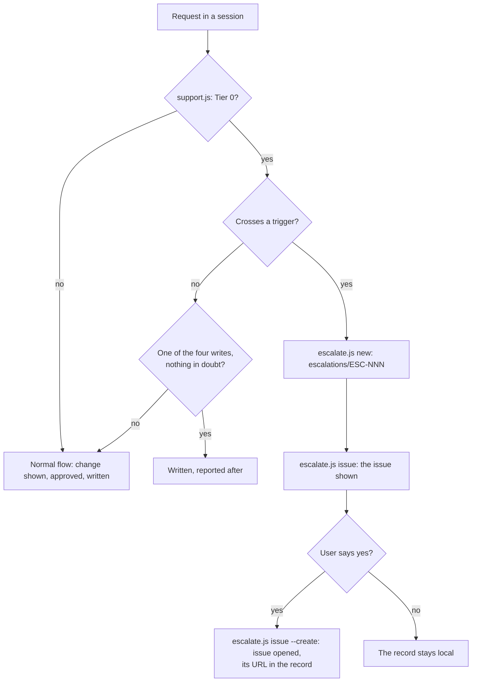
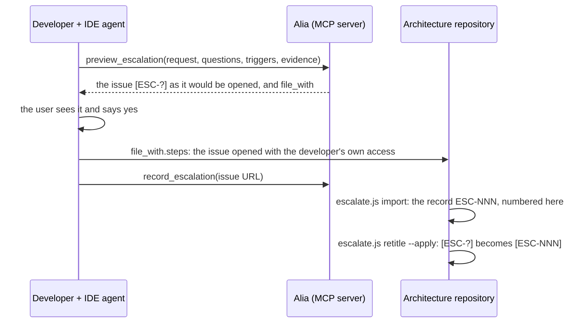
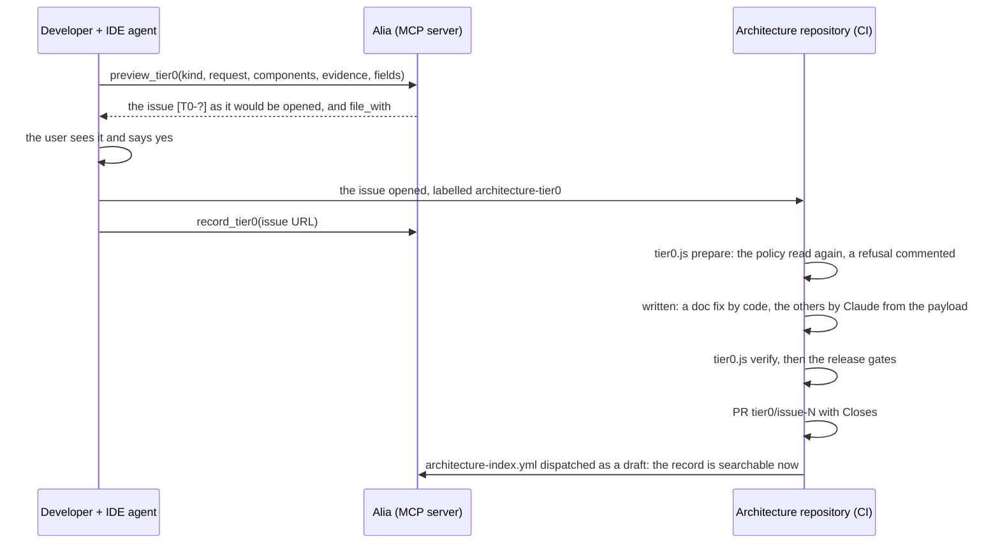
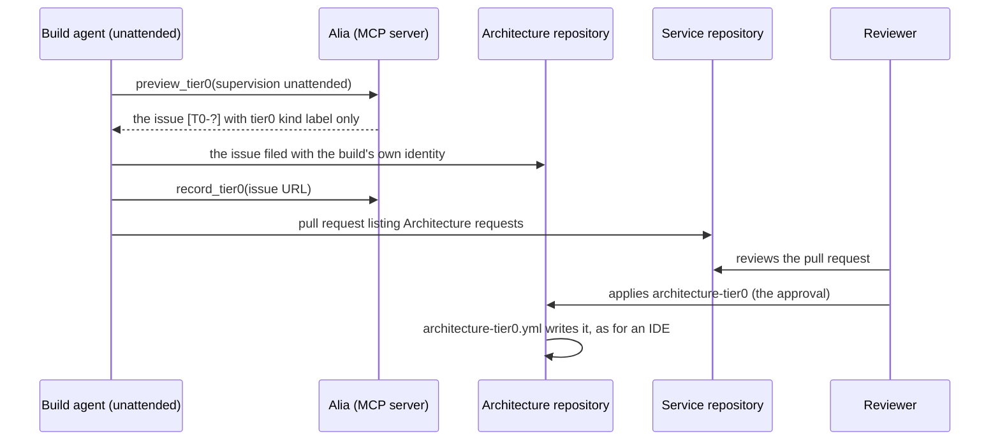

# RUN teams: Tier 0 and escalations

A RUN team maintains a released architecture without an architect at hand. The plugin lets the AI act as the
architect for small, safe changes (**Tier 0**). It turns everything else into an **escalation**, a structured
request a human architect answers. The architecture is never changed behind the architect's back. A request either
fits Tier 0 and is written, or it crosses a trigger and becomes an escalation that writes nothing.

| Tier | Who decides | What it covers |
|---|---|---|
| **Tier 0** | The AI, under the project's policy | Four writes, when nothing is in doubt and no trigger is crossed |
| **Tier 1** | SA office hours | An escalation: a question or a change that needs an architect |
| **Tier 2** | Design authority | An escalation that is CHANGE work: scope, structure, a new direction |

## Turning it on

1. Declare the project a RUN-team project:
   `bun <sa_skills_dir>/scripts/shared/support.js <project> --declare run`. This writes `"support": "run"` into
   `.sa-skills/project.json`.
2. Release the architecture once (`release my architecture`). Tier 0 applies only after the first `architecture-v*`
   tag. Before it, every write is confirmed.
3. Check it: `bun <sa_skills_dir>/scripts/shared/support.js <project>` prints whether Tier 0 applies and lists the
   triggers.

`/setup` writes the rules into the project's `CLAUDE.md` (§ RUN teams), so every session follows them.

## The policy

### The four Tier 0 writes

| Kind | What |
|---|---|
| `tdr-workaround` | A workaround recorded as a new TDR, status `Open` |
| `tdr-status` | A TDR status move that `tdr-check.js --move` accepts, with a dated History note. `Won't Fix` is excluded: that is the architect's decision |
| `adr-proposed` | A project ADR (101+) with status `Proposed`, never `Accepted` |
| `doc-fix` | A wording, typo or link fix in `docs/` that changes no fact: no value, name, id, integration, technology, decision or status |

They are written without the change-set approval and reported afterwards, file by file. **A doubt is not Tier 0**: a
request that leaves anything open goes through the normal confirmation.

### The triggers

| Trigger | Crossed by, for example |
|---|---|
| `new-integration` | An external system or an integration the architecture does not have |
| `data-classification` | Data moving to a new class, or personal data leaving through a new path |
| `cross-domain` | A change another domain or team owns |
| `security-iam` | Authentication, authorization, secrets, trust boundaries — including an interface whose authentication is not documented |
| `regulatory` | Regulatory or audit scope |
| `new-technology` | A new technology, product or vendor |
| `low-confidence` | Anything the AI cannot settle from the documents: an empty contract, a missing fact, a decision still `Proposed` the code depends on |

A crossed trigger **writes nothing to the architecture**: the request becomes an escalation.

## Escalations

### The record

Every escalation is a file, `escalations/ESC-NNN-<slug>.md`, in the architecture repository. Its front matter holds
`status` (`Open`, `In Review`, `Resolved`, `Rejected`), `date`, `architecture`, `route`, `triggers`, `components`,
`integrations`, `adrs`, `tdrs`, `requested_by`, `issue`, `resolution` and `closed`. Its body has these sections:

| Section | Content |
|---|---|
| Request | What was asked, verbatim: the task, never a "yes" to a question |
| Why it needs an architect | One row per trigger, with its evidence: a file and line, or a build-pack part and line |
| What the AI would propose (not applied) | The change the AI would have made, one line per item, using canonical names |
| Open questions for the architect | What only the architect can answer |
| Resolution | Written when it is closed |

The same content becomes an issue on the project's git host. GitHub, GitLab, Gitea and Azure DevOps are supported,
and the host is read from `origin`. The issue is titled `[ESC-NNN] <title>` and labelled `architecture-escalation`,
`tier-1` or `tier-2`, and `trigger:<id>`.

### From a session in the architecture repository

1. The session writes the request as JSON and runs `escalate.js new <project> --from request.json`.
2. `escalate.js issue <project> ESC-NNN` prints the issue it would open: title, labels and body.
3. The session shows it to the user and asks. Only after a yes does it run `--create`.
4. The session stops. Nothing in `docs/`, `adr/` or `tdr/` changes.

### From the IDE (the architecture MCP server)

A developer builds a component from its build pack, served by the MCP server (Alia). When something only the
architect can answer blocks the build, `BUILD.md` rule 9 makes the IDE agent escalate it instead of guessing or
keeping the questions in a local file.

The server holds no token: the issue is filed with the developer's own access. The number is assigned in the
architecture repository on import, so two IDEs never collide. The server files escalations only for the projects it
is configured for (`archindex.escalation.projects`; locally, `local/compose.escalation.yaml` with
`SA_INDEX_ESCALATION_PROJECT` and `SA_INDEX_ESCALATION_REPOSITORY`). For any other project it hands the questions back
for the architects.

### Closing

The architect answers with a decision, a debt record or a release:

- `escalate.js close <project> ESC-NNN --by ADR-NNN|TDR-NNN|architecture-vX.Y.Z`
- `escalate.js close <project> ESC-NNN --rejected "<reason>"`

**When a release answers it**, name the escalation in the release:
`lifecycle.js plan <project> --resolves ESC-NNN`. The changelog entry says "ESC-NNN resolved by this release", and
`apply` closes the record by the new tag in the release commit itself. The receipt names the issue, so the release
PR can carry `Closes #N`. Escalations closed in any other way since the last tag are listed in the next release's
entry.

`escalate.js list <project>` is the open queue, and `escalate.js status <project> ESC-NNN "In Review"` marks one as
taken.

## Tier 0 from the IDE

The IDE agent works in the service repository, where the four Tier 0 writes do not belong. `BUILD.md` rule 10 makes
it request them. The architecture repository then writes them, after checking the policy again.

- **Typical uses**: a shortcut the build pack does not state (a cache, a retry, a stub), recorded as a workaround TDR,
  or a TDR the code has resolved, moved to `Resolved`. The merge dispatches the index as a draft (10.10.11), so the
  IDE reads the new record — and previews the next move on it — before the next release, which carries it as
  released (`what_changed`).
- **The label is the key.** The workflow runs only when someone who can triage or write puts the
  `architecture-tier0` label. On a public repository anyone may open an issue, and its text reaches Claude.
  The key is a person's: a label put by a bot, or by an account listed in `SA_TIER0_AGENTS`, is refused even with
  write access, so an automation account never authorizes its own request.
- **The IDE's classification is a claim.** `tier0.js prepare` reads the policy again in the architecture repository
  and refuses, with its reasons, a request that is not a Tier 0 write. That covers a kind outside the four, a
  component name that is not canonical, a status move that is not allowed, `Won't Fix`, and a doc fix whose text is
  not where it says.
- **The write propagates, and is checked.** A record is not one file: the TDR skill links both ways (TDR ↔ affected
  components — the descriptor's `**Technical Debt:**` line —, TDR ↔ ADR) and adds its row to the Risks and Technical Debt section; the ADR skill indexes and links.
  `tier0.js verify` allows that propagation over `docs/` and the project ADRs where every changed hunk names the
  record's id, and refuses an unrelated change, any institutional ADR (001–100), a fact of the ledger outside the
  record's own part (a name, type, technology, integration, flow, figure or another record's status), a new TDR
  without its Section 13 row or its link from each affected component, a record that does not match the request, and a doc fix that moves any fact of the ledger.
- **Merge**: with `SA_TIER0_AUTOMERGE=true`, the pull request is merged as soon as the gates pass. Tier 0 needs no
  architect's approval. Without the variable, or when a gate blocks, a team member merges it.

The issue format (`[T0-?] <title>`, labels `architecture-tier0` and `tier0:<kind>`, the kind's fields as JSON) is
defined by `scripts/shared/tier0.js`. The MCP server's `preview_tier0` renders it the same way.

## Who consumes the index

The build packs and the MCP server do not depend on an IDE. Three kinds of consumer read them:

| Consumer | How it reads | A person beside it |
|---|---|---|
| **A developer's IDE** | MCP: `get_build_pack`, `what_changed`, `preview_*` | Yes: answers, approves, files with their own access |
| **An unattended build agent** (a CI job, a platform's agent) | MCP, as the IDE | No: its work ends in a pull request a person reviews |
| **A deterministic pipeline** (client or migration generation) | Each part's `download_url`, pinned by `pack_revision` | Not needed: it interprets nothing, it copies the contract byte for byte |

An unattended build is declared in the service repository's binding: `"supervision": "unattended"` in
`.architecture.json`. Without the field, a person attends. `BUILD.md` then changes four things:

| Rule | Attended | Unattended |
|---|---|---|
| 3 and 5. A gap, or a choice the standards leave open | Ask; with no answer, a `TODO(architecture)` | A `TODO(architecture)` at once |
| 4. Security | Fail closed | The same: an agent never opens an interface |
| 9. Escalation | Preview, the person's yes, filed with their access | Preview, filed with the build's own identity: an escalation writes nothing |
| 10. Tier 0 | Preview, the person's yes, filed with `architecture-tier0` | `preview_tier0(…, supervision: "unattended")`, filed **without** `architecture-tier0` |

The build's pull request lists every `TODO(architecture)` and every issue it filed under **Architecture requests**.
Its reviewer reads them there and applies `architecture-tier0` to the requests that should be written. The agent never
applies that label: the workflow refuses a bot, and the accounts listed in `SA_TIER0_AGENTS`.

## Setting up the repository

| What | Where |
|---|---|
| `"support": "run"` and a first release | `.sa-skills/project.json`, `release my architecture` |
| The workflows | `skills/architecture-lifecycle/ci/`: `architecture-gates.yml`, `architecture-release.yml`, `architecture-handoff.yml` and `architecture-tier0.yml`, copied to `.github/workflows/` |
| Secret | `CLAUDE_CODE_OAUTH_TOKEN` (`/install-github-app`) |
| Variables | `SA_TIER0_AUTOMERGE=true` to merge Tier 0 writes without a reviewer; `SA_TIER0_AGENTS`, the automation accounts (comma- or space-separated) that may file a request but never apply `architecture-tier0` |
| Labels | `architecture-tier0`, `tier0-refused` and the four `tier0:<kind>` (`tdr-workaround`, `tdr-status`, `adr-proposed`, `doc-fix`) — required: without `architecture-tier0` nobody can apply a request; for escalations `architecture-escalation`, `tier-1`, `tier-2` and `trigger:<id>`. `gh issue create --label` fails outright on a missing label: `escalate.js issue --create` and the IDE agent (`BUILD.md` rules 9 and 10) file the issue again without the labels refused — the `[ESC-…]` / `[T0-?]` title still identifies it, and the Kind row carries a request's kind — and name the missing labels beside the issue. `escalate.js labels <project> --create` creates all sixteen |
| Settings | Actions may create pull requests; the default branch accepts a merge by `GITHUB_TOKEN` |
| MCP server | The escalation host configured for the project (`archindex.escalation.projects`) |

## Command reference

| Command | Does |
|---|---|
| `support.js <project> [--declare run\|none]` | The policy: whether Tier 0 applies, and the triggers |
| `escalate.js new <project> --from <request.json>` | Writes the record |
| `escalate.js issue <project> ESC-NNN [--create]` | The issue, previewed, or opened with `--create` |
| `escalate.js import <project> <issue>` | An `[ESC-?]` issue filed from the IDE becomes a numbered record |
| `escalate.js retitle <project> ESC-NNN [--apply]` | The issue's title becomes `[ESC-NNN] …` |
| `escalate.js status <project> ESC-NNN "In Review"` | Marks it taken |
| `escalate.js close <project> ESC-NNN --by … \| --rejected "…"` | Closes it |
| `escalate.js list <project> [--all]` | The queue |
| `escalate.js labels <project> [--create]` | The labels escalations and Tier 0 requests carry, present or missing on `origin`'s host; `--create` adds the missing (`/setup` Step 12 asks first) |
| `lifecycle.js plan <project> --resolves ESC-NNN` | A release that answers an escalation closes it |
| `tier0.js render <request.json>` | The `[T0-?]` issue for a request |
| `tier0.js prepare <project> <issue>` | The policy read again; the payload, or the reasons for a refusal |
| `tier0.js apply \| verify <project> <payload>` | The doc fix written by code; the write held to the request |

All of them live under `<sa_skills_dir>/scripts/shared/` except `lifecycle.js`, which is
`skills/architecture-lifecycle/scripts/`.
