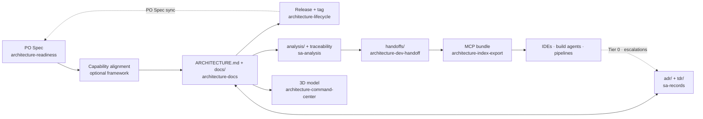
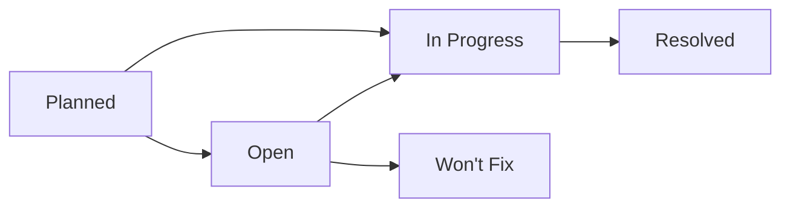

# Workflow Guide

The full lifecycle of an architecture with Solutions Architect Skills: what each phase needs, what it produces, which
checks hold it, and the phrases that start it. For a guided first run, read [QUICK_START.md](QUICK_START.md) first.

Examples use an invented parcel-tracking service, **ParcelPath** (`Tracking API`, `Scan Ingest`, `Shipment Store`,
`Notification Service`, the external `Carrier Network`).

**Contents:** [Lifecycle](#the-lifecycle-at-a-glance) · [Requirements](#phase-1--requirements) ·
[Capability alignment](#phase-15--capability-alignment) · [Architecture](#phase-2--the-architecture) ·
[Gates](#the-gates-as-code) · [ADRs and TDRs](#decisions-and-debt--adrs-and-tdrs) ·
[Release](#versioning-and-release) · [Governance](#governance--analysis-and-traceability) · [Delivery](#delivery) ·
[Visualization](#visualization) · [Compliance](#phase-3--compliance) · [Language](#documentation-language) ·
[Trigger phrases](#trigger-phrases)

## The lifecycle at a glance



**One rule runs through all of it:** the model writes, code checks. Every gate below is a script; a document either
passes or the script names the file and line to fix. The fix is an edit at that line, not a rewrite.

## Phase 1 — Requirements

**Skill:** `architecture-readiness` (plugin `sa-requirements`, installable alone for a Product Owner).
**Produces:** `PRODUCT_OWNER_SPEC.md` and `exports/PO-SPEC-<slug>.pdf`.

| Mode | Say | Result |
|---|---|---|
| Elicitation | `elicit requirements` | An interview, section by section, then a scored spec |
| Async intake | `business context intake` (a ticket, email or document) | `PO_SPEC_GAP_REPORT.md` with a ready-to-send message; a draft spec only at score ≥ 7.5 |
| Evaluation | `evaluate PO spec` | The score, the failing requirements and the questions that fix them |

The spec has eight sections: Business Context, Stakeholders & Users, Business Objectives, Use Cases, User Stories, UX
Requirements, Business Constraints, Success Metrics & KPIs. Three checks decide readiness:

- **Score** — weighted completeness, 0–10. **≥ 7.5** is ready for the architecture team.
- **Checkability** (`po-spec-checkability.js`) — every requirement must be testable by someone who was not in the
  room: *named, closed, dated, observable, measured*. Use cases are checked part by part. A failing requirement costs
  its section 25%; a failure in Use Cases, Objectives, Constraints or Metrics caps the score at 7.4. A wish that is not
  yet checkable goes to **Appendix → Aspirations**.
- **Coherence** (`po-spec-coherence.js`) — can it be built as written? An objective no use case serves or no metric
  measures, a state no use case sets, a trigger nothing produces, two statements that cannot both hold, and one
  acceptance test per use case (Given / When / Then) that names any fact the spec never gives. Figures that do not fit
  together are warnings.

The spec is written in the language the interview is held in and stays **business only**: no containers, protocols or
ADR ids.

### Keeping the PO Spec in step — PO Spec sync

When the architecture evolves, say `update the PO spec` (or `sync PO spec`). `po-spec-delta.js` collects by code what
changed since the spec's `<!-- ARCHITECTURE_SYNC: <version> (<date>) -->` marker — changelog entries, the ADRs and
TDRs they name, use cases the flows serve that the spec lacks, retired integrations. Each change with a business effect
becomes a proposal in business language; **the Product Owner approves item by item**; the spec is stamped, re-scored
and its PDF re-rendered. Nothing is rewritten silently.

## Phase 1.5 — Capability alignment

**Skill:** `architecture-capability-alignment` (`sa-requirements`).
Maps the PO Spec onto the capability framework the project declares, before design begins.

| Framework | Levels | Report |
|---|---|---|
| `BIAN` — banking | 8 Business Areas › 43 Business Domains › 341 Service Domains (v14.0.0, as published) | `BIAN_ALIGNMENT.md` |
| `CROSS-INDUSTRY` — any industry | 9 Domains › 41 Capability Groups › 223 Capabilities (Turbo EA, CC BY 4.0) | `CAPABILITY_ALIGNMENT.md` |
| A pack's framework | Its own levels | `CAPABILITY_ALIGNMENT.md` |
| `none` | — | — |

Declare once per project — Workflow 1 asks when nothing is declared:

```bash
bun <plugin_dir>/scripts/shared/frameworks.js --project .                     # list, and show what is declared
bun <plugin_dir>/scripts/shared/frameworks.js --declare CROSS-INDUSTRY --project .
```

The choice lives in `.sa-skills/project.json`; an institution pack may set an organization default. Once a framework
is declared, creating an architecture waits for its report (no skip); with `none` there is no gate. The report's
summary and impacted capabilities become **Section 1.5** of `docs/01-system-overview.md`. A BIAN report also lists the
published BIAN semantic APIs in scope.

## Phase 2 — The architecture

**Skill:** `architecture-docs` (plugin `sa-skills`). **Produces:** `ARCHITECTURE.md` (a navigation index with the
version) and one file per section under `docs/`.

| Section | File | Section | File |
|---|---|---|---|
| 1–2 Executive Summary, System Overview | `docs/01-system-overview.md` | 8 Technology Stack | `docs/06-technology-stack.md` |
| 3 Architecture Principles | `docs/02-architecture-principles.md` | 9 Security Architecture | `docs/07-security-architecture.md` |
| 4 Architecture Layers + diagrams | `docs/03-architecture-layers.md` | 10 Scalability & Performance | `docs/08-scalability-and-performance.md` |
| 5 Components | `docs/components/` | 11 Operational Considerations | `docs/09-operational-considerations.md` |
| 6 Data Flow Patterns | `docs/04-data-flow-patterns.md` | 12 ADRs | `adr/` |
| 7 Integration Points | `docs/05-integration-points.md` | 13 Risks and Technical Debt | `docs/10-risks-and-technical-debt.md` |
| References | `docs/11-references.md` | | |

Section numbers and file prefixes do not align: "Section 9" is `docs/07-…`.

### Workflow 1 — Create

Say `create the architecture`. The entry gates run first, checked together by `gates-check.js`:

| Step | Gate | Skippable |
|---|---|---|
| 0.1 | **Language** — `en` or `es`, stamped as `<!-- DOC_LANGUAGE: xx -->` | No |
| 0.2 | **PO Spec** — found, or created now: elicitation, async intake, inline context, or `SKIP PO SPEC` | Yes |
| 0.3 | **Capability alignment** — the declared framework's report | No while a framework is declared; skipped with the PO Spec |
| 0.4 | **HLD** — Mermaid (`.mmd`, `.mermaid`, a `.md` with mermaid fences) preferred; PDF, PNG, SVG accepted | No; skipped with the PO Spec |
| 0.6 | **ADR Context Block** — the decisions the design will need, confirmed by you | — |
| 0.65 | **Institutional ADR catalog** — imported into `adr/` if the organization keeps one | — |

A PDF, PNG or SVG HLD is transcribed once into `<name>.hld.mmd` beside it, box by box and arrow by arrow; every later
step reads the transcription. An inbound HLD is not held to the house diagram style.

**Architecture type.** `arch-types.js` lists the types on offer — the five built in, plus any an institution pack adds:

| Type | Choose when |
|---|---|
| `ENTERPRISE` (default) | Channels → Experience → Process → Domain Services → Systems of Record, any industry |
| `MICROSERVICES` | Independently deployable services, each owning its data, behind a gateway and an event backbone |
| `3-TIER` | One web application with one database |
| `N-LAYER` | One deployable organised as DDD / clean / hexagonal layers |
| `BIAN` | Banking services modelled on BIAN Service Domains throughout |

**The collection.** Step 4.9 saves every answer to `.cache/sa-skills/collect.json` and asks the last questions at once:
the checkpoint mode, the status of the ADRs to write (`Proposed` by default), and any optional diagrams.

**Segments and checkpoints.** The writing is split so each segment starts with a clear context. The four checkpoints
come after the collection · after Sections 1+2, 13, 4, 5 · after 8, 3, 6 · after the rest and `ARCHITECTURE.md`.

- **Manual** — the create stops at each checkpoint. Run `/clear`, then `continue the architecture`. One receipt
  (`resume-prepare.js`) carries the state; the gates and questions never run again.
- **Automatic** — segments 2–4 run one after another, each in a `segment-runner` sub-agent.

Each section is written from a **payload** cut by code (`section-prepare.js`): the guide's block for that section, the
type's templates, the inputs it takes, its parent sections in outline and the facts it cites. Then:

- **Step 5.7 — Content Hygiene Gate**: explorer headers, prose and size budgets over everything written.
- **Step 6 — ADRs**: each confirmed decision becomes `adr/ADR-101…` through the ADR skill.
- **Step 7 — Diagrams**: the four standard diagrams and the data-flow sequences (below), plus any optional ones —
  infrastructure, high availability, performance, integration, security.

**Result:** version `1.0.0`, status Draft.

### Workflow 2 — Edit

Ask for the change in plain words: `update the latency target of the track parcel flow to 300 ms`. The skill reads the
**facts ledger** first (`arch-facts.js` → `.cache/sa-skills/facts.json`: components, ADRs, integrations, flows,
phases, releases — collected once by code), anchors on the parent sections and matching ADRs, edits the target at the
lines that change, runs the post-write checks on what changed and lists the downstream sections and artifacts the
change affects. A change to Section 3 runs the principle gate in full.

Component files, the component index and C4 restructuring go through **`architecture-component-guardian`**
(`add component <X>`, `remove component <X>`, `sync component index`, `migrate to C4`) — the only writer of
`docs/components/README.md`.

### Workflow 8 — Diagrams

`generate my architecture diagrams` (or `update diagrams`) writes, all in Mermaid:

- `docs/03-architecture-layers.md` — Logical View (`flowchart TB`, a band per layer), C4 System Context, C4 Container,
  Detailed View;
- `docs/04-data-flow-patterns.md` — one `sequenceDiagram` per phase, and one end-to-end sequence per use case, derived.

The Logical and Detailed views share one fixed four-role palette: `zone`, `unit`, `store`, `ext`. Each phase of a flow
is drawn **once**; `flow-compose.js` builds every use case's end-to-end sequence from the phases it declares. Diagrams
that no documented flow backs are discarded.

### Workflow 9 — Migrate to `docs/`

`migrate my architecture` (or `split ARCHITECTURE.md`) turns a single-file architecture into the `docs/` layout:
extracts the sections, rewrites `ARCHITECTURE.md` as the index, adds heading anchors and stamps `DOC_LANGUAGE`. The
source language is preserved. An older multi-file layout missing a section file gets it scaffolded first (the layout
gate).

### Workflow 12 — Restyle

`restyle architecture` (or `/restyle-architecture`, with `--dry-run`, `--file <glob>`, `--force`) applies the prose
style to an architecture written before it: staged fixes, safest first, never dropping a fact, then stamps
`<!-- PROSE_STYLE: v1 -->`. From then on the prose rules **block** instead of only reporting. `--dry-run` is the plan.

**Also:** questions (`what is our authentication approach?` — the explorer locates passages by code, the answer cites
files) · `review my architecture` (a conformance review) · `regenerate explorer headers` (backfills the
`<!-- EXPLORER_HEADER -->` block — key concepts, technologies, components, scope, ADRs — every file carries after its H1).

## The gates, as code

Every script ships in the plugin and runs with `bun`, inside the workflows or on its own in CI.

| Script | Checks | Blocks? |
|---|---|---|
| `prose-check.js` | The prose contract: no template boilerplate, filler, narration about the document itself, hedges, marketing register or first person; sentence and paragraph length; tables before prose. Judgement rules go to the judge | Lexical rules block once the project carries `PROSE_STYLE: v1`; report-only before. Length and form are warnings |
| `principle-check.js` | Section 3, Layer 1: the nine core principles (a tenth for event-driven designs) in order, each with Description, Implementation and Trade-offs; system-specific implementation, at least three quantified trade-offs that are costs, not open items; an ADR reference; no platitudes or placeholders | Yes |
| `principle-quality-reviewer` | Section 3, Layer 2: decision rules vs outcomes, honest trade-offs, contradictions, ADR alignment. Writes the review stamp a release needs | Yes, at release |
| `flow-check.js` | `docs/04` states each flow twice — its phases and its sequence — and the two agree; every flow has a `**Phases**:` line | Yes |
| `flow-compose.js --check` | The derived end-to-end sequences match the phase panels | Yes |
| `mermaid-check.js` | Every Mermaid block: no `;` in a label, no HTML tags or emoji, balanced quotes, the palette on Diagrams 1 and 4, and a real render when mermaid-cli is installed | Yes |
| `label-check.js` | Connection labels against a design language standard's grammar and action types | **Governed mode** only — when an institution pack supplies a standard. In **fallback mode** it is skipped and says so |
| `integration-check.js` | Each `docs/05` integration's protocol cell (blocking in governed mode), and each HLD edge against the inventory — missing, reversed, not in the HLD (warnings) | Partly |
| `docs-stats.js` | Size budgets per file and the shapes that bloat a corpus: a principle over budget, a risk row that argues instead of linking, a component described outside its file, ADR/TDR sections over their word budgets | Shape budgets block once stamped; file sizes are warnings |
| `explorer-cli.ts check` | One `EXPLORER_HEADER` right after the H1, known keys only, components and ADRs that exist | Yes |

Hooks on `Write` and `Edit` run the lexical prose rules on the new lines of an architecture document as they are
written: in a stamped project a banned phrase is refused at the moment of writing, and length warnings come back in
the same turn.

## Decisions and debt — ADRs and TDRs

Both skills ship in `sa-records`. Each is the only writer of its folder.

### ADRs — `architecture-definition-record`

`ADR-001` … `ADR-100` are **institutional** (organization-wide, imported into the project); `ADR-101` and up are the
**project's** own.

| Say | Does |
|---|---|
| `create ADR` | One ADR, interactively |
| `update ADR status` · `supersede ADR` · `amend ADR` | Status changes, replacement, amendment |
| `list ADRs` · `regenerate ADR index` | The inventory; `adr/README.md`, derived by code |
| `compact ADRs` | Rewrites a verbose ADR to the decision in force, within its word budget |
| `import institutional ADRs` | Clones a catalog from a git URL into `adr/` and pins it in `adr/.institutional-catalog.json` |
| `sync institutional ADRs` | Re-pulls the catalog, classifies every change and propagates its impact into the architecture |

Institutional ADRs are copies in the project, never referenced by an outside path — every check resolves them on disk.

**Catalog mode.** A repository that maintains the institutional catalog itself carries `.sa-skills/adr-catalog.json`
and no `ARCHITECTURE.md`. There the skill amends an ADR in place, every language edition in the same change, and
measures every ADR with `catalog-check.js`. Install `sa-records` alone for such a repository.

### TDRs — `technical-debt-records`

A TDR records an architectural compromise, not a bug. Say `record technical debt`, `update TDR status`, `list TDRs` or
`check TDRs`. Each record has exactly one of five statuses, always in English:



Nothing goes straight to `Resolved`; every move is a dated History note. `Planned` needs a target date, `In Progress` a
named owner. `tdr-check.js --move TDR-NNN "<status>"` accepts a transition or names the path it must take.

## Versioning and release

**Skill:** `architecture-lifecycle` (`sa-skills`). A release is a **git tag**: the project must be a git repository.
`ARCHITECTURE.md` carries `<!-- ARCHITECTURE_VERSION: 1.2.0 -->`, `ARCHITECTURE_STATUS` and `ARCHITECTURE_RELEASED`;
every component file carries `**Component Version:**`, `**Architecture Version:**` and `**Last Updated:**`.

| Command (`lifecycle.js`) | Say | Does |
|---|---|---|
| `status` | `architecture status` | The state, the changes since the tag with their bump, and every downstream artifact built from an older version |
| `check` | `release readiness` | Every gate once; names the blocking ones with their fix |
| `plan` · `apply` | `release my architecture` | Plan: gates, change list, recommended bump, draft changelog entry. Apply: writes the version, component versions and `docs/CHANGELOG.md`; commits only `ARCHITECTURE.md`, `docs/`, `adr/`, `tdr/`; with `--direct`, tags and pushes |
| `tag` | — (CI, after a release PR is merged) | Tags the merge or squash commit that brought the release, and pushes it |
| `recover` | `recover architecture tag` | Restores a tag lost outside the release history |
| `deprecate` | `deprecate architecture` | Marks the architecture Deprecated |

`release my architecture` (or `/release-architecture`) runs plan and apply, asking one question: the bump. By default
it pushes a `release/architecture-v<version>` branch for a pull request, tagged once merged (`lifecycle.js tag`, run by
CI — `ci/architecture-release.yml`); `--direct` commits and tags on the current branch. A gate can be waived only explicitly, with a reason written into the changelog (`--waive <gate>:<reason>`).

### In CI — the automatic mode

`skills/architecture-lifecycle/ci/` holds four GitHub Actions workflows to copy into `.github/workflows/`:

| Workflow | Runs on | Does |
|---|---|---|
| `architecture-gates.yml` | every pull request | `lifecycle.js check --undecided warn`: every release gate, its findings commented on the PR |
| `architecture-release.yml` | the merge of a release PR | the tag, the index (chunks and ledger), and the handoff dispatch |
| `architecture-handoff.yml` | the dispatch | the kit regenerated by Claude into a pull request, edited in place (§ Handoff kit); its merge publishes the build packs |
| `architecture-tier0.yml` | an issue labelled `architecture-tier0` by a person | a RUN team's Tier 0 request re-checked, written, verified, gated and merged ([RUN_TEAMS.md](RUN_TEAMS.md)) |

**States** are derived, never stored: `draft`, `changed`, `released`, `untagged`, `deprecated`, `no-git`.

**Semver**, recommended by code from the change list:

| Bump | When |
|---|---|
| MAJOR | Something a consumer relied on is gone or the structure changed — a system added or removed; a container, integration, flow or section removed; the type changed |
| MINOR | Something added or a decision moved — a container, ADR, TDR, integration, flow, phase or section added; a container renamed or retyped; an ADR's status |
| PATCH | Text changed, structure did not |

The tag is `architecture-v{version}`, and it is the only baseline: a correction is a new PATCH release. Handoffs,
analyses and exports state the architecture version they were cut from, so `status` can name the stale ones.

### Delivery increments

One target design, delivered in pieces. A `Delivery Increments` table in `docs/01` (`Increment | Use Cases | Target`)
assigns **use cases** to increments. `increments.js` derives each slice — flows, phases, containers and integrations,
cumulative, with what is new. Never assign a container by hand: move a use case. `release increment 2` releases one piece (`lifecycle.js plan --increment
2`); its gates block only on findings inside the slice, and the changelog entry and tag record the delivery scope.

**Temporary elements** — a stopgap one increment needs and a later one replaces — declare their window and the TDR
that records the compromise: `**Delivery Increments:** 1–2 · TDR-104` in a component file, or an `Increments` column
in `docs/05`. Releasing an increment after the window is blocked (`retire-pending`) until the element is retired.

## Governance — analysis and traceability

Both skills ship in `sa-analysis`.

### Analysis — `architecture-analysis`

Say `run architecture analysis` (or a lens by name, or `all analyses`). Pick lenses, then Markdown or interactive HTML.

| Lens | Looks for | Report |
|---|---|---|
| SPOF | Single points of failure | `analysis/SPOF-<date>.md` |
| Blast Radius | Downstream cascade per component | `analysis/BLAST-RADIUS-<date>.md` |
| Bottleneck | Throughput chokepoints, capacity headroom | `analysis/BOTTLENECK-<date>.md` |
| Cost Hotspots | Cost concentration, over-provisioning | `analysis/COST-HOTSPOTS-<date>.md` |
| STRIDE | Threats per trust boundary | `analysis/STRIDE-<date>.md` |
| Vendor Lock-in | Portability risk, exit cost | `analysis/VENDOR-LOCKIN-<date>.md` |
| Latency Budget | Per-hop budget against each flow's target | `analysis/LATENCY-BUDGET-<date>.md` |
| Tech Debt / EOL | Technology currency, deprecated SDKs | `analysis/TECH-DEBT-<date>.md` |
| Coupling | Fan-in, fan-out, instability, cycles | `analysis/COUPLING-<date>.md` |
| Data Sensitivity | Personal-data flows, encryption and retention gaps | `analysis/DATA-SENSITIVITY-<date>.md` |
| Security Posture | One checklist merging STRIDE and Data Sensitivity | Markdown only |

Code computes the dependency graph, latency sums and load model; the model classifies; `check-report.js` holds every
report to the findings contract. Each finding has an id (`C1`, `B1`, `T1-S`, `OB-01` …), a mitigation column and a
residual severity — the ids the command center lights up.

### Traceability — `architecture-traceability`

`check requirements coverage` compares every PO Spec use case with the architecture and writes
`TRACEABILITY_REPORT.md`: each requirement `Covered`, `Partial` or `Not Covered`, with its evidence. With delivery
increments declared, coverage is reported per increment.

## Delivery

All four skills ship in `sa-delivery`.

### Handoff kit — `architecture-dev-handoff`

`generate dev handoff` writes the **Service Handoff Kit** for C4 Level 2 containers (systems are boundaries, not units):

| Part | File | Contents |
|---|---|---|
| System Runtime View | `handoffs/SYSTEM_RUNTIME_VIEW.md` | Every flow with its per-hop budget, edge rationale, failure posture |
| Cross-Cutting Standards | `handoffs/CROSS_CUTTING_STANDARDS.md` | Rules every service follows, each citing an institutional ADR |
| Interface Contract | `handoffs/interfaces/<upstream>→<downstream>.md` | Per adjacent pair: the interaction, entry and exit state, mutual assumptions, failure semantics, ownership |
| Component Specification | `handoffs/components/NN-<slug>.md` | Per container: intent and constraints — deliberately not the implementation |

**Assets** per container in `handoffs/assets/NN-<slug>/` — OpenAPI, AsyncAPI, GraphQL SDL, Avro, DDL, Protobuf, a Redis
key schema — each validated by `contract-check.js`: it parses, the structure holds against its spec (Redocly for
OpenAPI 3.1 and AsyncAPI 3.0, graphql-js, avsc, SQL parsers per engine, protobufjs), and every operation, channel,
field and table is one the architecture documents. Nothing is invented.

**Security obligations** per container (`security.md`, by code): who may call it and with what authentication — an
interface with none documented fails closed —, the security principle, the STRIDE findings on its boundaries, the
sensitive data it handles. A specification without one fails the kit gate.

**Technical debt** per container: the TDRs its descriptor names on the `**Technical Debt:**` line, written by code as a
table at the end of the specification's § 7. The model never writes it.

**A regeneration keeps what did not change.**
- **Nothing moved:** a part whose sources did not move is kept, and only its version row moves.
- **Something moved:** a part whose sources moved is **edited in place**. The generator gets the delta since the release
  the part was written at, plus the previous text, and changes only the sections the delta reaches. Code restores any
  other section it touched.
- **The result:** the kit's pull request after a release shows the release's change, not the model's other words.
  Never `--force` a release.

`kit-check.js` gates the whole kit — markers, placeholders, every Mermaid block, the architecture version on every
part. `docs/05-integration-points.md` is required; missing latency or blast-radius analyses become `[NOT DOCUMENTED]`
markers. Flags: `--force`, `--parallelism`, `--seam-parallelism`, `--asset-parallelism` (default 4, max 8). Run it in a
fresh session.

### Word export — `architecture-docs-export`

`export architecture to Word` writes, on demand, `exports/SA-<name>.docx` — a role-routed stakeholder briefing: one page
first, a section per role, decisions pending last — its companion `exports/SA-<name>-reference.docx` with the detail it
cites, and `exports/ADR-NNN-<title>.docx` per ADR.

`export handoff to Word` exports the kit. Mermaid diagrams render as pictures when mermaid-cli is installed (`/sa-skills:setup`
checks it), otherwise as source.

### Architecture index — `architecture-index-export`

`export architecture index` turns the architecture into an `sa-index/1` bundle for an architecture MCP server: every
section, flow, integration, ADR and TDR as a searchable chunk, the facts ledger, and a **build pack** per container
covered by a handoff kit of the same version — spec, security obligations, interface contracts, assets byte for byte,
budgets, open questions, an ordered build plan. A developer's IDE, or a build agent that works unattended, can then
ask the architecture and build one service from its pack. Who consumes the index, and what changes with no person:
[RUN_TEAMS.md](RUN_TEAMS.md#who-consumes-the-index).

- `publish-index.js <project> --up` publishes a draft to a local server in Docker, to try while writing.
- CI publishes each release: copy `ci/github-actions.yml`, `ci/gitea-actions.yml` or `ci/azure-pipelines.yml` from the
  skill. The tag publishes chunks and ledger; committing the regenerated kit publishes the build packs.

The server side is Alia — see [ALIA.md](ALIA.md).

## Visualization

**Skill:** `architecture-command-center` (`sa-visualization`). Say `command center` (or `3D view`, `physical view`).

It writes `visualizations/architecture-command-center.scene.json` and `.html` — one self-contained page, regenerated
in place. A floor per layer, a block per container, routes per integration; Logical and Physical views; use-case
walkthroughs phase by phase; analysis findings on the stage; a load simulation from the documented capacity and demand;
an increment filter when increments are declared; skins `alia` (default), `holo`, `atlas`, `corporate` or your own. **Alia**, the
navigator, answers from a dossier of the architecture baked into the page. It never edits a document. See
[ALIA.md](ALIA.md).

## Phase 3 — Compliance

Compliance contracts are organization-specific, so the base ships none. An organization that has its own compliance
questions ships them as a plugin of its **institution pack**, which reads the architecture like any other skill; no
skill in the base reads what it writes. See [INSTITUTION_PACKS.md](INSTITUTION_PACKS.md).

## Documentation language

- Skill files, templates and instructions are English. **The documents written into your project** are in the language
  chosen at Step 0.1: `en` or `es`.
- `<!-- DOC_LANGUAGE: es -->` near the top of `ARCHITECTURE.md` is the one authority; every skill reads it.
- Every structural heading carries an English anchor, so every check reads both languages:
  `## 1. Resumen Ejecutivo <!-- SECTION: Executive Summary -->`.

- **Never translated:** ADR/TDR ids, status values (`Proposed`, `Open`, `Covered`…), the literal `Not documented`,
  table column headers, filenames, marker names, Mermaid keywords, and the identifiers of the documented system —
  API paths, fields, topics, tables. The handoff assets copy those verbatim, so a Spanish field name becomes a Spanish
  contract.

## Trigger phrases

Typing one of these starts the matching skill directly. Slash names work too (`/<plugin>:<skill>`).

| Say | Skill | Does |
|---|---|---|
| `elicit requirements` · `PO spec` · `business context intake` · `evaluate PO spec` | `architecture-readiness` | Write or score the PO Spec |
| `update the PO spec` · `sync PO spec` · `align PO spec with the architecture` | `architecture-readiness` | PO Spec sync |
| `capability alignment` · `cross-industry capability map` · `map to BIAN` · `BIAN alignment` | `architecture-capability-alignment` | Align the spec to the declared framework |
| `create the architecture` | `architecture-docs` | Workflow 1 |
| `continue the architecture` · `resume the architecture` · `continúa la arquitectura` | `architecture-docs` | Resume a create after a checkpoint |
| `generate my architecture diagrams` · `update diagrams` | `architecture-docs` | Workflow 8 |
| `migrate my architecture` · `split ARCHITECTURE.md` | `architecture-docs` | Workflow 9 |
| `restyle architecture` · `apply prose style` · `/restyle-architecture` | `architecture-docs` | Workflow 12 |
| `add component <X>` · `remove component <X>` · `sync component index` · `migrate to C4` | `architecture-component-guardian` | The component index |
| `regenerate explorer headers` · `/regenerate-explorer-headers` | `architecture-explorer-headers` | Backfill headers |
| `release my architecture` · `/release-architecture` · `architecture status` · `release readiness` · `recover architecture tag` · `deprecate architecture` | `architecture-lifecycle` | Versioning and release |
| `create ADR` · `update ADR status` · `supersede ADR` · `list ADRs` · `compact ADRs` · `import institutional ADRs` · `sync institutional ADRs` | `architecture-definition-record` | ADRs |
| `record technical debt` · `update TDR status` · `list TDRs` · `check TDRs` | `technical-debt-records` | TDRs |
| `run architecture analysis` · `SPOF analysis` · `STRIDE threat model` · `security posture` · `all analyses` | `architecture-analysis` | Risk analyses |
| `check requirements coverage` · `traceability report` · `PO spec coverage` | `architecture-traceability` | `TRACEABILITY_REPORT.md` |
| `generate dev handoff` · `component handoff for <X>` · `interface contracts` | `architecture-dev-handoff` | The handoff kit |
| `export architecture to Word` · `export handoff to Word` · `stakeholder briefing` | `architecture-docs-export` | `.docx` files |
| `export architecture index` · `export build packs` · `test the architecture index` | `architecture-index-export` | The MCP bundle |
| `command center` · `3D view` · `physical view` · `onboard to architecture` | `architecture-command-center` | The 3D model |

**Release is not export.** "Release my architecture" bumps the version and tags it (`architecture-lifecycle`);
"export my architecture to Word" writes `.docx` files (`architecture-docs-export`).
