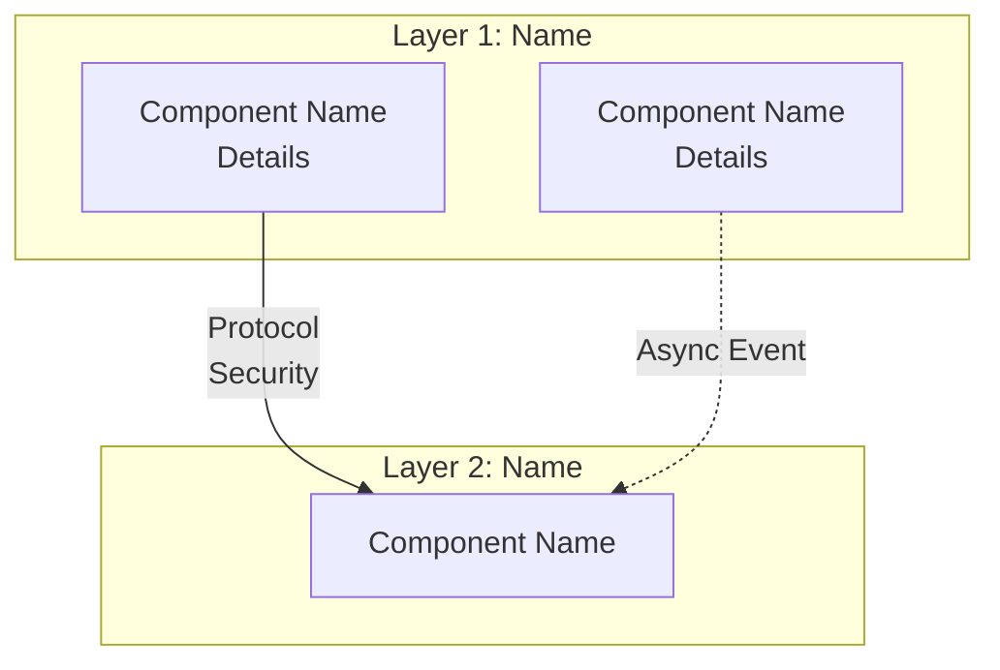

# Architecture Documentation Guide

> A comprehensive guide for creating system architecture documentation ARCHITECTURE.md

## Purpose

This guide defines how the plugin documents system architectures.

**Use this guide when:**
- Starting a new system architecture from scratch
- Documenting an existing system's architecture
- Standardizing architecture documentation across multiple projects
- Onboarding teams to a new system
- Communicating architecture decisions to stakeholders

## Related Documentation

This guide focuses on **what to write** and **how to structure** architecture documentation content.

For supporting operations and algorithms:
- **→ SKILL.md**: Operational workflows, when to trigger actions, context-efficient editing strategies
- **→ METRIC_CALCULATIONS.md**: Algorithms for index updates and metric consistency detection
- **→ DESIGN_DRIVER_CALCULATIONS.md**: Implementation details for Design Drivers calculation
- **→ VALIDATIONS.md**: Structure enforcement rules, required principles, section name validation
- **→ ADR_GUIDE.md**: Architectural Decision Record format and creation guidelines
- **→ RESTRUCTURING_GUIDE.md**: Multi-file docs/ directory structure, naming conventions, cross-reference conventions, verification checklist

## C4 Model Alignment

Components in this architecture follow the **C4 model** (IcePanel convention):

### C4 Level 1 — Systems
Systems are logical groups of applications and data stores, typically owned by a single development team. In multi-system architectures, each system becomes a **folder** under `docs/components/`.

### C4 Level 2 — Containers
Each component file represents a **container** — a separately deployable/runnable unit. Containers are classified as:

| Type | C4 Category | Examples |
|------|------------|---------|
| API Service | App | REST API, GraphQL server, gRPC service |
| Web Application | App | SPA, SSR frontend, admin portal |
| Worker/Consumer | App | Message consumer, background processor, scheduler |
| Database | Store | PostgreSQL, MongoDB, SQL Server |
| Cache | Store | Redis, Memcached |
| Message Broker | Store | Kafka, RabbitMQ, Azure Service Bus |
| Object Storage | Store | S3, Azure Blob, MinIO |
| Gateway | App | API Gateway, reverse proxy, load balancer |

### Boundary Test
Before creating a component file, verify:
- "Can this be deployed independently?" → YES = valid container
- "Does this run as its own process/container?" → YES = valid container
- Code module inside a deployable → NOT a container (C3 level — document within parent)
- External system you don't own → NOT a container (reference in integration docs)

### Naming Convention (IcePanel)
- Technology in brackets: `[Spring Boot 3.2]`, `[PostgreSQL 16]`, `[React 18 SPA]`
- Communication protocols on relationships: HTTPS, gRPC, AMQP, TCP

---

## Architecture Type Selection

**Before creating your ARCHITECTURE.md, choose your architecture type.** The architecture type determines the structure and content of **Section 4 (Meta Architecture)** and **Section 5 (Component Details)**.

### Available Architecture Types

1. **ENTERPRISE Architecture** - 5-layer enterprise model (Channels, Experience, Process, Domain Services, Systems of Record & Data) for large systems with complex integrations; an institution pack may add types
2. **3-Tier Architecture** - Classic web application pattern (Presentation → Application → Data)
3. **Microservices Architecture** - Cloud-native distributed systems with independent services
4. **N-Layer Architecture** - Customizable patterns (DDD, Clean Architecture, Hexagonal)

### How to Select

When creating a new ARCHITECTURE.md, the skill will prompt you to select your architecture type. Refer to:
- **`templates/ARCHITECTURE_TYPE_SELECTOR.md`** - Decision guide with comparison matrix

### Type-Specific Templates

Each architecture type has dedicated templates:
- **Section 4 Templates**: `templates/SECTION_4_*.md` (layer/tier structure)
- **Section 5 Templates**: `templates/SECTION_5_*.md` (component organization)

The skill automatically loads the appropriate templates based on your selection.

### Changing Architecture Type

To change the architecture type of an existing ARCHITECTURE.md:
1. Re-invoke the skill and specify the new type
2. The skill will detect the change and update Sections 4 and 5
3. **Manual review required** to ensure component mappings align with new structure

---

## Document Structure Overview

Each section is stored in its `docs/NN-name.md` file. **The section ↔ file table is kept once, in `SKILL.md` → "Section number vs file prefix"** — section numbers (S1–S13) and file prefixes (01–11) do not align; resolve one through that table, never by assuming `NN` = `N`.

**IMPORTANT**: The section names shown above are the **English anchor names** — the machine identity that must match exactly. Every section heading carries its anchor as a trailing HTML comment, and every downstream gate and validator matches the anchor rather than the visible text:

```markdown
## 1. Executive Summary <!-- SECTION: Executive Summary -->      # doc_language: en
## 1. Resumen Ejecutivo <!-- SECTION: Executive Summary -->       # doc_language: es
```

The **visible** name is authored in the project's `doc_language`, resolved once at Workflow 1 Step 0.1 and recorded as `<!-- DOC_LANGUAGE: xx -->` in `ARCHITECTURE.md`. The visible-name registry for both languages is `references/LANGUAGE_POLICY.md` §5.1; anchors are never translated. See `VALIDATIONS.md` §1.5 and §2 for the enforcement rules.

**IMPORTANT**: `ARCHITECTURE.md` at the project root is the **navigation index only**. All section content lives in the `docs/` files listed above. Filenames are always English and never localize — the `docs/NN-*.md` names above are fixed in every language (`references/LANGUAGE_POLICY.md` §4).

---

## Authoring budgets

There is no file-length rule on a section file and there must never be one. There are **budgets**,
reported by `bun [plugin_dir]/skills/architecture-docs/scripts/docs-stats.js <project>` at the
Content Hygiene Gate (Step 5.7 check 4), at release (`architecture-lifecycle`) and after an edit (Check G).
A byte budget says where the bytes went; the author decides. The budgets exist because every section
is read by seven skills and served page by page by the command center's navigator, whose dossier
cuts a page at 12 KB.

| Artifact | Budget | What usually breaks it |
|---|---|---|
| `ARCHITECTURE.md` | 8 KB | content in the index instead of the sections |
| `docs/02` principles | 24 KB | Description over one sentence; > 5 Implementation bullets; the ADR's argument restated in a bullet |
| `docs/04` data flows | 40 KB | a hand-drawn end-to-end sequence (§ End-to-End Wire Sequences is derived by `flow-compose.js` from the phase panels — 8.30.0); a table per phase instead of the single Use Case Resolutions matrix. The `sequenceDiagram` per phase is **required**: it is the one sequence anyone authors, drawn once and reused by every flow |
| `docs/10` risks and debt | 12 KB | a row that argues the risk instead of naming it and linking the ADR / TDR |
| `docs/11` references | 12 KB | the ADR index restated — `adr/README.md` is the index; link it |
| `docs/components/**` | 10 KB each | handoff-level detail; restated integration or flow text |
| `docs/CHANGELOG.md` entry | 6 KB | architecture content in a release note instead of fact deltas |
| other `docs/NN` | 12–40 KB | see `scripts/docs-stats.js` `BUDGETS` |

**Shape budgets** carry a fix — move the argument to the ADR or linked document it cites — and are
**BLOCKING when enforcing** (`--enforce`, or `<!-- PROSE_STYLE: v1 -->` stamped); the byte budgets
above, changelog and describe-once findings stay WARNING in every mode.

| Shape | Budget |
|---|---|
| Principle (`docs/02`) | Description one sentence ≤ 25 words · ≤ 5 Implementation bullets · exactly 3 Trade-offs (this budget caps them at 3, `P-TRADEOFF-COUNT-01` requires 3) · bullets ≤ 25 words |
| Risk register cell (`docs/10`) | per column: Risk / Description 30 words · Mitigation 40 · Title 15 · Owner 12 · Likelihood / Impact / Severity / Status / ID 3 · other columns 40 |
| Integration block (`docs/05`) | ≤ 150 words per I-nn — its inventory row plus the `**I-nn …**` detail block. The head opens the line in bold: `**I-04 — title**` (body below), `**I-19 e I-20 — title**` (one block for both ids), `**I-11 — retirada**, per [ADR-120] …` (a one-line retired block, body inline); `scripts/integration-head.js` is the one reading, shared by `docs-stats.js`, `prose-check.js` and the handoff kit |
| Component descriptor | ≤ 12 KB without the EXPLORER_HEADER — the dossier's page cut |
| Project ADR (101+) | ≤ 1,500 words of decision body, `## Review History` excluded — WARNING only (`architecture-definition-record` ADR_GUIDE.md § Decision Body and Amendment Log) |

**Describe once.** A component is described in its own file under `docs/components/`. Every other
section — layers, integrations, flows, security, operations — **names it and links it**; a second
description drifts from the first the day one of them is edited. The same holds for a decision
(its ADR), a debt item (its TDR) and a metric (S1 Key Metrics). `docs-stats.js` reports a component
described in three or more multi-sentence paragraphs outside its file.

## Explorer-Friendly Headers (v3.14.0)

Every newly-created or edited `docs/NN-*.md` section file and `docs/components/**/*.md` component file MUST include an **Explorer Header** — a 5–10 line block placed immediately after the H1 title that surfaces the doc's key concepts, terms, technologies, and component names.

### Why

`explorer-cli.ts manifest` lists every doc and component file with the fields of its `<!-- EXPLORER_HEADER -->` block — read right after the H1 by `parseHeader` — and compliance, analysis, the handoff kit and the command center's dossier choose which files to read from those fields. A file whose load-bearing terms appear only deep in the body has nothing to be chosen by; a short, dense header right after the H1 is what makes it findable, and `explorer-cli.ts check` holds every header to the contract.

`ARCHITECTURE.md` at the project root is exempt — it is a navigation index, read in full, no header needed.

### Format

Place the header between the H1 and the first regular section. Use this exact frontmatter-style fence so it is easy for the explorer to find and ignore the body of the doc when scoring:

```markdown
# Section 8: Scalability & Performance

<!-- EXPLORER_HEADER
key_concepts: SLO, SLI, MTTR, error budget, HPA, auto-scaling, p95, p99
technologies: Prometheus, Grafana, Datadog
components: api-gateway, payment-service, inbox-hub
scope: Service-level objectives, horizontal pod autoscaling, latency budgets
related_adrs: ADR-014, ADR-022
-->

> [≤60 words: what this doc covers and what it does not, for a reader deciding in 30 seconds whether to read on.]

## 8.1 Service Level Objectives
...
```

Field guidance:

- **key_concepts** — comma-separated list of 5–15 domain terms a downstream synthesis agent would search for. Pull from the doc's actual content. Concrete, domain-specific vocabulary surfaces relevant docs in downstream filtering; generic vocabulary surfaces nothing.
- **technologies** — concrete tools/products named in the doc (Prometheus, AWS, Kubernetes, Spring Boot, etc.). Skip generic terms like "database" or "API".
- **components** — kebab-case component names referenced in the doc, matching `docs/components/<NN>-<slug>.md` filenames.
- **scope** — one short sentence (≤120 chars) explaining what the doc covers and what it explicitly does NOT cover.
- **related_adrs** — ADR identifiers (ADR-NNN) whose decisions are reflected in this doc. Helps the explorer's ADR intersection logic.

The trailing `>` blockquote is the **30-second summary** — a human-readable distillation that complements the machine-readable header. `explorer-cli.ts check` warns when it is missing, and it is what a human skimming the doc reads first.

### Language

The six field **keys** (`key_concepts`, `technologies`, `components`, `component_self`, `component_type`, `scope`, `related_adrs`) are machine identifiers and are **always English**, in every language — `skills/architecture-explorer-headers/utils/header-detector.ts` matches them literally.

The field **values** are authored in the project's `doc_language`, because they are the terms a reader of that document would actually search for. In a Spanish architecture the header reads:

```markdown
<!-- EXPLORER_HEADER
key_concepts: cumplimiento PCI, idempotencia, reembolso, contracargo, liquidación
technologies: Spring Boot 3.3, PostgreSQL 16, Stripe API
component_self: payment-service
component_type: api-service
scope: Captura, reembolso y anulación de pagos; no cubre la liquidación contable
related_adrs: ADR-018, ADR-031
-->
```

Note what does **not** move: `technologies` holds product names, `component_self` holds the canonical kebab-case component slug, `component_type` holds a fixed vocabulary value, and `related_adrs` holds ADR ids. All four stay verbatim regardless of language (`references/LANGUAGE_POLICY.md` §4). Only `key_concepts` and `scope` — the free-prose fields — localize.

The trailing `>` blockquote localizes in full.

### What goes in `docs/components/NN-<slug>.md`

Component files follow the same rule with one variation — the `components` field is replaced by `component_self`:

```markdown
# Payment Service

<!-- EXPLORER_HEADER
key_concepts: PCI compliance, idempotency, refund, chargeback, settlement
technologies: Spring Boot 3.3, PostgreSQL 16, Stripe API
component_self: payment-service
component_type: api-service
internal_name: pay-svc-payment-service
scope: Payment capture, refund and void; settlement accounting is out of scope
related_adrs: ADR-018, ADR-031
-->

> Payment Service ingests authorization requests from the order-checkout flow, calls the Stripe API for capture/refund/void operations, and persists ledger entries with idempotency guarantees.

## Component Metadata
**Type:** API Service
**Technology:** [Spring Boot 3.3, PostgreSQL 16]
**Description:** Payment Service authorizes, captures and refunds card payments and persists the ledger entries.
**Internal Name:** `pay-svc-payment-service`
...
```

**Two names, one rule.** The H1 is the **canonical name** and is what every derived document, diagram and viewer cites. When the container is also known by a repository, workload or product identifier (`shp-spa-order-history`), state it **once, structurally**: the `**Internal Name:**` metadata row right after `**Technology:**`, mirrored as `internal_name` in the header. Both are optional and omitted when the identifiers coincide. The row is what `component-cli.ts list` (`internal_name`), the command center's scene (`internal`) and Alia's dossier read — a prose callout ("Nombre interno y producto: …") is not, so it never reaches them. The internal name is shown beside the canonical name, never instead of it.

**The tagline is a contract.** Every L2 container carries `**Description:**` — one line that opens
with the canonical name (the H1 verbatim, plain text, never in backticks) and runs 120 characters at
most, name included. It is the fixed-width slot the component index, the briefing tables and the
command center print beside the name, so it never starts elsewhere and never exceeds the slot; the
detail goes to Purpose. `component-cli.ts check` reads it (`description` on the fact and on the facts
ledger) and reports `missing-field: **Description:**`, `description-name-prefix` and
`description-too-long` — each an edit at that line.

### Maintenance

When you edit a doc, update the EXPLORER_HEADER if the change adds/removes a key concept, technology, or component reference. Stale headers are worse than missing ones — they actively mislead the classifier. The header is part of the doc's source-of-truth, not a derived index.

### Backwards compatibility

Legacy docs without an EXPLORER_HEADER continue to work — the explorer falls back to scoring against headings + body sample. There is no breaking change. The header simply boosts classification accuracy for new and updated docs going forward.

---

## Document Index & Navigation

**Purpose**: `ARCHITECTURE.md` serves as the navigation index — a short table linking to all `docs/NN-name.md` section files. This replaces the old line-number-based Document Index.

Every project should have `ARCHITECTURE.md` at the project root containing:
- A Documentation table linking to each `docs/` file
- An ADR table linking to each `adr/` file
- Nothing else (no section content)

Edits go to the individual `docs/` file; the index is updated only when a file is added, renamed or removed (`SKILL.md` → "File naming and location").

### Navigation Index Template

`ARCHITECTURE.md` should follow the template in **RESTRUCTURING_GUIDE.md** (`ARCHITECTURE.md Navigation Index Template` section). Key shape:

```markdown
# <System Name> — Architecture

> <One-line system description>

## Documentation

| # | Section | File | Description |
|---|---------|------|-------------|
| S1+S2 | Executive Summary & System Overview | [docs/01-system-overview.md](docs/01-system-overview.md) | ... |
...

## Architecture Decision Records

| ADR | Title | Status |
|-----|-------|--------|
| [ADR-001](adr/ADR-001-name.md) | Title | Accepted |
```

### How to Navigate

**When Reading:**
1. Read `ARCHITECTURE.md` in full (no offset needed)
2. Find your target section in the Documentation table
3. Read the linked `docs/NN-name.md` file in full (50–400 lines — no offset needed)

**When Editing:**
- Edit the target `docs/NN-name.md` file directly
- Only update `ARCHITECTURE.md` when adding, removing, or renaming a `docs/` file

### Context Guidelines

With the multi-file structure, context management is straightforward:

| Operation | What to Read | Approx Lines |
|-----------|-------------|--------------|
| Find target section | `ARCHITECTURE.md` | full file |
| Edit one section | 1 `docs/` file | ~50–400 |
| Edit component | 1 `docs/components/` file | ~40–200 |
| Full architecture review | All `docs/` files | ~2,000–3,500 |

### Foundational Context & Source Attribution Requirement

Architecture documentation follows a dependency hierarchy, and the **write order is the dependency order** (8.32.0 — `section-prepare.js` `SECTIONS` is the one table; the tiers below are its content). A tier is what a section reads: its parents, the facts tables `arch-facts.js` derives from files other sections write (`components` ← S5, `layers` ← S4, `integrations` ← S7), and what its gate opens after the write.

- **Tier 0**: S1+2 (System Overview) and S13 (Risks) — the PO Spec, the BIAN alignment, the HLD, and the ADRs already in `adr/`; nothing written by another section
- **Tier 1**: S4 (Layers) — S1+2, the HLD, the type template
- **Tier 2**: S5 (Components) — S1+2, S4; after it the `components` facts exist and every later header can name a component that has a file
- **Tier 3**: S8 (Tech Stack) — S1+2, S4, the descriptors' technologies
- **Tier 4**: S3 (Principles) — S1+2, S4, S5, S8: the principles are written about this system's layers and technologies, and the Section 3 gate (`principle-check.js` type matrix and specificity, the Layer 2 reviewer) checks them against `docs/03` and `docs/06` — written before those, the writer guessed the vocabulary and the gate could not verify it. S6 (Data Flow) — S1+2, S4, S5
- **Tier 5**: S7 (Integration) — S4, S5, S6
- **Tier 6**: S9 (Security), S10 (Scalability) — S3, S5, S7, S8 (S10 repeats S1's Key Metrics)
- **Tier 7**: S11 (Operations) — S3, S5, S8, S10
- **Tier 8**: S12 (References, the ADR index link) — last: it names components that must exist and indexes the ADRs every section resolved

S1+2, S3 and the ADRs remain the **foundation** every downstream claim cites — the foundation is a citation rule, not a write order.

**Source Attribution Rule**: Every claim in a downstream section that originates from another section MUST carry a cross-reference link to its source. Metrics repeated from S1 Key Metrics, design choices governed by ADRs, and constraints from S3 principles must include traceable citations (e.g., `(see [Key Metrics](01-system-overview.md#key-metrics))`, `per [ADR-003](../adr/ADR-003-title.md))`).

**Unverifiable Claims**: If a specific claim (metric, decision, constraint) cannot be traced to an existing section, user input, or ADR, insert a `<!-- TODO: Add source reference -->` marker. These markers signal content that needs sourcing during review.

For the full dependency map, loading procedure, and citation format table, see the **Foundational Context Anchor Protocol** in EDIT_WORKFLOW.md.

---

## Section 1: Executive Summary

**Purpose**: High-level overview for executives and stakeholders.

**Important**: Section 1 (Executive Summary) and Section 2 (System Overview) are combined in `docs/01-system-overview.md`. The `ARCHITECTURE.md` file at the project root is the navigation index only — it does not contain section content.

**Complete Template (Including Index):**
```markdown
<!-- ARCHITECTURE_VERSION: 1.0.0 -->
<!-- ARCHITECTURE_STATUS: Draft -->
<!-- ARCHITECTURE_RELEASED: YYYY-MM-DD -->
<!-- DOC_LANGUAGE: en -->

# [System Name] - [Tagline]

> [≤35 words: what the system does, for whom, and the one constraint that shapes it.]

**Version**: 1.0.0
**Status**: Draft | Released | Deprecated
**Released**: YYYY-MM-DD (leave empty while Status: Draft)
**Architect**: [Name or Team]
**Supersedes**: — (or: v0.9.0)

<!-- Navigation index lives in ARCHITECTURE.md at the project root (see
     RESTRUCTURING_GUIDE.md → "ARCHITECTURE.md Navigation Index Template").
     This file (docs/01-system-overview.md) contains Sections 1+2 only. -->

---

## 1. Executive Summary <!-- SECTION: Executive Summary -->

### System Overview <!-- SECTION: System Overview -->

[≤50 words: what the system is and its operating shape.]

**Key Metrics:** <!-- LABEL: Key Metrics -->

#### Read TPS
- **Average Read TPS**: [Value] transactions/second
- **Peak Read TPS**: [Value] transactions/second
- **Measurement Period**: [Time frame for measurements, e.g., "Average over last 30 days in production; Peak observed during Black Friday 2024"]

#### Processing TPS
- **Average Processing TPS**: [Value] transactions/second
- **Peak Processing TPS**: [Value] transactions/second
- **Measurement Period**: [Time frame for measurements, e.g., "Average over last quarter; Peak during end-of-month batch processing"]

#### Write TPS
- **Average Write TPS**: [Value] transactions/second
- **Peak Write TPS**: [Value] transactions/second
- **Measurement Period**: [Time frame for measurements, e.g., "Average over last month; Peak during data migration events"]

**Additional Metrics:**
- **Availability SLA**: [Value]% uptime
- **Latency Targets**: p95 < [Value]ms, p99 < [Value]ms
- **[Other Metric]**: [Value and context]

**Technology Stack:** [Primary technologies: language, framework, cloud platform]

**Deployment:** [Cloud provider, orchestration platform, deployment model]

**Business Value:** <!-- LABEL: Business Value -->
- **Value Proposition 1**: [Impact statement]
- **Value Proposition 2**: [Impact statement]
- **Value Proposition 3**: [Impact statement]

### 1.5 BIAN Capability Alignment

> **Heading per framework**: `BIAN Capability Alignment` for BIAN, `Capability Alignment` for any other declared framework (the framework's own level names replace the BIAN ones below; Diagram ID Segments and API Surface are BIAN only). Omitted when no framework is declared.

> **Source**: lifted from the framework's report (`BIAN_ALIGNMENT.md`, or `CAPABILITY_ALIGNMENT.md` for another framework) at the project root, generated by `sa-requirements:architecture-capability-alignment` and accepted by the Workflow 1 Step 0.3 Capability Alignment Gate.

**Capability Model**: BIAN Service Landscape v14.0.0, as published
**Alignment Report**: [`BIAN_ALIGNMENT.md`](../BIAN_ALIGNMENT.md)
**Alignment Generated**: YYYY-MM-DD

**Impacted Business Areas** (lifted verbatim from `BIAN_ALIGNMENT.md` § Summary — show only rows where Status is 🟢 Impacted or 🟡 Partial; omit ⚪ rows for brevity):

| # | Business Area | `DOM` | Status | Business Domains Impacted | Service Domains Impacted |
|---|---------------|-------|--------|---------------------------|--------------------------|
| [N] | [Business Area] | `XXX` | 🟢 / 🟡 | N/total | N |

**Impacted Business Domains (per area)** — lifted from `BIAN_ALIGNMENT.md` per-area `**Impacted Business Domains**` blocks (🟢 / 🟡 only; ⚪ areas omitted; the `(not impacted: …)` parenthetical is dropped here for brevity — see the source report for the full enumeration):

- **[Business Area]** (N/total): `[Business Domain A]` `CAPA` 🟢, `[Business Domain B]` `CAPB` 🟡
- **[Business Area]** (N/total): `[Business Domain C]` `CAPC` 🟢
- …

**Impacted Service Domains** — the atomic BIAN capabilities this architecture realizes or consumes, lifted from the per-area `**Impacted Service Domains**` tables. Name and BIAN id only; the role definitions stay in the source report:

- **[Business Domain]**: `[Service Domain]` (`id`) — Realizes, `[Service Domain]` (`id`) — Consumes
- …

**Published BIAN APIs in scope** — count and the source pointer: [P] of [K] impacted Service Domains carry a published OpenAPI 3 specification. See `BIAN_ALIGNMENT.md` § API Surface for the specification URLs; retrieve them before designing equivalent contracts.
```

> **Language**: this template is shown with `doc_language: en`. Under `doc_language: es` every visible heading, label and prose line is Spanish while the anchors, the `<!-- … -->` marker names and values, the `**Version**` / `**Status**` / `**Architect**` field labels, the status value `Draft`, the emoji status glyphs, and every BIAN Business Area / Business Domain / Service Domain name, BIAN id and `DOM` / `CAP` code lifted from `BIAN_ALIGNMENT.md` stay exactly as shown. BIAN publishes in English and the SA Design Language Standard mandates English for these vocabularies in every edition. Registry: `references/LANGUAGE_POLICY.md` §5.

**Rules for Section 1.5**:
- This sub-section is populated **only** during Step 5 of Workflow 1 when Step 0.3 PASSED. If Step 0.3 was cascading-skipped (because PO Spec was skipped), omit Section 1.5 entirely and replace it with the comment `<!-- BIAN_ALIGNMENT_GATE: SKIPPED -->` so downstream skills can detect the absence. When the project declares no framework, omit it and record `<!-- ALIGNMENT_GATE: NONE -->`. Traceability markers: `BIAN_ALIGNMENT_GATE` / `BIAN_ALIGNMENT_SOURCE` for BIAN, `ALIGNMENT_GATE` / `ALIGNMENT_SOURCE` for another framework.
- The Section 1.5 table is **NOT** the source of truth for the alignment — `BIAN_ALIGNMENT.md` is. Section 1.5 is a summary lift. To refresh, re-run `/sa-requirements:architecture-capability-alignment` and then re-run the affected portion of `architecture-docs` (typically Workflow 2 — Edit Existing Section, targeting Section 1.5).
- The component-naming-fidelity rule applies: use the verbatim BIAN names from `BIAN_ALIGNMENT.md` in Section 1.5 cells (write `Finance And Risk Management`, not `Finance & Risk` or `Risk`; write `Custody, Collateral And Documents` with its comma). These are registry values, not labels.
- **Business Domain and Service Domain names** must be lifted verbatim — no abbreviation, no aliasing, and no correcting BIAN's spelling (`Intelectual Property And Knowledge` is spelled that way upstream).
- **`DOM` / `CAP` codes** are copied from the source report's § Diagram ID Segments, never re-derived. A `CAP` is four letters and a `DOM` is three. When the source report omits that section (the design-language folder was absent when it ran), omit the `DOM` and `CAP` columns here too rather than filling them.
- **There is one shape and no fallback.** Section 1.5 renders `BIAN_ALIGNMENT.md` at `<!-- BIAN_ALIGNMENT_VERSION: 3.0 -->` or later, and nothing else. A pre-v6.0.0 `ENTERPRISE_ALIGNMENT.md`, or any file below `3.0`, is **not rendered in a legacy shape** — it was written against the withdrawn institutional model, and its domain names and `DOM`/`CAP` codes belong to a retired registry. Step 0.3 blocks on it with a regeneration message; Section 1.5 is never populated from it.
- **No Cross-Cutting Findings, no Owner Engagement Plan.** BIAN publishes no governance rules. Do not add either section, and do not add an owner column to the lifted table — their absence is the design.

### Delivery Increments (8.139.0) — optional

An architecture delivered in pieces keeps **one target design**; the pieces are one table in `docs/01`, after Section
1.5, assigning the use cases of the docs/04 Flow Inventory to increments in delivery order:

```markdown
### Incrementos de entrega <!-- LABEL: Delivery Increments -->

| Increment | Use Cases | Target |
|---|---|---|
| 1 | UC-01, UC-03 | 2026-12 |
| 2 | UC-02, UC-04 | 2027-03 |
```

- **Use cases only.** Containers, integrations and phases are never assigned by hand: `scripts/shared/increments.js`
  derives each increment's slice — its use cases and every earlier increment's, the flows serving them, their phases,
  the components the phases' **Hops** name, the docs/05 integrations with both ends in the slice — and what is new
  against the increment before.
- A use case sits in one increment. A use case no flow serves, a flow without its `**Phases**:` line, or a phase absent
  from the catalog is a gap that blocks that increment's release (`lifecycle.js plan --increment <id>`).
- No `Status` column: the release that carried an increment is in `docs/CHANGELOG.md` (`<!-- DELIVERY_INCREMENT: <id> -->`),
  and `lifecycle.js status` reads it there.
- Business phasing comes from the PO Spec's Timeline & Milestones; this table is its architectural form. Without the
  table the architecture is delivered whole.

**Temporary elements** — a piece of a transition state that a later increment replaces (a stopgap batch integration, a
bridge container). The target design documents it while it lives, with its window and the TDR that records the
compromise:

- a container: `**Delivery Increments:** 1–2 · TDR-004` in its descriptor, after `**Last Updated:**`;
- an integration: an `Increments` column in the docs/05 inventory, `1–2 · TDR-004` on its row, empty on every other.

Inside its window the element is in the increment's slice whether or not a flow names it; after it, it is out, and the
slice lists it as retired. Releasing the increment after the window is blocked (`retire-pending`) until the element is
retired — the docs/05 row struck (`~~I-07~~`, its Increments cell kept), the container removed through
`architecture-component-guardian` — so the change list shows the removal. The TDR then moves to `Resolved`
(`tdr-open` warns until it does). A window that names no increment of the table, or a TDR missing from `tdr/`, blocks
every increment.

**Maintaining the Navigation Index:**

1. **Initial Creation**: Create `ARCHITECTURE.md` at the project root using the Navigation Index Template (see RESTRUCTURING_GUIDE.md → "ARCHITECTURE.md Navigation Index Template").
2. **When Adding a Section File**: Add a new row to the Documentation table in `ARCHITECTURE.md` with the S-prefix, title, file link, and one-line description.
3. **When Renaming or Removing a File**: Update the matching row (or remove it) in `ARCHITECTURE.md`. Do not leave dangling links.
4. **ADR Table**: Add a row to the Architecture Decision Records table when a new ADR is accepted; let `architecture-definition-record` manage status changes.
5. **No line numbers required**: The multi-file structure reads each `docs/NN-*.md` file in full (50–400 lines), so line ranges are not tracked or maintained.

---

### Architecture Versioning

Every `ARCHITECTURE.md` carries a **semantic version** (MAJOR.MINOR.PATCH) in the header metadata block. This version is the canonical reference for all downstream artifacts (compliance contracts, handoffs, traceability reports).

**Metadata block format**:

```markdown
<!-- ARCHITECTURE_VERSION: 1.2.0 -->
<!-- ARCHITECTURE_STATUS: Released -->
<!-- ARCHITECTURE_RELEASED: 2026-04-08 -->

# [System Name] - [Tagline]

> [≤35 words: what the system does, for whom, and the one constraint that shapes it.]

**Version**: 1.2.0
**Status**: Released
**Released**: 2026-04-08
**Architect**: Platform Architecture Team
**Supersedes**: v1.1.0
```

**Semver rules for architecture docs**:
- **MAJOR** (1.0.0 → 2.0.0): Breaking structural changes — new system added, architecture type changed, core principles changed, major ADR superseded
- **MINOR** (1.0.0 → 1.1.0): New components, new sections, new integrations, new ADRs accepted
- **PATCH** (1.0.0 → 1.0.1): Corrections, clarifications, metric updates, typo fixes

**Status values**:
- `Draft` — work in progress; not yet ready for compliance or handoff consumers
- `Released` — frozen baseline; compliance contracts and handoffs should reference this version
- `Deprecated` — superseded by a newer version; retained for historical reference

**Lifecycle**:
1. **Initial creation** → `v1.0.0` / Status: `Draft` (no `Released` date)
2. **First release** → Status: `Released` + `Released: YYYY-MM-DD`
3. **Minor update** → bump to `v1.1.0`, re-release
4. **Breaking change** → bump to `v2.0.0`, set `Supersedes: v1.X.X`

**Per-component versions** (in `docs/components/**/*.md`): Each component file carries its own `Component Version` alongside the parent `Architecture Version`. See Section 5 for the component header template.

**Technical debt on a component** (10.8.0): a component a TDR in force names in `affected-components` carries
`**Technical Debt:** [TDR-001](../../../tdr/TDR-001-….md) · [TDR-004](…)` after `**Last Updated:**` — the link back,
written by the TDR skill with the record and the id dropped when the record is `Resolved`; ids only, the compromise is
the record's (describe once). The label stays English; `tdr-check.js` holds both directions, and the facts ledger reads
it as the component's `tdrs`.

**CHANGELOG**: All released versions are documented in `docs/CHANGELOG.md` with Added / Changed / Deprecated / Superseded sections (Keep a Changelog format).

**Git tag (when repo is under version control)**: Each released version MUST be tagged as `architecture-v{version}` (e.g., `architecture-v1.2.0`). The tag is namespaced to distinguish from plugin/app version tags.

---

## Section 2: System Overview

**Purpose**: Context about the problem, solution, and key use cases.

**Template:**
```markdown
## System Overview

### Problem Statement
[≤2 sentences. [Industry/domain] faces [specific problem]; current solutions suffer from [pain points]. Name the constraint, not the market.]

### Solution
[≤1 sentence: [System name] addresses this by [approach].]

Key differentiators:
- [differentiator 1]
- [differentiator 2]
- [differentiator 3]

### Design Drivers

| Driver | Measures | Threshold | Assessment | Justification |
|---|---|---|---|---|
| Value Delivery | Effectiveness of change in customer experience | >50% = High | [HIGH / LOW] | [percentage or business-value metric, with a link to [Key Metrics](01-system-overview.md#key-metrics)] |
| Scale | Customers impacted | >100K = High | [HIGH / LOW] | [customer or transaction volume, with a link to [Primary Use Cases](01-system-overview.md#primary-use-cases)] |
| Impacts | Implementation complexity across configuration, development and applications | >5 = High | [HIGH / LOW] | [component count + technology count, with links to [Components](components/README.md) and [Technology Stack](06-technology-stack.md)] |

**Last Calculated**: YYYY-MM-DD
**Calculation Method**: [Automatic / Manual Override]

### Primary Use Cases
1. **Use Case 1**: [Description]
2. **Use Case 2**: [Description]
3. **Use Case 3**: [Description]
```

**Design Drivers Guidance:**

The Design Drivers subsection provides a quantifiable assessment of the architecture's impact across three dimensions. This helps justify architecture complexity and communicate value to stakeholders.

Design Drivers can be calculated automatically during architecture reviews — the skill extracts metrics from Sections 1, 2.3, 5 and 8 to determine impact levels. That is a fact about the tooling, so it belongs here and **must not** appear inside the emitted template.

### What Design Drivers Measure

Design Drivers assess architecture impact using three quantifiable dimensions:

**1. Value Delivery - Effectiveness of Change**

Measures the effectiveness of the change from a customer experience perspective.

- **Threshold**: >50% = HIGH Impact, ≤50% = LOW Impact
- **Data Source**: Section 1 Executive Summary, Business Value bullets
- **What to Look For**: Percentage improvements in cost reduction, efficiency gains, time savings, productivity increases, or customer satisfaction metrics
- **Examples**:
  - "70% cost reduction" → HIGH (70% > 50%)
  - "45% time savings" → LOW (45% ≤ 50%)
  - "60% efficiency improvement" → HIGH (60% > 50%)

**Calculation Approach**:
1. Review Section 1 Business Value bullets for percentage metrics
2. Identify the maximum percentage value
3. Compare to 50% threshold
4. Include source line number in justification

**2. Scale - Breadth of Impact**

Measures the estimated number of customers or transactions impacted by the system.

- **Threshold**: >100,000 = HIGH Impact, ≤100,000 = LOW Impact
- **Data Source**: Section 2.3 Use Cases, Success Metrics subsections
- **What to Look For**: Daily/monthly volumes for customers, users, transactions, payments, jobs, or events processed
- **Examples**:
  - "500,000+ reminders per day" → HIGH (500,000 > 100,000)
  - "50,000 customers" → LOW (50,000 ≤ 100,000)
  - "1,000,000 transactions/month" → HIGH (1M > 100K)

**Calculation Approach**:
1. Review Section 2.3 Success Metrics for volume indicators
2. Extract customer counts, transaction volumes, daily/monthly throughput
3. Identify the maximum volume
4. Compare to 100,000 threshold
5. Include source line number in justification

**3. Impacts - Implementation Complexity**

Measures implementation complexity by counting architectural components and technologies.

- **Threshold**: >5 total = HIGH Impact, ≤5 total = LOW Impact
- **Data Sources**: Section 5 (Component Details) + Section 8 (Technology Stack)
- **What to Count**:
  - Components: Count ### subsection headers in Section 5 (e.g., ### 5.1, 5.2, 5.3)
  - Technologies: Count technology table rows in Section 8 (excluding headers)
  - Total: Component count + Technology count
- **Examples**:
  - 5 components + 3 technologies = 8 total → HIGH (8 > 5)
  - 3 components + 2 technologies = 5 total → LOW (5 ≤ 5)
  - 6 components + 0 technologies = 6 total → HIGH (6 > 5)

**Calculation Approach**:
1. Count component subsections in Section 5 (pattern: `^###\s+\d+\.\d+`)
2. Count technology table rows in Section 8 (exclude headers and separators)
3. Sum the counts
4. Compare to 5 threshold
5. Provide breakdown in justification

### Why Design Drivers Matter

Design Drivers provide quantifiable justification for:
- **Architecture Complexity**: "8 components/technologies" explains why the solution is sophisticated
- **Investment Level**: "500,000 customers/day" justifies infrastructure costs and engineering resources
- **Business Value**: "70% cost reduction" demonstrates ROI and strategic importance

**Use Cases**:
- Architecture reviews and audits
- Stakeholder presentations and buy-in
- Budget justification and resource allocation
- Validating architecture decisions against business goals
- Quarterly architecture assessments

### When to Calculate

**Manual Assessment** (Initial Documentation):
- When creating Section 2 during initial architecture documentation
- Review Section 1, Section 2.3, Section 5, and Section 8
- Manually extract metrics and apply thresholds
- Document assessment with source line numbers

**Automatic Calculation** (Architecture Reviews):
- During architecture reviews or audits
- After significant architecture changes
- When explicitly requested: "calculate design drivers"
- Skill automatically extracts metrics and applies thresholds
- Presents results for user review and approval

### Automation Support

The architecture-docs skill includes a Design Drivers calculation workflow that:

**What It Does**:
1. **Extracts Metrics**: Automatically reads Section 1, 2.3, 5, and 8
2. **Applies Algorithms**: Uses regex patterns and counting logic to extract percentages, volumes, and component counts
3. **Determines Impact Levels**: Compares extracted values to thresholds (50%, 100K, 5)
4. **Generates Justifications**: Creates human-readable justifications with source line numbers
5. **Presents for Review**: Shows calculation report before making any changes
6. **Updates Document**: After user approval, updates Section 2.2.1 with calculated values

**How to Trigger**:
- Request "architecture review"
- Explicitly ask to "calculate design drivers"
- Skill automatically prompts during architecture audits

**Implementation Details**:
For detailed extraction algorithms, edge case handling, and calculation logic, see:
→ **DESIGN_DRIVER_CALCULATIONS.md** § Algorithm 1, 2, 3

For operational workflows and when to trigger calculations, see:
→ **DESIGN_DRIVER_CALCULATIONS.md**

### Threshold Edge Cases

**Exactly at Threshold**:
- 50% exactly → LOW Impact (threshold is >50%, not ≥50%)
- 100,000 exactly → LOW Impact (threshold is >100K, not ≥100K)
- 5 exactly → LOW Impact (threshold is >5, not ≥5)
- These cases are flagged for user review with a note

**Multiple Metrics**:
- If multiple percentages exist (e.g., 70%, 45%, 60%), use the maximum (70%)
- If multiple volumes exist (e.g., 500K customers, 1M transactions), use the maximum (1M)
- Rationale: Assess overall impact based on strongest metric

**Missing Data**:
- If no percentage metrics found in Section 1 → Default to LOW with note "No quantifiable metrics found"
- If no volume metrics in Section 2.3 → Default to LOW with note "No volume metrics found"
- If Section 5 or 8 missing → Calculate with available data, note missing section

### Manual Override

Users can override any calculated value:
- Change impact level (HIGH ↔ LOW)
- Provide custom justification
- Specify different threshold or metric
- Mark as "Manual Override" with reason and date

When manual override exists:
- Subsequent automatic calculations prompt before overwriting
- Preserve manual override unless user explicitly approves change
- Document override reason in "Calculation Method" field

---

## Visualizing Your Architecture

**Purpose**: Create visual representations of your architecture using Mermaid diagrams for improved clarity and communication.

### When to Add Diagrams

**Section 4 (Architecture Layers/Tiers)**:
- **Required for**: Visual representation of layer/tier structure
- **Diagram Type**: Layer flow diagram using `graph TB` (top-to-bottom)
- **Shows**: Components grouped by layers, data flow between layers
- **Benefit**: Helps stakeholders quickly understand system organization

**Section 6 (Data Flow Patterns)**:
- **Recommended for**: Complex request/response flows
- **Diagram Type**: Sequence diagrams or flowcharts
- **Shows**: Step-by-step data movement through components
- **Benefit**: Clarifies integration patterns and communication protocols

### Quick Mermaid Syntax Reference

**Basic Structure** (Layer/Tier Diagram):
````markdown

````

**Arrow Types**:
- **Solid arrows (`-->`)**: Synchronous calls (REST, gRPC, SOAP)
- **Dashed arrows (`-.->`)**: Asynchronous events (Kafka, message queues)

**Color Styling** (Optional but Recommended):
````markdown

````

**Standard Color Palette** — for **optional and ad-hoc diagrams only**:
- **Blue** (`#4A90E2`): Entry points, schedulers
- **Orange** (`#F5A623`): Workers, executors
- **Green** (`#7ED321`): Query services, read models
- **Purple** (`#BD10E0`): Event streaming (Kafka, queues)
- **Teal** (`#50E3C2`): Domain services
- **Gray** (`#9B9B9B`): Infrastructure (API Gateway, load balancers)

> **Not for the four standard diagrams (v4.3.0).** Diagrams 1 and 4 in `docs/03-architecture-layers.md` use the fixed four-role `zone` / `unit` / `store` / `ext` palette — fill by *what a box is*, never by what it does or which layer it sits in. See `references/DIAGRAM-GENERATION-GUIDE.md` → Diagram 1 § "Palette", and `MERMAID_DIAGRAMS_GUIDE.md` § 6 for the scope split.

### Section 4 Template Examples

Each Section 4 template (ENTERPRISE, 3-Tier, Microservices) includes a complete Mermaid diagram example that you can copy and customize:

- **SECTION_4_ENTERPRISE.md**: 5-layer architecture with process orchestration and domain services
- **SECTION_4_3TIER.md**: Classic 3-tier showing presentation → business → data layers
- **SECTION_4_MICROSERVICES.md**: Service mesh topology with API Gateway and independent services

### Complete Instructions

For comprehensive Mermaid diagram guidance, including:
- Detailed component guidelines and naming conventions
- Data flow labeling (protocols, security, timeouts, retries)
- Legend templates
- Step-by-step creation and update instructions
- Common scenarios (adding services, topics, changing protocols)
- Best practices and validation checklists

**See**: [MERMAID_DIAGRAMS_GUIDE.md](MERMAID_DIAGRAMS_GUIDE.md)

---

## Section 3: Architecture Principles

**Purpose**: Guiding principles that drive architectural decisions.

### Quality Attribute vs. Principle — disambiguation

**Section 1** (Executive Summary → Key Metrics) records **outcomes**: measurable system properties.
**Section 3** records **decision rules**: how the team decides between options when trade-offs arise.

| Belongs in Section 1 (Quality Attribute / KPI) | Belongs in Section 3 (Principle / Decision Rule) |
|---|---|
| "99.9% availability" | "We accept 3x infrastructure cost to achieve 99.9% availability" |
| "p95 latency < 200ms" | "We prefer denormalized reads over normalized joins to meet our p95 latency target" |
| "10,000 RPS peak throughput" | "We scale horizontally over vertically; capacity is a feature, not a constraint" |
| "Data classification: PII (Tier 2)" | "We encrypt all PII at rest with HSM-backed keys; we accept 5–10% write-path latency" |
| "RPO ≤ 15 minutes" | "We choose synchronous cross-region replication despite +30ms p95 write latency" |

A statement is a **principle** if it begins with — or implies — a verb of *choice*: `accept`, `prefer`, `prioritize`, `defer`, `delegate`, `choose`, `trade`, `refuse`, `favor`, `reject`, `require`, `enforce`, `mandate`.

A statement is a **quality attribute** if it states a target metric or measurable outcome with no actor making a decision.

**Why this matters**:
- A principle of "99.9% availability" is **not a principle** — it's a goal restated. It tells the team nothing about *how* to choose between competing designs that all could plausibly achieve 99.9%.
- A principle of "We accept 3x infrastructure cost to achieve 99.9% availability" is a **decision rule** — it tells the team that when a cheaper design at 99.5% is offered, the answer is no.

**Enforcement**: `PRINCIPLE_VALIDATION.md` rule `P-QA-CONFLATION-01` blocks Description fields that state a numeric outcome without a decision verb. Layer 2 reviewer (`agents/reviewers/principle-quality-reviewer.md`) catches paraphrased outcomes the regex misses (`checkType: conflation`).

Use **Description** to state the rule, **Implementation** to show the chosen tactics, **Trade-offs** to enumerate the cost of the choice. Never state a metric in Description without naming the trade-off the metric implies.

---

**Required Principles (in order):**

All architecture documents must include these 9 core principles in this exact order:

1. **Separation of Concerns**: Each component has a single, well-defined responsibility
2. **High Availability**: System remains operational during infrastructure failures
3. **Scalability First**: Design for horizontal scalability from day one
4. **Security by Design**: Security is not an afterthought
5. **Observability**: All components emit metrics, logs, and traces
6. **Resilience**: System degrades gracefully under failure
7. **Simplicity**: Choose the simplest solution that meets requirements
8. **Cloud-Native**: Design for cloud deployment and orchestration
9. **Open Standards**: Prefer open standards over proprietary solutions

**Optional Principle:**

10. **Decouple Through Events**: *(Apply selectively where temporal independence and scalability are prioritized)*
    - Loose coupling via domain events
    - Asynchronous communication patterns

**Document Header Rule:**

The section heading must reflect the actual principle count:
- If only principles 1–9 are included: `## Architecture Principles (9 Core Principles)`
- If optional principle 10 is also included: `## Architecture Principles (10 Core Principles)`

**Template Structure:**

Each principle must follow this three-part structure:

```markdown
## Architecture Principles (9 Core Principles)

### 1. Separation of Concerns

**Description:**
Each component has a single, well-defined responsibility with clear boundaries between layers and modules.

**Implementation:**
- [How this principle is applied in your system]
- [Specific technologies, patterns, or architectural choices]
- [Examples of separation in your architecture]

**Trade-offs:**
- [Costs or downsides of implementing this principle]
- [Complexity introduced, performance impacts, etc.]

### 2. High Availability

**Description:**
System remains operational during infrastructure failures through redundancy and fault tolerance.

**Implementation:**
- [Your HA strategy: clustering, multi-zone deployment, etc.]
- [Specific configurations and technologies used]
- [Health checks, failover mechanisms]

**Trade-offs:**
- [Increased infrastructure complexity and cost]
- [Additional operational overhead]

### 3. Scalability First

**Description:**
Design for horizontal scalability from day one, enabling linear capacity scaling by adding resources.

**Implementation:**
- [Stateless services, auto-scaling configuration]
- [Specific scaling strategies and triggers]
- [Technologies used: Kubernetes HPA, load balancers, etc.]

**Trade-offs:**
- [State management complexity]
- [Distributed coordination challenges]

### 4. Security by Design

**Description:**
Security is not an afterthought but built into every layer with encryption, authentication, and authorization.

**Implementation:**
- [Encryption standards: mTLS, TLS version]
- [Authentication/authorization: OAuth, RBAC, etc.]
- [Secrets management, key vault solutions]
- [Audit logging and compliance measures]

**Trade-offs:**
- [Performance overhead from encryption]
- [Development complexity increase]

### 5. Observability

**Description:**
All components emit metrics, logs, and traces to provide full visibility into system behavior and failures.

**Implementation:**
- [Logging strategy: structured logging, correlation IDs]
- [Metrics collection: Prometheus, CloudWatch, etc.]
- [Tracing: distributed tracing tools]
- [Dashboards and alerting setup]

**Trade-offs:**
- [Storage and processing overhead for metrics/logs]
- [Additional infrastructure cost]

### 6. Resilience

**Description:**
System degrades gracefully under failure with automatic handling of transient issues and isolation of persistent failures.

**Implementation:**
- [Retry strategies: exponential backoff]
- [Circuit breakers and bulkheads]
- [Timeouts and dead-letter queues]
- [Graceful degradation patterns]

**Trade-offs:**
- [Increased complexity in error handling logic]
- [Potential for delayed failure detection]

### 7. Simplicity

**Description:**
Choose the simplest solution that meets requirements, avoiding over-engineering and unnecessary complexity.

**Implementation:**
- [Technology choices favoring simplicity]
- [Design patterns chosen for clarity]
- [Examples of choosing simple over complex solutions]

**Trade-offs:**
- [May require refactoring as requirements grow]
- [Balance between simplicity and flexibility]

### 8. Cloud-Native

**Description:**
Design for cloud deployment and orchestration, leveraging cloud platform capabilities.

**Implementation:**
- [Container orchestration: Kubernetes, ECS, etc.]
- [Cloud services utilized: managed databases, message queues]
- [Infrastructure as Code approach]
- [12-factor app principles applied]

**Trade-offs:**
- [Potential vendor lock-in]
- [Cloud provider dependency]

### 9. Open Standards

**Description:**
Prefer open standards over proprietary solutions to ensure interoperability and avoid vendor lock-in.

**Implementation:**
- [Standard protocols: REST, gRPC, OpenAPI]
- [Open source technologies chosen]
- [Industry standards followed]

**Trade-offs:**
- [May miss proprietary optimizations]
- [Potential performance trade-offs]

### 10. Decouple Through Events *(Optional - apply selectively)*

**Description:**
Use asynchronous domain events to decouple components where temporal independence and scalability are prioritized over immediate consistency.

**Implementation:**
- **Synchronous Patterns**: [Describe where sync APIs are used, e.g., REST for user-facing operations]
- **Asynchronous Patterns**: [Describe where async events are used, e.g., Kafka for background processing]
- [Consumer groups, idempotency, schema management]

**When to Use Async:**
- [Scenarios where async is appropriate, e.g., background jobs, notifications]

**When to Use Sync:**
- [Scenarios requiring sync, e.g., user-facing APIs, immediate feedback needed]

**Trade-offs:**
- Eventual consistency requires careful handling in business logic
- Increased debugging complexity for async flows
- Not all interactions benefit from async (user-facing APIs need immediate responses)
- [Additional trade-offs specific to your implementation]
```

**Important Notes:**

- All 9 core principles are **required** in every ARCHITECTURE.md
- Principles must appear in the **exact order** listed above
- Each principle must include all three subsections: **Description**, **Implementation**, and **Trade-offs**
- The **Implementation** section must be customized with system-specific details (not generic placeholders)
- The **Trade-offs** section must honestly assess the costs and downsides
- **Budget per principle (BLOCKING once `PROSE_STYLE: v1` is stamped — `docs-stats.js`; see "Authoring budgets")**: Description is **one sentence, ≤ 25 words**, stating the decision rule; Implementation is **≤ 5 bullets, ≤ 25 words each**, one fact per bullet with its ADR cited; Trade-offs is **≤ 3 bullets**. The argument behind a bullet belongs in the ADR it cites, not in the bullet. `PRINCIPLE_VALIDATION.md` rule `P-BUDGET-01` and `scripts/docs-stats.js` report the overrun; a principles file under this budget is ≈ 20 KB
- Decouple Through Events (principle #10) is **optional** and should only be included where asynchronous patterns provide clear benefits for temporal decoupling and scalability

---

## Section 4: Meta Architecture

**Machine-read shape — the § 4.1 layer table.** Whatever the type template adds, the layer table
carries one row per layer whose first cell starts with the layer id (`**L1 — Canales**`,
`**T1 — Presentation**`), a **Containers** column listing the containers on that layer by canonical
name (comma-separated, backticks allowed), and either an **Inside boundary** column (`Yes` / `Sí` /
`No`) or an **External systems** column naming the systems that occupy the layer from outside.
`arch-facts.js`, `scene-from-docs.js` and the command center read these columns by header; a
layer table without them is a layer table the tooling cannot see.

> **Foundational Traceability**: Before writing/editing S4, load: **S1** (business scope/scale), **S3** (scalability/modularity principles), **ADRs** (architecture style decisions). S4 derives the layer model directly from business requirements and governing principles.

**Purpose**: Define the architecture model that organizes system components according to their responsibilities and functions.

**Architecture Type**: This section's structure depends on your chosen architecture type. The skill automatically loads the appropriate template based on your selection.

**Available Templates**:
- `templates/SECTION_4_MICROSERVICES.md` - **Microservices (Recommended)** - API Gateway, Service Mesh, Services, Event Bus, cloud-native patterns
- `templates/SECTION_4_ENTERPRISE.md` - ENTERPRISE 5-layer model (Channels → Experience → Process → Domain Services → Systems of Record & Data)
- `templates/SECTION_4_3TIER.md` - Classic 3-tier (Presentation → Application/Business Logic → Data)
- `templates/SECTION_4_NLAYER_PATTERNS.md` - Customizable N-layer patterns (DDD, Clean Architecture, Hexagonal)

**Note**: The Microservices Architecture template is shown below as the recommended default example. When creating your ARCHITECTURE.md, the skill will prompt for architecture type selection and load the corresponding template.

---

## Microservices Architecture Components (Recommended Default Template)

## Architecture Overview

| Component Layer | Function |
|----------------|----------|
| **API Gateway** | Single entry point for clients, handles routing, authentication, rate limiting, and request aggregation. |
| **Service Mesh** | Infrastructure layer managing service-to-service communication, observability, and resilience. |
| **Microservices** | Independently deployable services implementing bounded contexts and business capabilities. |
| **Data Stores** | Decentralized data management with database-per-service pattern. |
| **Event Bus** | Asynchronous communication backbone for event-driven interactions between services. |
| **Supporting Infrastructure** | Configuration, service discovery, secrets management, and cross-cutting concerns. |

---

### Component Documentation Template

For each component layer, document the following information:

**Template:**
```markdown
## Microservices Architecture Components

### API Gateway

**Purpose**: [What the API Gateway provides to clients]

**Capabilities**:
- Request routing and load balancing
- Authentication and authorization (JWT, OAuth 2.0)
- Rate limiting and throttling
- Request/response transformation
- API composition and aggregation

**Technologies**:
- Primary: [Kong, AWS API Gateway, Azure API Management, etc.]
- Supporting: [Authentication provider, caching layer]

**Key Responsibilities**:
- Centralized authentication
- API versioning management
- Cross-cutting concerns (CORS, compression)
- Client-specific API composition (BFF pattern)

**Communication Patterns**:
- Inbound: HTTPS from external clients
- Outbound: HTTP/gRPC to microservices
- Protocols: [REST, GraphQL, gRPC]

**Non-Functional Requirements**:
- Performance: [Latency overhead, throughput]
- Availability: [High availability setup]
- Scalability: [Concurrent connections capacity]

---

### Service Mesh

**Purpose**: [What the service mesh provides to services]

**Capabilities**:
- Service-to-service authentication (mTLS)
- Traffic management (canary deployments, circuit breaking)
- Observability (distributed tracing, metrics)
- Resilience (retries, timeouts, circuit breakers)

**Technologies**:
- Primary: [Istio, Linkerd, Consul Connect, AWS App Mesh]
- Supporting: [Envoy proxy, Jaeger, Prometheus]

**Key Responsibilities**:
- Automatic mTLS for service communication
- Traffic shaping and routing
- Distributed tracing injection
- Health checks and circuit breaking

**Communication Patterns**:
- Sidecar proxy pattern
- Control plane ↔ data plane communication
- Protocols: [gRPC for control plane, HTTP/gRPC for data plane]

**Non-Functional Requirements**:
- Performance: [Proxy overhead <10ms p99]
- Availability: [Control plane redundancy]
- Scalability: [Support for N services]

---

### Microservices

**Purpose**: [What microservices provide to the system]

Document each microservice using this template:

#### Service: [Service Name]

**Bounded Context**: [Domain/business capability this service owns]

**Responsibilities**:
- Responsibility 1
- Responsibility 2
- Responsibility 3

**Technologies**:
- Primary: [Language, framework - e.g., Java/Spring Boot, Node.js/Express, Go]
- Supporting: [Libraries, tools]

**API Endpoints**:
- `POST /api/v1/resource`: [Description]
- `GET /api/v1/resource/{id}`: [Description]
- `PUT /api/v1/resource/{id}`: [Description]

**Data Store**:
- Type: [PostgreSQL, MongoDB, DynamoDB, etc.]
- Schema: [Brief description or link to schema]
- Data Ownership: [What data this service owns]

**Events Published**:
- `resource.created`: [When and what data]
- `resource.updated`: [When and what data]

**Events Consumed**:
- `other.event`: [From which service, what action taken]

**Dependencies**:
- Upstream Services: [Services this service calls]
- Downstream Services: [Services that call this service]

**Non-Functional Requirements**:
- Performance: [Response time, throughput]
- Availability: [SLA, redundancy]
- Scalability: [Scaling strategy, resource limits]

---

### Data Stores (Database-per-Service)

**Purpose**: [Decentralized data management strategy]

**Pattern**: Database-per-Service

**Data Stores**:

| Service | Database Type | Technology | Purpose |
|---------|--------------|------------|---------|
| Service A | Relational | PostgreSQL | [Transactional data] |
| Service B | Document | MongoDB | [Flexible schema] |
| Service C | Key-Value | Redis | [Caching, sessions] |

**Data Consistency Strategy**:
- **Saga Pattern**: [For distributed transactions]
- **Event Sourcing**: [If applicable]
- **CQRS**: [If applicable]
- **Eventual Consistency**: [How handled]

**Data Synchronization**:
- Method: [Events, CDC, scheduled sync]
- Tools: [Kafka, Debezium, custom]

**Non-Functional Requirements**:
- Performance: [Query latency, throughput]
- Availability: [Backup strategy, failover]
- Scalability: [Sharding, replication]

---

### Event Bus

**Purpose**: [Asynchronous communication and event streaming]

**Capabilities**:
- Event publishing and subscription
- Event ordering and partitioning
- Event replay and history
- Dead-letter queue handling

**Technologies**:
- Primary: [Kafka, RabbitMQ, AWS EventBridge, Azure Event Hubs]
- Supporting: [Schema registry, monitoring]

**Event Topics**:

| Topic | Producers | Consumers | Purpose |
|-------|-----------|-----------|---------|
| `topic.name` | [Services] | [Services] | [What events flow here] |

**Key Responsibilities**:
- Reliable event delivery
- Event schema validation
- Event retention and replay
- Topic partitioning for scalability

**Communication Patterns**:
- Pub/Sub model
- Event sourcing (if applicable)
- CQRS read model updates

**Non-Functional Requirements**:
- Performance: [Throughput, latency]
- Availability: [Replication factor, durability]
- Scalability: [Partitioning strategy, consumer groups]

---

### Supporting Infrastructure

**Purpose**: [Cross-cutting infrastructure services]

**Components**:

#### Service Discovery
- Technology: [Consul, Eureka, Kubernetes DNS]
- Purpose: Dynamic service registration and lookup

#### Configuration Management
- Technology: [Spring Cloud Config, Consul KV, Kubernetes ConfigMaps]
- Purpose: Centralized configuration for all services

#### Secrets Management
- Technology: [HashiCorp Vault, AWS Secrets Manager, Azure Key Vault]
- Purpose: Secure storage and rotation of secrets

#### Distributed Logging
- Technology: [ELK Stack, Splunk, CloudWatch]
- Purpose: Centralized log aggregation and search

#### Monitoring & Alerting
- Technology: [Prometheus, Grafana, Datadog, New Relic]
- Purpose: Metrics collection and visualization

**Non-Functional Requirements**:
- Performance: [Minimal performance overhead]
- Availability: [High availability for critical infrastructure]
- Scalability: [Support system growth]
```

**Example (illustrative)** — one component section; a real document repeats this shape for every component:

```markdown
## Microservices Architecture Components

### API Gateway

**Purpose**: Provide unified entry point for e-commerce platform clients (web, mobile, partners).

**Capabilities**:
- Request routing to appropriate microservices
- JWT authentication and OAuth 2.0 authorization
- Rate limiting per client tier (free: 100 req/min, premium: 1000 req/min)
- Request/response transformation and aggregation
- API composition for mobile and web clients

**Technologies**:
- Primary: Kong API Gateway, Redis (rate limiting)
- Supporting: Auth0 (authentication), DataDog (monitoring)

**Key Responsibilities**:
- Centralized authentication and JWT validation
- API versioning (v1, v2) management
- CORS, compression, and caching
- Backend-for-Frontend (BFF) pattern for mobile/web

**Communication Patterns**:
- Inbound: HTTPS from web/mobile clients, partners
- Outbound: HTTP/gRPC to Order, Product, User microservices
- Protocols: REST (external), gRPC (internal services)

**Non-Functional Requirements**:
- Performance: <20ms p99 latency overhead
- Availability: 99.99% uptime (4x instances, load balanced)
- Scalability: Handle 10,000 concurrent connections
```

---

## Section 5: Component Details

> **Foundational Traceability**: Before writing/editing S5, load: **S1** (key metrics/use cases), **S3** (separation of concerns), **S4** (layer structure — components must map to layers), **ADRs** (component boundary decisions). Layer boundaries from S4 determine component grouping.

**Purpose**: Deep dive into each component within the architecture, organized according to your chosen architecture type.

**Architecture Type**: This section's organization depends on your chosen architecture type. The skill automatically loads the appropriate template based on your selection.

**Available Templates**:
- `templates/SECTION_5_ENTERPRISE.md` - Components grouped by 5 ENTERPRISE layers
- `templates/SECTION_5_3TIER.md` - Components grouped by 3 tiers (Presentation, Application, Data)
- `templates/SECTION_5_MICROSERVICES.md` - Microservice catalog with comprehensive service details

**Note**: The generic component template is shown below. When creating your ARCHITECTURE.md, the skill will load the type-specific template that matches your Section 4 architecture type.

---

## Generic Component Template (All Architecture Types)

### Component Template
```markdown
### Component Name

**Type**: Service | Database | Message Queue | Cache | Gateway
**Technology**: [Specific technology used]
**Version**: [Version number]
**Location**: [Package/directory path]

**Purpose**:
[1-2 sentence description of what this component does]

<!-- Budget (WARNING, never a cap): the whole file ≤ 10 KB — the command center cuts a dossier page at 12 KB; lists ≤ 6 bullets each; a detail beyond that belongs in the handoff kit, an ADR or the asset it describes. This file is where the component is described; every other section names it and links here. -->

**Responsibilities**:
- Responsibility 1
- Responsibility 2
- Responsibility 3

**APIs/Interfaces**:
- API 1: [Description, endpoints]
- API 2: [Description, endpoints]

**Dependencies**:
- Depends on: [Other components this depends on]
- Depended by: [Components that depend on this]

**Configuration**:
- Config param 1: [Description, default]
- Config param 2: [Description, default]

**Scaling**:
- Horizontal: [Yes/No, approach]
- Vertical: [Limits, approach]

**Failure Modes**:
- Failure 1: [Impact, mitigation]
- Failure 2: [Impact, mitigation]

**Monitoring**:
- Key metrics: [Metrics to track]
- Alerts: [Alert conditions]
- Logs: [What is logged]
```

**Example:**

> **Note:** The following example uses illustrative file paths (`services/user-service/`, `proto/user/v1/user.proto`) that represent a typical microservices project structure. When documenting your own system, replace these with your actual project paths.

```markdown
### User Service

**Type**: Microservice
**Technology**: Go 1.21 + gRPC
**Version**: v2.3.1
**Location**: `services/user-service/` *(example path)*

**Purpose**:
Manages user identity, authentication, and profile information.

**Responsibilities**:
- User registration and authentication
- Profile management
- Session management
- Role-based access control (RBAC)

**APIs/Interfaces**:
- gRPC API: `UserService` (see proto/user/v1/user.proto)
- REST API: `/api/v1/users/*` (via API Gateway transcoding)
- Events: Publishes to `user.created`, `user.updated` topics

**Dependencies**:
- PostgreSQL: User data persistence
- Redis: Session cache
- NATS: Event publishing

**Configuration**:
- `DB_CONNECTION_STRING`: PostgreSQL connection (required)
- `SESSION_TTL`: Session timeout in seconds (default: 3600)
- `BCRYPT_COST`: Password hashing cost (default: 12)

**Scaling**:
- Horizontal: Stateless, scales linearly with load
- Vertical: 2 vCPU, 4GB RAM per instance

**Failure Modes**:
- Database unavailable: Returns 503, sessions fail to persist
- Redis unavailable: Falls back to database sessions (slower)
- NATS unavailable: Events queued locally, retry on reconnect

**Monitoring**:
- Metrics: Request rate, latency, error rate, active sessions
- Alerts: Error rate > 1%, p99 latency > 500ms
- Logs: All authentication attempts, errors
```

---

### Capacity table (every container, 8.33.0)

Every L2 descriptor carries, after its Communication Patterns, a `## Capacity <!-- LABEL: Capacity -->`
section (visible heading in `doc_language`: *Capacidad*) holding **one four-column table** — the rows
the load simulation of the command center reads, and the one place a container's throughput is stated:

```markdown
## Capacidad <!-- LABEL: Capacity -->

| Metric | Value | Unit | Source |
|---|---|---|---|
| capacity_per_replica | 250 | rps | Prueba de carga 2026-08 · [ADR-117](../../adr/ADR-117-….md) |
| replicas | 3 | count | HPA `minReplicas` |
| max_replicas | 10 | count | HPA `maxReplicas` |
| requests_per_transaction | 2 | ratio | una consulta GraphQL = dos llamadas aguas abajo |
| documented_demand | 13300 | tpm | Medición de la tribu, 2026-09-06 |
```

- **Closed registries, never localized**: `Metric` ∈ `capacity_per_replica · replicas · max_replicas ·
  requests_per_transaction · documented_demand · request_size · response_size · session_transfer`; `Unit` ∈
  `rps · rpm · tps · tpm · sessions · count · ratio · B · KB · MB · KB/s · MB/s`. Column headers stay English.
- **Sizes** (8.54.0): `request_size` and `response_size` are the bytes of one request the container
  receives and one response it returns (`B` · `KB` · `MB`, decimal — 1 KB = 1 000 B, the convention a CDN
  or cloud egress bill uses); `session_transfer` is the bytes per second one held session moves toward
  its client (`KB/s` · `MB/s`), for a connection-holding container. The simulation multiplies the rate on
  every hop by them: what each instance, each path and each deployment node on the chain moves in bytes
  per second, and the GB a month a traffic-billed node (`metered` in the scene) is charged for. A receiver
  without sizes is **pending** on every path it loads — an unknown number of bytes, never zero.
  ```markdown
  | request_size | 1.2 | KB | Contrato GraphQL, p50 de la consulta |
  | response_size | 8 | KB | p50 de la respuesta, medición 2026-09 |
  | session_transfer | 0.3 | KB/s | Sostenido por sesión WSS tras la carga inicial |
  ```
- **Value** is a number or the literal `Not documented` — nothing else. No `≈`, no ranges, no prose: the
  nuance goes in **Source** (a measurement date, an ADR, a load test).
- **Normalization is code** (`architecture-component-guardian/utils/capacity.ts`): every internal figure is
  requests per second — `tps × requests_per_transaction`, `tpm / 60 × requests_per_transaction`,
  `rpm / 60`; a `tps` / `tpm` value without `requests_per_transaction` converts at ×1 and is flagged
  `assumed_rpt`. `sessions` stays a gauge for the connection-holding containers, never converted.
- A `Not documented` row renders **grey** in the simulation and is listed by
  `scene-from-docs.js --capacity-check`; a malformed table (unknown metric or unit, a value that is not a
  number, a duplicate row, localized column headers) is a `component-cli.ts check` defect naming the line.
  A descriptor without the section is not a defect — it is a gap the check lists.

## Section 6: Data Flow Patterns

> **Foundational Traceability**: Before writing/editing S6, load: **S1** (throughput metrics), **S3** (event-driven/async principles), **S5** (component names — flows reference components as source/destination nodes), **ADRs** (data pipeline decisions). Throughput metrics from S1 Key Metrics constrain flow design.

**Purpose**: Document how data moves through the system for key operations.

### Mode selection (mandatory first decision)

> **The four mode headings are anchored, and detection matches the anchor.** `### Phase Catalog <!-- SECTION: Phase Catalog -->`, `### Flow Inventory <!-- SECTION: Flow Inventory -->`, `### Use Case Resolutions <!-- SECTION: Use Case Resolutions -->`, `### End-to-End Wire Sequences <!-- SECTION: End-to-End Wire Sequences -->`. Anchors are heading-level independent, so the long-standing H2-vs-H3 ambiguity in the mode detector disappears: DIAGRAMS_GATE greps the anchor, not `## Phase Catalog`. The visible names localize (`references/LANGUAGE_POLICY.md` §5.4) — `Catálogo de Fases`, `Inventario de Flujos`, `Resolución de Casos de Uso`, `Secuencias Extremo a Extremo`.
>
> **In-document links follow the visible heading, not the anchor.** A Markdown fragment link is generated from the rendered heading text, so under `doc_language: es` the cross-references in this template become `[Catálogo de Fases](#catálogo-de-fases)`. Regenerate every `(#…)` fragment to match the localized headings — a link left pointing at `#phase-catalog` in a Spanish document is dead.


Section 6 has two authoring modes. Choose before writing any content.

- **Phase Catalog mode** (default) — use when **either** condition holds:
  1. The architecture has **2 or more use cases** that share components or operations (every UC re-runs payment / persistence / notification, etc.), **OR**
  2. A single UC has **≥4 distinguishable phases** that benefit from per-phase latency budgets and failure signatures.
- **Single-Flow mode** (legacy/simple fallback) — only when there is **one UC** and **≤3 short linear flows** with no shared sub-sequences. CRUD-only services that emit one event each are the canonical example.

**Why the default favors Phase Catalog mode**: when multiple UCs share phases, Single-Flow mode forces every UC's flow to duplicate the shared steps, the differences between UCs disappear into prose, and every change to a shared step (e.g. payment retry policy) has to be hand-mirrored across N flows. Phase Catalog mode names each shared step once, then composes UCs as subsets — keeping the differences visible at a glance.

If unsure, default to Phase Catalog mode. The shape scales down (a 2-phase, 1-UC system still reads cleanly under it); Single-Flow mode does not scale up.

### EXPLORER_HEADER vocabulary for `docs/04-data-flow-patterns.md`

In addition to the generic EXPLORER_HEADER fields (above), `key_concepts` for Section 6 should include — when applicable to the doc's content — phase names from the Phase Catalog (e.g. `Discovery`, `Confirmation`, `Payment`, `Registration`), use case identifiers (`UC1`, `UC2`, …), and the cross-cutting flow vocabulary the doc actually uses: `idempotency`, `dedup`, `retry`, `compensation`, `out-of-band`, `fire-and-forget`, `optimistic activation`, `parallel reads`, `latency budget`, `failure classification`. Concrete phase and UC names are far more discoverable than abstract terms — prefer the names actually used in the doc body.

### Template — Phase Catalog mode (default)

```markdown
## Data Flow Patterns

> [≤60 words: sync vs async posture; source of latency targets (link to S1 Key Metrics); what is delegated vs implemented in this domain.]
>
### Flow Inventory <!-- SECTION: Flow Inventory -->

| Flow | Trigger | Use Case | Latency Target |
|---|---|---|---|
| 1. [Flow Name] | [User/event trigger] | UC1 | [≤ X s end-to-end] |
| 2. [Flow Name] | [Trigger] | UC2 | [≤ X s end-to-end] |
| 3. [Compensation/Internal Flow] | [Trigger] | Internal — invariant enforcement | [≤ X s after failure detection] |

### Phase Catalog <!-- SECTION: Phase Catalog -->

Each phase below is a self-contained mini-flow. Use cases compose subsets of these phases.

| # | Phase | On critical path? | Owner | Failure mode |
|---|---|---|---|---|
| 1 | [Phase Name] | yes/no | [Component → Component → External] | [Brief failure signature] |
| 2 | [Phase Name] | yes/no | [Owner chain] | [Failure signature] |
| ... | ... | ... | ... | ... |

#### Phase 1 — [Phase Name]

**Purpose**: [One sentence: what this phase accomplishes.]
**Hops**: [Component A → Component B → External — the owner chain, in call order; the same chain the Phase Catalog table names].
**Latency budget (p95)**: [≤ X ms / parallel | serial decomposition].
**Side effects**: [State changes; "none (read-only)" if applicable; reference any ADR that constrains the side-effect choice].

[Repeat one H4 per row in the Phase Catalog summary table. **Every phase carries its `sequenceDiagram`** (8.30.0): scoped to the phase, numbered steps `1.`, `2.`, … in business intent, participants by canonical name, the §9 directive first. It is the one sequence anyone authors — `flow-compose.js` derives every end-to-end sequence from these panels, so a phase is drawn once and reused by every flow that runs it. A phase that branches (`alt` / `par`) draws the branch here.]

### Use Case Resolutions <!-- SECTION: Use Case Resolutions -->

| Phase | UC1 — [Name] | UC2 — [Name] | UC3 — [Name] |
|---|---|---|---|
| 1 — [Phase] | ✓ | reused (from prior screen / cache / event) | n/a |
| 2 — [Phase] | ✓ | skipped ([reason]) | n/a |
| 3 — [Phase] | ✓ | ✓ mandatory ([reason]) | n/a |
| ... | ... | ... | ... |

> Allowed cell values: `✓` (executed), `skipped` (with reason), `reused` (with source), `n/a`, or a brief UC-specific note. Do not leave cells blank.

#### Flow 1 — [UC1 Name]

**Use case**: UC1 / [Story ID].
**Phases**: [N → N → N] (synchronous).
**Delta**: [≤25 words — what this UC does that UC1 does not, or what it does NOT skip that would surprise a reader.]
**Governed by**: [[ADR-NNN](../adr/ADR-NNN-slug.md)]

→ Full wire-level sequence diagram: see [End-to-End Wire Sequences §Flow 1](#flow-1--name-full-wire-sequence) at the end of this document.

[Repeat one H4 per UC in the Flow Inventory.]

### Cross-cutting flow concerns

#### Idempotency

| Field | Value |
|---|---|
| Key carrier | [component + header/field that generates and transports the key] |
| Dedup gate position | [phase N, before any external side effect] |
| Store and operation | [e.g. `SET NX idem:{key} <hash> EX 86400`] |
| TTL | [duration + the constraint that sets it] |
| Governing ADR | [[ADR-NNN](../adr/ADR-NNN-slug.md)] |

[≤40 words, only if caller-side dedup is structurally required and the table does not already say why.]

#### Latency budget breakdown

| Hop | Budget |
|---|---|
| [Edge / CDN] | [≤ X ms] |
| [MFE → gateway] | [≤ X ms] |
| [gateway → backing service] | [≤ X ms] |
| [external system 1] | [≤ X ms] |
| [external system 2] | [≤ X ms] |
| [audit / async publish] | [≤ X ms aggregate (off critical path)] |
| **Total p95** | **[≤ X s — fits ≤ Y s SLO with N s headroom]** |

#### Failure classification

| Phase | Failure | Recovery |
|---|---|---|
| [Phase N] — [Sub-step] | [Specific failure mode] | [Specific recovery: retry / fallback / DLQ / out-of-domain reconciliation / customer-visible error / etc.] |
| ... | ... | ... |

> One row per (phase, distinct failure mode) pair. For phases that are out-of-band or fire-and-forget, recovery rows say so explicitly and link to the governing ADR.

### End-to-End Wire Sequences <!-- SECTION: End-to-End Wire Sequences -->

<!-- DERIVED: flow-compose.js — do not hand-edit -->

#### Flow 1 — [UC1 Name] (full wire sequence)

*Derived from phases 1 → 2 → 4 of the Phase Catalog.*

`​`​`mermaid
[the §9 palette directive, once]
sequenceDiagram
    [participants of phases 1, 2 and 4, unioned by display name]
    APP->>AD:  1.1 [step 1 of phase 1]
    APP->>LDB: 1.2 [step 2 of phase 1]
    APP->>SGW: 2.1 [step 1 of phase 2]
    MFA->>APP: 4.1 [step 1 of phase 4]
`​`​`

[**This section is written by `scripts/flow-compose.js`, never by hand** — one H4 per flow of the Flow Inventory, the concatenation of the Phase Catalog panels the flow's `**Phases**:` line declares, every numbered step relabelled `N.M` (phase N, the panel's own step M). `4.2` in one flow is the same step of the same panel as `4.2` in another: one numbering, the phase's own. A non-monotonic run (`6.1 … 7.1 … 4.1`) is information — the flow ends on a phase others start with. `Note`/`rect` phase delimiters are not used: §12 of the design language bans them, and the labels carry the boundary. A flow with no synchronous role in this domain declares no phases and its H4 carries a one-sentence "no wire sequence in this domain" clause + a mandatory ADR link, which the composer keeps. To change a sequence, change the panel or the Phases line and re-run; `flow-compose.js --check` fails when the section is not the derivation of its catalog.]

### Validation

- [ ] Phase Catalog: each phase has Purpose + Hops + Latency budget + Side effects **and its `sequenceDiagram`** (the source of every derived end-to-end sequence; `flow-check.js` fails a phase without one).
- [ ] Use Case Resolutions: phase × UC matrix maps every UC from Flow Inventory to every phase from Phase Catalog; no blank cells.
- [ ] Cross-cutting concerns: Idempotency, Latency budget breakdown table, Failure classification table all present.
- [ ] End-to-End Wire Sequences: derived — `flow-compose.js --check` exits 0 and `flow-check.js` reports no finding (one H4 per flow: the derived `sequenceDiagram`, or the explicit out-of-domain clause the composer keeps).
- [ ] Latency budget total verified against S1 Key Metrics SLO.
- [ ] Failure classification has ≥1 row for every phase H4 in the Phase Catalog.
```

### Template — Single-Flow mode (legacy/simple fallback)

```markdown
## Data Flow Patterns

### [Operation Name] Flow

**Flow Steps**:
1. Component A → Component B: [Action]
2. Component B → Component C: [Action]
[Continue for key steps]

**Performance**: [Latency p50/p99, throughput]
**Error Handling**: [Key error scenarios and mitigations]

### [Event Name] Event Flow

**Event**: `event.name.v1`
**Publisher**: [Component]
**Subscribers**: [Components]
**Guarantees**: [Delivery, ordering, retention]
```

> Use Single-Flow mode only when the mode-selection rule above explicitly authorizes it. If you find yourself copy-pasting steps across flows, stop and convert to Phase Catalog mode — the duplication is the signal.

---

## Section 7: Integration Points

**Machine-read shape — the integration inventory.** One row per integration with an `I-nn` id in
the first column (backticks allowed), a **From** and a **To** column naming containers by canonical
name (a compound target as `` `A` y `B` ``, an intermediate as `` `X`, vía `Y` ``), and a **Protocol**
or **Label** column carrying the connection label (`<PROTOCOL>/<STYLE> [Action Type]` when the
design language governs). A retired integration keeps its row struck through (`~~I-11~~`) — the
tooling reads it as retired, never as absent. `arch-facts.js`, `scene-from-docs.js`,
`po-spec-delta.js` and the handoff kit read these columns by header.

> **Foundational Traceability**: Before writing/editing S7, load: **S1** (integration count), **S3** (loose coupling principle), **S5** (component interfaces — integrations connect to specific components), **ADRs** (protocol decisions). The loose coupling principle from S3 constrains protocol choices.

**Purpose**: Document every integration between the documented containers and the systems around them.

**Template** (the machine-read shape above, then one detail block per integration — ≤ 150 words each, inventory row included, per *Authoring budgets*; 8.102.0 replaced a per-integration prose template that contradicted both):
```markdown
## 7. Integration Points <!-- SECTION: Integration Points -->

| # | From | To | Protocol | Pattern | Boundary |
|---|---|---|---|---|---|
| I-01 | `Channel App` | `Movements API` | HTTPS/JSON [Query] | request-response | internal |
| I-02 | `Movements API` | `Movements Store`, vía `Cache` | TCP/RESP [Cache] · keyspace mov:* | cache-aside | internal |

**I-01 — Consulta del historial**
Why it exists, what crosses it, authentication, timeout and failure behaviour, and the ADR that governs it (link it). A component is named and linked, never described here — its file describes it.

**I-02 — Lectura desde caché**
…
```

The **Protocol** cell follows the connection label grammar the payload prints (protocol, style, Action Type, at most one data-scope and one composition qualifier); `integration-check.js` blocks on any other text there, so notes go in the detail block. Rate limits, SLAs and costs belong to Sections 10 and 11, and credentials to Section 9 — cite them from the block when they matter.

---

## Section 8: Technology Stack

> **Foundational Traceability**: Before writing/editing S8, load: **S1** (constraints), **S3** (tech selection criteria), **S4** (architecture type — constrains tech patterns, e.g., microservices → containers/mesh), **S5** (per-component tech — S8 aggregates component-level choices), **ADRs** (technology decisions).

**Purpose**: Comprehensive list of all technologies used in the system.

**Every technology an Accepted ADR mandates for this system is listed** (8.118.8), with that ADR in its row: the
runtime platform, infrastructure as code, deployment, the gateway, the identity provider, the observability suite —
whatever the institutional ADRs in force name, even when no component descriptor declares it. Section 3 is written
after this section and its principles cite those ADRs and their technologies; a technology a principle names that is
not here fails the Layer 2 specificity check (the 2026-10-01 control run spent a review round on three of them).

**Template:**
```markdown
## Technology Stack

### Languages
| Language | Version | Use Case | Justification |
|----------|---------|----------|---------------|
| Go | 1.21+ | Backend services | Performance, concurrency |
| TypeScript | 5.0+ | Frontend | Type safety |
| Python | 3.11+ | Data processing | Libraries, ecosystem |

### Frameworks & Libraries
| Framework | Version | Component | Purpose |
|-----------|---------|-----------|---------|
| gRPC | 1.60+ | API layer | Inter-service communication |
| Vue 3 | 3.4+ | Frontend | UI framework |

### Databases
| Database | Version | Use Case | Data Type |
|----------|---------|----------|-----------|
| PostgreSQL | 16+ | Primary DB | Transactional data |
| Redis | 7.0+ | Cache | Session, temp data |
| ScyllaDB | 5.0+ | Time-series | Events, metrics |

### Infrastructure
| Service | Version | Purpose |
|---------|---------|---------|
| Kubernetes | 1.28+ | Orchestration |
| Docker | 24+ | Containerization |
| Terraform | 1.6+ | IaC |

### Observability
| Tool | Purpose |
|------|---------|
| Prometheus | Metrics collection |
| Grafana | Metrics visualization |
| Jaeger | Distributed tracing |
| ELK Stack | Log aggregation |

### Security
| Tool | Purpose |
|------|---------|
| HashiCorp Vault | Secrets management |
| cert-manager | Certificate management |
| OWASP ZAP | Security testing |

### CI/CD
| Tool | Purpose |
|------|---------|
| GitHub Actions | CI/CD pipelines |
| ArgoCD | GitOps deployment |
| Trivy | Container scanning |
```

---

## Section 9: Security Architecture

> **Foundational Traceability**: Before writing/editing S9, load: **S1** (compliance requirements), **S3** (security by design principle), **S5** (component security boundaries), **S7** (integration auth mechanisms), **S8** (security tools), **ADRs** (security framework decisions). S9 has the heaviest dependency set — security controls span components, integration auth, and security tooling.

**Purpose**: Document security controls, threat model, and compliance requirements.

**Template:**
```markdown
## Security Architecture

### Security Principles
1. **Defense in Depth**: Multiple layers of security controls
2. **Least Privilege**: Minimum necessary permissions
3. **Zero Trust**: Verify everything, trust nothing
4. **Encryption Everywhere**: Data encrypted in transit and at rest

### Threat Model

**Assets**:
- User data (PII, credentials)
- Financial transactions
- API keys and secrets
- Intellectual property

**Threats**:
1. **Unauthorized Access**: [Mitigation]
2. **Data Breach**: [Mitigation]
3. **DDoS Attack**: [Mitigation]
4. **SQL Injection**: [Mitigation]
5. **Man-in-the-Middle**: [Mitigation]

### Security Controls

**Authentication & Authorization**:
- Method: [OAuth 2.0, JWT, mTLS, etc.]
- Session management: [Approach]
- MFA: [Required for whom]
- RBAC: [Role model]

**Network Security**:
- Network segmentation: [VPCs, subnets]
- Firewall rules: [Ingress/egress]
- DDoS protection: [Service/approach]
- WAF: [Rules, provider]

**Data Security**:
- Encryption at rest: [Algorithm, key management]
- Encryption in transit: [TLS version]
- PII handling: [Tokenization, masking]
- Backup encryption: [Approach]

**Application Security**:
- Input validation: [Framework, approach]
- Output encoding: [Method]
- CSRF protection: [Tokens]
- Rate limiting: [Per endpoint, global]

**Secrets Management**:
- Storage: [HashiCorp Vault, AWS Secrets Manager, etc.]
- Rotation: [Frequency, automation]
- Access control: [IAM policies]

**Compliance**:
- Standards: [SOC 2, PCI-DSS, GDPR, HIPAA, etc.]
- Audit logging: [What, where, retention]
- Data residency: [Requirements, implementation]

### Security Monitoring

**Detection**:
- IDS/IPS: [Tool, rules]
- Anomaly detection: [ML-based, rules-based]
- Vulnerability scanning: [Tool, frequency]

**Response**:
- Incident response plan: [Link to runbook]
- Security team contact: [On-call rotation]
- Breach notification: [Process, timeline]
```

---

## Section 10: Scalability & Performance

> **Foundational Traceability**: Before writing/editing S10, load: **S1** (SLO/throughput — source of truth for performance targets), **S3** (scalability principle), **S5** (per-component scaling strategies), **S8** (infrastructure capabilities), **ADRs** (scaling strategy decisions). S1 Key Metrics are the authoritative source for all performance targets repeated here.

**Purpose**: Document how the system scales and performance characteristics.

**Template:**
```markdown
## Scalability & Performance

### Scalability Model

**Horizontal Scaling**:
| Component | Scaling Strategy | Limits |
|-----------|-----------------|--------|
| API Gateway | Auto-scale 2-50 instances | CPU > 70% |
| App Services | Auto-scale 3-100 instances | Request queue > 100 |
| Database | Read replicas (5 max) | Replication lag < 100ms |

**Vertical Scaling**:
| Component | Min Resources | Max Resources |
|-----------|--------------|---------------|
| App Service | 2 vCPU, 4GB RAM | 8 vCPU, 16GB RAM |
| Database | 4 vCPU, 16GB RAM | 32 vCPU, 128GB RAM |

**Data Partitioning**:
- Strategy: [Sharding, partitioning approach]
- Partition key: [Field used for partitioning]
- Rebalancing: [Automated or manual]

### Demand by Use Case (8.33.0)

The load that enters the system, one row per use case of the Flow Inventory — what the command center's
simulation starts from (the descriptors' `Capacity` tables are what it lands on):

```markdown
### Demanda por caso de uso <!-- LABEL: Demand by Use Case -->

| Use Case | Value | Unit | Peak factor | Source |
|---|---|---|---|---|
| UC-01 | 76 | tps | 3 | Medición de la tribu 2026-09-06 · docs/01 Key Metrics |
| UC-04 | 10000 | sessions | 1 | ADR-117 — techo del piloto |
| UC-04 · F3 | 20 | rps | | Lecturas del cache por sesión durante la carga inicial (§ 10.2) |
```

`Use Case` is a `UC-nn` id of docs/04 (a row naming no flow is a warning); `Unit` ∈ `rps · rpm · tps · tpm
· sessions`; `Value` is a number or `Not documented`; `Peak factor` is the multiplier the simulation's ×N
control starts from (1 when empty). Read by `arch-facts.js` (`demand`) and `scene-from-docs.js`.

**A phase in its own unit** (8.42.0). A flow has one unit, and one of its phases may run in the other — the
request-shaped read a session-shaped replication makes against a store, the session a request-shaped
readmission opens on the gateway. Qualify the row by the phase: `UC-04 · F3` (also `UC-04 / fase 3`,
`UC-04 (phase 3)`); its `Unit` and `Value` are that phase's inside the use case, the other phases keep the
flow's row. The phase must be one the flow's `**Phases**:` line declares (`demand-phase-unknown` otherwise);
a phase row whose Value is `Not documented` carries nothing — it never falls back to the flow's figure in the
wrong unit. Without it, a container sized in rps that only a session flow crosses reads ρ = 0 and paints
green; the simulation now paints it grey with a `unit-mismatch` finding naming this row as what closes it.

### Performance Targets

**Latency**:
| Operation | p50 | p95 | p99 |
|-----------|-----|-----|-----|
| Read API | <50ms | <100ms | <200ms |
| Write API | <100ms | <200ms | <500ms |
| Batch Job | N/A | N/A | <30min |

**Throughput**:

| Category | Average TPS | Peak TPS | Measurement Period |
|----------|-------------|----------|--------------------|
| Read TPS | [Value] transactions/second | [Value] transactions/second | [Time frame, e.g., "Average over last 30 days; Peak during event X"] |
| Processing TPS | [Value] transactions/second | [Value] transactions/second | [Time frame, e.g., "Average over last quarter; Peak during batch processing"] |
| Write TPS | [Value] transactions/second | [Value] transactions/second | [Time frame, e.g., "Average over last month; Peak during migration"] |

**Note**: These TPS metrics should match the values documented in Section 1: Executive Summary, Key Metrics.

**Capacity Planning**:
- Current load: [Metrics]
- Growth projection: [% per month/year]
- Capacity headroom: [Safety margin]
- Next scaling milestone: [When, what action]

### Performance Optimization

**Caching Strategy**:
- L1 (Application): [In-memory cache, TTL]
- L2 (Distributed): [Redis, TTL]
- CDN: [CloudFlare, assets cached]

**Database Optimization**:
- Indexing strategy: [Key indexes]
- Query optimization: [Approach]
- Connection pooling: [Pool size, timeout]

**Async Processing**:
- Message queue: [Technology]
- Background jobs: [Framework]
- Batch processing: [Schedule, size]
```

---

## Section 11: Operational Considerations

> **Foundational Traceability**: Before writing/editing S11, load: **S1** (availability targets), **S3** (observability principle), **S5** (per-component operational requirements), **S8** (infrastructure/observability tools), **S10** (alerting thresholds — S10 performance targets drive S11 monitoring alerts), **ADRs** (deployment/DR decisions).

**Purpose**: Document deployment, monitoring, and operational procedures.

**Template:**
```markdown
## Operational Considerations

### Deployment

**Environments**:
- Development: [Purpose, update frequency]
- Staging: [Purpose, resembles production]
- Production: [Multi-region, HA setup]

**Deployment Strategy**:
- Method: [Blue-green, rolling, canary]
- Rollback procedure: [Automated, manual]
- Deployment frequency: [Daily, weekly, on-demand]
- Deployment windows: [Anytime, maintenance windows]

**Infrastructure as Code**:
- Tool: [Terraform, CloudFormation, etc.]
- Repository: [Git repo location]
- State management: [Remote state, locking]

### Monitoring & Observability

**Metrics**:
- **Golden Signals**: Latency, Traffic, Errors, Saturation
- **Business Metrics**: [Revenue, conversions, etc.]
- **Infrastructure Metrics**: [CPU, memory, disk, network]

**Dashboards**:
- Overview: [System health at a glance]
- Service-specific: [Per-service deep dive]
- Infrastructure: [Host, container metrics]

**Alerting**:
| Alert | Threshold | Severity | On-call |
|-------|-----------|----------|---------|
| API error rate | >1% | Critical | Yes |
| Database CPU | >80% | Warning | No |
| Disk space | <10% | Critical | Yes |

**Logging**:
- Format: [JSON, structured]
- Aggregation: [ELK, Loki, CloudWatch]
- Retention: [Duration per log level]
- PII handling: [Redaction, masking]

### Backup & Disaster Recovery

**Backup Strategy**:
| Data Store | Frequency | Retention | Location |
|------------|-----------|-----------|----------|
| PostgreSQL | Hourly | 30 days | S3 + Glacier |
| Redis | Daily | 7 days | S3 |
| File storage | Daily | 90 days | S3 + vault |

**Disaster Recovery**:
- RTO (Recovery Time Objective): [Target]
- RPO (Recovery Point Objective): [Target]
- Failover procedure: [Automated, manual]
- DR testing: [Frequency, procedure]

### Cost Management

**Cost Breakdown**:
| Service | Monthly Cost | Percentage |
|---------|-------------|------------|
| Compute | $X,XXX | XX% |
| Storage | $X,XXX | XX% |
| Network | $X,XXX | XX% |
| Managed Services | $X,XXX | XX% |
| **Total** | **$XX,XXX** | **100%** |

**Optimization Opportunities**:
- Reserved instances: [Potential savings]
- Storage tiering: [Cold data archival]
- Resource right-sizing: [Over-provisioned services]
```

---

## Section 12: Architecture Decision Records (ADRs)

**Purpose**: Document key architectural decisions in separate ADR files.

Architecture decisions should be documented using Architecture Decision Records (ADRs). For complete guidance on creating and managing ADRs, see [ADR_GUIDE.md](ADR_GUIDE.md).

**ID format**: `ADR-NNN` where `NNN` is a 3+ digit, zero-padded number within the row's Scope range — institutional (`001–100`, Architecture Team) or user/project (`101+`, this project). **Never** include phase prefixes (`ADR-P1-001`), version suffixes (`ADR-101-v2`), variant letters (`ADR-101a`), or any non-digit characters in the body — the 100+ range encodes project scope on its own. The full format rules and anti-patterns are in `ADR_GUIDE.md § ADR ID Format Rules`; the regex gate that rejects malformed IDs lives in `architecture-definition-record/SKILL.md § ADR ID Format Gate`.

**Template:**
```markdown
## Architecture Decision Records

Architectural decisions are documented in ADRs. See [ADR_GUIDE.md](ADR_GUIDE.md) for the complete ADR template and guidelines.

### Active ADRs

| ID | Title | Scope | Status | Date | Impact |
|----|-------|-------|--------|------|--------|
| [ADR-101](adr/ADR-101.md) | [Title] | User | Accepted | YYYY-MM-DD | High/Medium/Low |
```

> **Scope column**: `Institutional` for org-wide standards owned by the Architecture Team (IDs 001–100); `User` for decisions local to this project (IDs 101+). The column is the authoritative scope source for downstream skills — `architecture-definition-record` Workflow 1 Step 1.3 reads it directly when present and skips the inference dance.

**Automatic ADR File Generation**:

When using the architecture-docs skill to create ARCHITECTURE.md, you will be prompted to automatically generate these ADR files. The skill will:
- Read the table above
- Create each ADR file in the `adr/` directory
- Populate metadata (title, status, date) from the table
- Use the standard template (`adr/ADR-000-template.md`)

You can skip automatic generation and create ADRs manually as architectural decisions are made. To add ADRs later, simply update this table and manually create the files using the template.

For complete ADR creation guide and template details, see: [ADR_GUIDE.md](ADR_GUIDE.md)

---

## Section 13: Risks and Technical Debt

**Purpose**: Surface known architectural risks and accepted technical debt so they remain visible and reviewable. Risks describe potential future problems; technical debt describes accepted present compromises.

Full Technical Debt Records (TDRs) live under `tdr/` at the repository root and are owned by the `technical-debt-records` skill. This section is a *summary view* that links into those records — never duplicate full TDR content here.

**Source File** (multi-file layout): `docs/10-risks-and-technical-debt.md`

**Auto-create when missing**: When this section's file is absent during Workflow 1 (new doc creation) or Workflow 9 (multi-file restructure), create `docs/10-risks-and-technical-debt.md` from the template below. The summary tables start empty in new architectures and are populated as TDRs are recorded via the `technical-debt-records` skill.

**Template:**

```markdown
## 13. Risks and Technical Debt <!-- SECTION: Risks and Technical Debt -->

Known risks and accepted technical debt affecting the architecture. Full Technical Debt Records (TDRs) are maintained under [`/tdr/`](../tdr/) at the repository root; this section is the summary view.

### 13.1 Risks <!-- LABEL: Risks -->

<!-- Risks describe potential future problems; technical debt (13.2) describes accepted present compromises. Budget: one row per risk; Risk and Mitigation ≤ 25 words each, naming the ADR or TDR that carries the argument — never restating it. -->

| Risk | Likelihood | Impact | Mitigation |
|------|-----------|--------|------------|

### 13.2 Technical Debt <!-- LABEL: Technical Debt -->

Open technical debt items. See [`/tdr/`](../tdr/) for the full records.

| ID | Title | Status | Owner |
|----|-------|--------|-------|

### Conventions <!-- LABEL: Conventions -->

- TDRs are created using the `technical-debt-records` skill workflow.
- IDs are global and zero-padded (`TDR-NNN`) and never reused.
- Status values: `Open`, `Planned`, `In Progress`, `Resolved`, `Won't Fix` — exactly one per record; the transitions and the Jira tag of each value are in `technical-debt-records/SKILL.md` § Status vocabulary.
- When a TDR is `Resolved` or `Won't Fix`, it remains in `/tdr/` for traceability but is removed from this summary table.
```

**Both tables ship empty** — header row and separator, no example rows. This is deliberate: a
placeholder `| TDR-NNN | <short title> | Open | <team> |` row is indistinguishable from a real
entry to every downstream reader (the analysis skill's Tech Debt lens, compliance contract
generation, downstream analysis), and an architecture that has recorded no debt should say so by being
empty rather than by shipping a fictional TDR. Rows arrive when the `technical-debt-records` skill
writes them.

**Language**: the visible heading is authored in `doc_language` (`## 13. Riesgos y Deuda Técnica`
under `es`) and always carries the English `SECTION:` anchor — the anchor is the machine identity
and is never translated. The same applies to the three `LABEL:` anchors. Table **column headers**
(`Risk`, `Likelihood`, `Impact`, `Mitigation`, `ID`, `Title`, `Status`, `Owner`), the `TDR-NNN` id
format, and every status value stay English in both languages
(`references/LANGUAGE_POLICY.md` §4).

> **arc42 alignment**: external arc42 calls this Section 11. This skill's internal numbering puts it at **Section 13** to avoid colliding with the existing Section 11 (Operational Considerations). Projects migrating from arc42 should map their Section 11 → this Section 13. The drop-in arc42 snippet shipped by the TDR skill (`plugins/sa-records/skills/technical-debt-records/references/arc42-section-11-snippet.md`) is for arc42 layouts that store docs under `docs/architecture/`; for this skill's `docs/` layout, use the template above.

For the full TDR format and creation workflow, see [`technical-debt-records` skill](../../plugins/sa-records/skills/technical-debt-records/SKILL.md) (it ships in the sa-records plugin).

---

## References

**Related Guides:**
- [ADR_GUIDE.md](ADR_GUIDE.md) - Complete guide for Architecture Decision Records
- [MERMAID_DIAGRAMS_GUIDE.md](MERMAID_DIAGRAMS_GUIDE.md) - Complete Mermaid architecture diagram instructions

**External Resources:**
- [C4 Model](https://c4model.com/) - Architecture diagram approach
- [arc42](https://arc42.org/) - Architecture documentation template
- [BIAN](https://bian.org/) - Banking Industry Architecture Network (General Overview)
- [BIAN Service Landscape v14.0.0](https://bian.org/servicelandscape-14-0-0/views/view_54486.html) - Official Service Domain Definitions (Default Version for BIAN-aligned architectures)
- **BIAN v14.0.0 Default**: v14.0.0 is the default and recommended version for all BIAN-aligned architecture implementations

---

**Document Version**: 2.0.0
**Last Updated**: 2025-01-18
**Maintained By**: Architecture Team