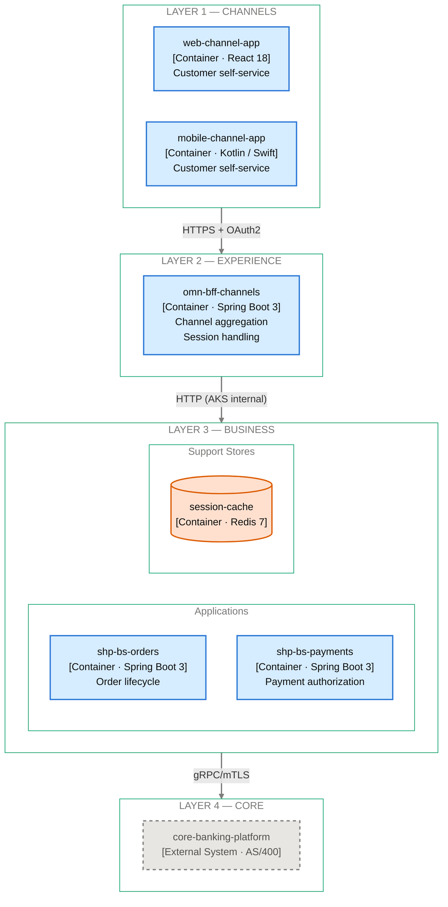
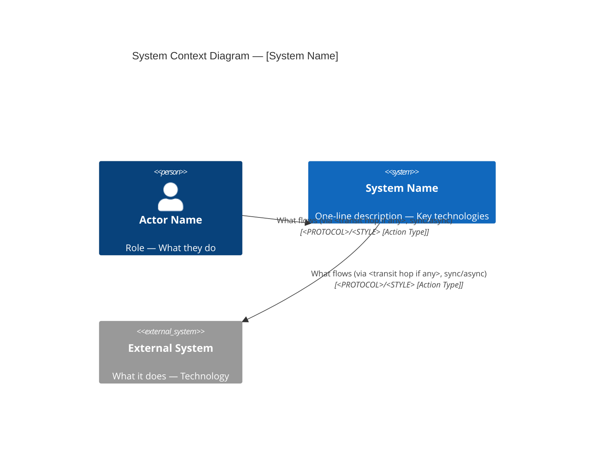
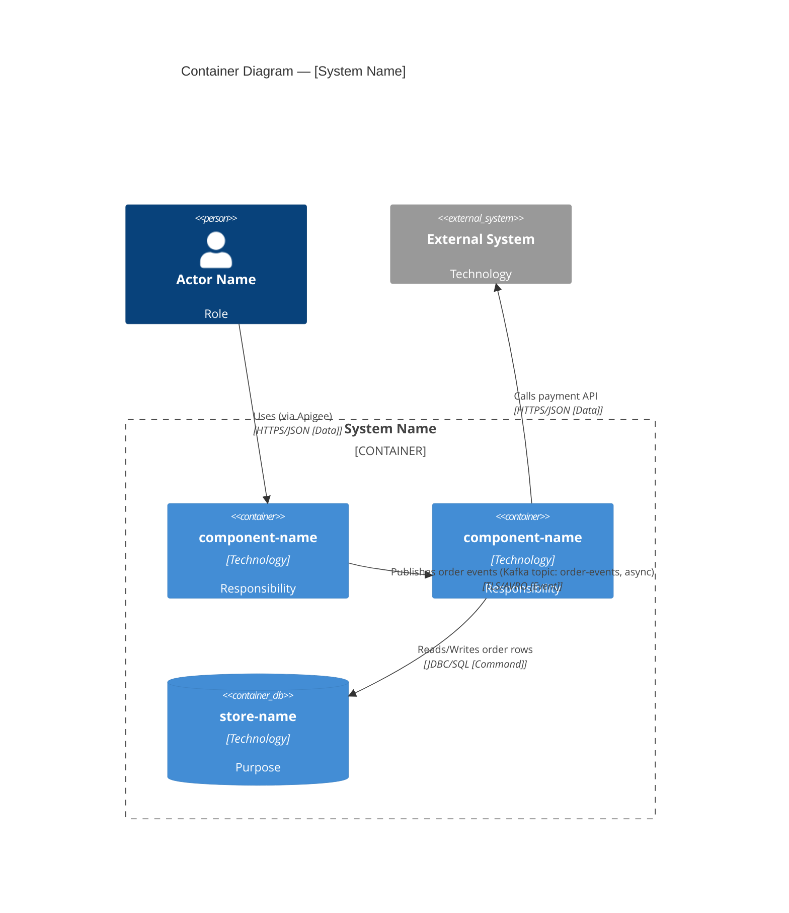
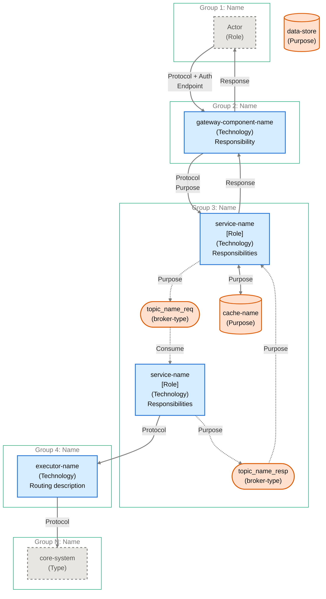
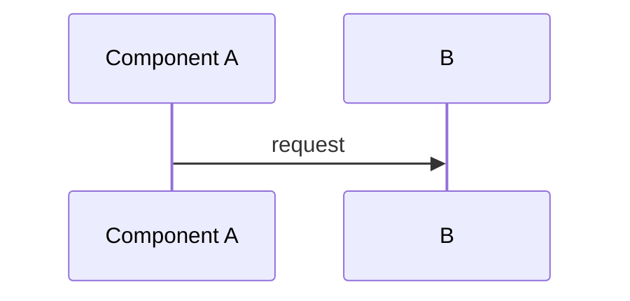
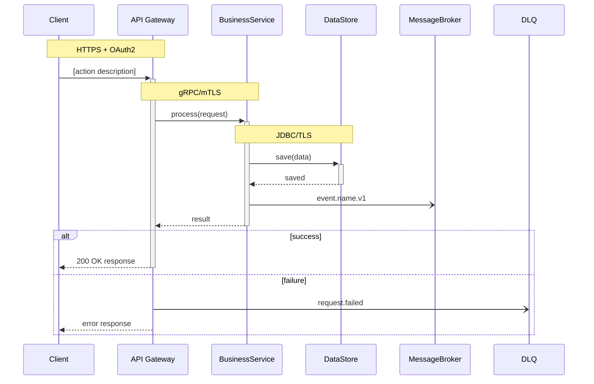

# Architecture Diagram Generation Guide

> **Load map.** Workflow 8 and Workflow 1 Step 7 read this guide whole. **A write that only adds or changes a connection label** on Diagram 2 / 3 / 4 — a Workflow 2 edit of one edge, a guardian regeneration, an ad-hoc "add X to the diagram" — reads two sections only: `## Design Language Governance` and `## Pre-Write Validation` (`rg -n \'^## \'` for the offsets). Everything else here is generation procedure that a label edit does not need.

> Reference for generating the 4 standard architecture diagrams in `docs/03-architecture-layers.md`.
> Each diagram serves a different audience and zoom level. Generate all 4 when creating or updating architecture documentation.
> Diagrams adapt their grouping and naming to the detected architecture type; Diagram 4 also adapts its colors.
> **All four are Mermaid.**

---

## Overview

| # | Diagram | Format | Audience | Shows |
|---|---------|--------|----------|-------|
| 1 | Logical View | Mermaid `flowchart TB` | Executives, architects | Layers/tiers/groups as `subgraph` bands with components inside, arrows between groups only |
| 2 | C4 Level 1 — System Context | Mermaid `C4Context` | Non-technical stakeholders | The system as a single box, external actors, external systems |
| 3 | C4 Level 2 — Container | Mermaid `C4Container` | Development teams | All containers inside the system boundary, grouped by C4 category (apps, stores, brokers), with protocols |
| 4 | Detailed View | Mermaid `graph TB` | Architects, SREs | Full component wiring with topic names, queue names, all async/sync flows |

**Ordering in the file**: Always place diagrams in this order (1→2→3→4) under a `## Architecture Diagrams` heading.

**Architecture type detection**: Read the `<!-- ARCHITECTURE_TYPE: ... -->` comment in `docs/03-architecture-layers.md` to determine the active type. All 4 diagrams adapt to this type.

**Format column caveat**: the formats above are the **fallback-mode** formats. When the SA Design Language Standard is bundled, governed mode changes Diagrams 2, 3 and 4 — see the next section.

---

## Design Language Governance (conditional — supersedes the per-diagram formats below)

**Trigger**: `[design_language_dir]/llms-mermaid.txt` exists → every Mermaid block this guide generates runs in **governed mode**. Absent → **fallback mode**: the per-diagram formats below apply exactly as written, and this section is inert.

In governed mode the SA Design Language Standard's Mermaid syntax contract (`llms-mermaid.txt`, rules `M-01`…`M-21`) governs the diagram blocks Workflow 8 writes into `docs/03-architecture-layers.md` and `docs/04-data-flow-patterns.md` — not only inline sketches. Where this guide's per-diagram formats disagree with the contract, **the contract wins**. What changes, per diagram:

| Diagram | Fallback format | Governed format |
|---|---|---|
| 1 — Logical View | `flowchart TB`, four-role palette | Unchanged in form; gains the §9 palette directive and the M-rules |
| 2 — C4 Level 1 System Context | `C4Context` | **`flowchart TB`** — Mermaid's `C4` type is excluded by the contract §1 ("Use `flowchart`") |
| 3 — C4 Level 2 Container | `C4Container` | **`flowchart TB`** — same exclusion |
| 4 — Detailed View | `graph TB` | **`flowchart TB`** — `M-01`: write `flowchart`, never `graph` |
| Data Flow | `sequenceDiagram` | `sequenceDiagram` **retained** — sanctioned by `M-01`'s named exception + §12 (see below) |

**Rules applying to every governed block:**

- **The §9 palette directive** — all seventeen `%%{init}%%` lines, **copied verbatim from `llms-mermaid.txt` §9**, first thing inside the fence, multi-line, straight ASCII apostrophes, never retyped and never transcribed from a `.docx` or PDF (`M-13`, §7). For flowchart blocks the four `classDef` lines follow and every node is assigned a class (`M-14`) — they are the same `zone` / `unit` / `store` / `ext` roles Diagrams 1 and 4 already carry.
- **The `M-12` comment line** sits between the directive and the type keyword. This plugin keeps no diagram register, so **never invent a Diagram ID**: write `%% Diagram ID: [NOT DOCUMENTED — assigned by the diagram register]` (brackets are safe in a comment; braces are not). When the project genuinely records a Diagram ID for the view, carry it instead.
- **Four shapes and no others** (`M-07`), quoting per `M-05`/`M-06`, spaced link operators (`M-08`), `-->` / `---` only (`M-10`), 200-character ceiling with a 160 target (`M-15`), two-space indentation (`M-21`).
- **Theme detection is retired for governed blocks.** The §9 directive is the palette on both backgrounds; do not read or write `<!-- DIAGRAM_THEME -->` for them, and do not ask the user. (Fallback mode keeps the Theme Preference Detection section below.)
- **`<br/>` is permitted** in governed flowchart labels (`M-17` — the only markup that is); the Pre-Write "HTML tags" row does not apply to it there.
- **Connection labels are governed by `llms-rules.txt` §5.3–§5.4** — the protocol normal form, the fifteen Action Types, the `Via` slot (§5.9), the data-scope forms and the three composition qualifiers. The Connection Naming Rule below carries those registries verbatim; the standard is the registry of record. The §10 self-check is syntactic and does not test vocabulary, so the **Connection Label Check** (Pre-Write Validation) runs on every Diagram 2 / 3 / 4 block in addition to it.
- **Pre-Write Validation additionally runs the `llms-mermaid.txt` §10 self-check (15 items) per block.** The check must pass before the write. Its one-line receipt is reported in the generation summary — **not** written into `docs/**`, where it would be meta-narration the Content Hygiene Gate forbids; the receipt-below-the-fence rule is a chat-surface device.

**Diagram 2 governed form** — a Context view in the standard notation: the system as a single `unit` node, actors and external systems as `ext` nodes, directed `-->` edges whose labels follow the connection normal form governed by `llms-rules.txt` §5, quoted per `M-05`; an edge gateway in front of the system is the edge's `· Via <name>`, never a node (§5.9). The heading stays `#### Diagram: C4 Level 1 — System Context` — the altitude is still C4 L1; only the notation changes.

**Diagram 3 governed form** — a Container view: the system boundary as a `subgraph` (classed `zone`), app containers as `unit`, data stores as `store` (cylinder `[( )]`), gateways, proxies, load balancers and message brokers per the Infrastructure-as-via Rule, named in the label's `· Via <name>` slot (§5.9) rather than the description, externals as `ext`, technology carried in the label via `<br/>`, protocols on every edge in the §5 normal form. Heading unchanged.

**Data Flow governed form** — `docs/04-data-flow-patterns.md` is **by design the sequence rendering** of each flow (this recorded decision is the standing answer to the contract's `B10a` question), so `sequenceDiagram` stays, under §12's contract:

- The §9 directive is pasted; **no `classDef`, no `class`, no `linkStyle`** — a sequence diagram ignores them silently, and the directive alone reaches the participant boxes.
- Operators are `->>` and `-->>` only. A returned value is `-->>` and carries **no step number** — it is the same interaction observed coming back.
- **The label is the step, not the protocol**: `<n>. <business-intent verb phrase>` from the initiator's view, with an optional `[CTRL: <control-id>]` before the phrase. **No protocol normal form and no Action Type on any data-flow diagram** — `HTTPS/JSON [Query]` names a mechanism the reader already sees on Diagram 3.
- **Forbidden: `Note`, `loop` / `alt` / `opt` / `par` blocks, activation bars, `rect` highlights** — their colours are not governed by the directive. What a Note or an `alt` branch would have said moves to the surrounding prose of the flow subsection (edge cases already have a home in the flow's own text).
- `participant <ID> as <Label>` lines, one per element, in the order they first act, using the identifiers the topology diagrams use.
- The Step 7.3 count gates (≥ `U` wire sequences plus a `**Hops**` line per phase in Phase Catalog mode; one per H3 flow in Single-Flow mode) apply unchanged — the block type is still `sequenceDiagram`.

**What governed mode does NOT change**: the four `#### Diagram:` headings (do-not-localize registry values, and the Step 7.3 gate keys on them), the 1→2→3→4 ordering, canonical file locations, the component-facts sourcing rule, Diagram 1's band-to-band edge form, the Diagram 4 subgraph-ID-arrow prohibition, and the "diagrams for undocumented flows are discarded" rule.

**Regeneration**: a governed run **replaces** a fallback-mode `C4Context` / `C4Container` / `graph TB` block under the same heading — never supplements it — the same replace-don't-supplement rule the v4.3.0 Logical View migration set. `architecture-icepanel-sync` Step 1.1 carries a governed-notation branch, so the sync does not depend on the C4 fences surviving.

---

## Component Facts

Every diagram needs the same four facts per component — canonical name, C4 type, technology,
slug. Load them once, before drawing anything:

```bash
bun [plugin_dir]/skills/architecture-component-guardian/utils/component-cli.ts list <project_root>
```

Each entry gives `name` (the canonical full name — use it verbatim, never abbreviated), `type`
(one of the 8 C4 L2 values), `technology[]`, `slug`, `system`, and `level` (`L1` descriptors are
excluded from container diagrams).

**Do not re-parse `docs/components/README.md` or the `**Type:**` field directly.** The component
file is the source of truth and the README is derived from it, so a hand-parse of the index can
disagree with the file it indexes. If the command is unavailable, fall back to the README index
and note the degradation.

---

## Architecture Type Adaptation

Diagrams 1 (Logical View) and 4 (Detailed View) use architecture-specific grouping. Diagrams 2 (C4 L1) and 3 (C4 L2) use pure C4 conventions — they do NOT group by architecture layers/tiers.

**Colour does not adapt at all.** Grouping and naming adapt to the architecture type; colour does not. Diagrams 1 and 4 share one fixed four-role palette (`zone` / `unit` / `store` / `ext`) on every type — see Diagram 1 § "Palette".

| Architecture Type | Grouping Strategy | Group Naming Pattern | Layer/Group Source |
|-------------------|-------------------|---------------------|--------------------|
| ENTERPRISE | 5 layers: Channels → Experience → Process → Domain Services → Systems of Record & Data (cross-cutting capabilities as one vertical group) | `LAYER N — NAME` | `docs/03-architecture-layers.md` layer summary table |
| BIAN | 5 layers matching BIAN v14.0.0 service landscape | `LAYER N — NAME` | `docs/03-architecture-layers.md` layer summary table |
| 3-TIER | 3 tiers: Presentation → Logic → Data | `TIER N — NAME` | `docs/03-architecture-layers.md` tier definitions |
| N-LAYER | Layers from architecture doc (varies: Domain, Application, Infrastructure, etc.) | `LAYER — NAME` | `docs/03-architecture-layers.md` layer definitions |
| MICROSERVICES | Functional groups: API Gateway, Services, Data Stores, Message Brokers | `GROUP — NAME` | `docs/03-architecture-layers.md` component groupings |

---

## Diagram 1 — Logical View (Mermaid)

**Purpose**: High-level logical view showing the architecture structure. Each layer/tier/group is a `subgraph` band containing its components. Arrows flow between groups only — no internal wiring (that is Diagram 4's job).

**Format**: Mermaid `flowchart TB` inside a ` ```mermaid ` fence.

**When to use**: All architecture types. For MICROSERVICES without layers, use functional groups (Gateway, Services, Stores, Brokers) as the bands.

### Regenerating an existing architecture

**Regeneration replaces, never merges.** When updating an architecture whose `#### Diagram: Logical View` still holds an ASCII block, delete the whole fenced block and write the Mermaid one in its place. Do not leave both. A leftover ASCII block under that heading is a DIAGRAMS_GATE failure (`ARCHITECTURE_TYPE_SELECTION_WORKFLOW.md` → Step 7.3, check D1). `.docx` export pre-renders Mermaid to PNG through an optional, auto-detected mermaid-cli and falls back to source where it is not installed — see `plugins/sa-delivery/skills/architecture-docs-export/SKILL.md` § Diagrams.

### Structure Rules

1. **One `subgraph` per group**: `subgraph L1["GROUP TITLE"]` — the id is short and stable (`L1`, `L2` … for layers; `T1`, `T2` … for tiers; `G1`, `G2` … for functional groups), the label is the uppercase group title per the Architecture Type Adaptation table
2. **Every component is a node inside exactly one group**: no component appears in two bands
3. **Inter-group edges connect subgraph ids, never nodes**: `L1 -->|"HTTPS + OAuth2"| L2`. A node-to-node edge in Diagram 1 is a scope violation — that level of detail belongs in Diagram 4
4. **Sub-groups**: a band with many components may nest **one** level (`subgraph L3A["Applications"]`). A nested id is never an edge endpoint — only the outer band id is
5. **Edge shapes**: `-->` for a synchronous runtime call, `-.-` (dotted, no arrowhead) for a conceptual / non-runtime relationship such as domain-model alignment
6. **Edge labels are free prose** — protocol plus network context (`HTTPS + OAuth2`, `HTTP (AKS internal)`, `gRPC/mTLS`). The Connection Naming Rule does **not** apply to Diagram 1 (see its Scope subsection)
7. **Every node and every subgraph carries a class** — `unit`, `store`, `ext`, or `zone`. An unclassed element falls back to the host theme and becomes unreadable on whichever background the reader is not using
8. **Legend**: a `**Legend:**` bullet list follows the fence and replaces the old ASCII legend — notation facts only: what the bands are, what a band-to-band edge means, what the four role classes denote

### Node Label Content

Each node label carries exactly these lines, separated by `\n` (never `<br/>` — see Mermaid Compatibility Rules):

1. **Line 1**: Component name — the **canonical full name** (`name` from `component-cli.ts list`), never abbreviated
2. **Line 2**: `[C4 Type]` or `[C4 Type · Technology]` — from `type` and `technology[]` in `component-cli.ts list`
3. **Lines 3+**: 1–3 key responsibilities (short phrases, not sentences)

Data stores use the cylinder shape `[("…")]`; everything else uses `["…"]`.

### Template



### Palette — assign by drawing role, and by nothing else

Diagram 1 uses the four-role palette below on **every** architecture type, and **Diagram 4 uses the identical palette** — this is the single colour policy for both topology diagrams, defined here and referenced from Diagram 4 § "Palette".

| Drawing role | Fill | Stroke | Text | class |
|---|---|---|---|---|
| Group band — any `subgraph` | **none** | `#019f68`, 1px | `#7a7977` | `zone` |
| Component in scope | `#d6ecff` | `#2a78d6`, 2px | `#0b0b0b` | `unit` |
| Data store in scope — the `[( )]` cylinder | `#ffe0cf` | `#dd5c00`, 2px | `#0b0b0b` | `store` |
| External / out-of-scope neighbour | `#e7e6e3` | `#7e7d7b`, 2px, dashed `5 5` | `#52514e` | `ext` |
| Connection line | — | `#7e7d7b`, 2px | — | `linkStyle default` |

Four rules govern it:

- **Bands carry no fill (`fill:none`), and that is load-bearing.** Mermaid paints cluster rectangles *after* it paints edges, so an opaque `subgraph` fill lands on top of every edge label drawn inside that band and washes it out; two nested bands of the same fill also erase their shared boundary. The aqua stroke carries the grouping role; the fill was carrying nothing but interference.
- **Colour is notation, not meaning.** Strip the colour and the diagram must say exactly what it said — that is the test. Never tint a node because it is critical, regulated, or in a particular trust zone. Red, amber and green never appear.
- **No hand-set colour on an individual node.** If a box needs to stand out, it needs a different role, not a different hex.
- **One palette serves both themes.** These values clear contrast floors against a light and a dark background alike, which is why Diagram 1 needs no dark-theme variant (see Theme Preference Detection).

The palette is adapted from the SA Design Language Standard companion `llms-HOWTO.md` §7.5 / rule `B11`. That rule is **informative only** — it binds inline chat sketches and cannot be cited in a conformance finding — so it is reproduced here as this plugin's own convention, not as a standard obligation. The `fill:none` mechanism above is a Mermaid rendering fact and holds independently.

### Layout Rules

- **Complexity budget**: 5–9 primary boxes per band. A band that needs more wants sub-groups (rule 4), or the architecture wants splitting
- **`direction` statements inside subgraphs are ignored** once subgraph-level edges are present — this is a known Mermaid constraint and the reason Diagram 1 does not use `direction LR`. Accept the default vertical stacking
- **Band order is top-to-bottom in call order**: caller above, callee below, so depth in the drawing means depth in the architecture

### Data Sources

| Element | Source File | Field |
|---------|-----------|-------|
| Group names (layers/tiers) | `docs/03-architecture-layers.md` | Layer/tier summary table |
| Components per group | `docs/03-architecture-layers.md` | Each group section → `**Components:**` |
| Component names, types, technologies | `component-cli.ts list` (see **Component Facts** below) | `name`, `type`, `technology[]` |
| Component responsibilities | `docs/components/**/*.md` | `## Responsibilities` section (pick top 2–3) |
| Protocols between groups | `docs/03-architecture-layers.md` | `**Communication Patterns:**` per group |

---

## Diagram 2 — C4 Level 1 System Context (Mermaid C4)

**Purpose**: Highest zoom level. Shows the system as a single box, who uses it, and what external systems it depends on.

**Format**: Mermaid `C4Context` — native C4 diagram type. **Fallback mode only** — in governed mode this diagram is `flowchart TB` per § Design Language Governance above.

### Structure Rules

1. **3–7 elements max**: 1 internal system, 1–3 external actors, 1–3 external systems
2. **No internal details**: The system is a single opaque box — no containers, no layers
3. **Actor labels**: Use `Person()` or `Person_Ext()` with role description in third parameter
4. **Relationship labels**: Use `Rel()` with description and protocol — e.g., `Rel(actor, system, "Submits payments", "HTTPS + OAuth2")`
5. **Phase 2 systems**: Add "(Phase 2)" suffix in the description parameter

### Template



The 3rd parameter (description) carries human prose: verb, data subject, via-hop, sync/async flag. The 4th parameter (protocol) follows the canonical normal form — see "Connection Naming Rule (L1 + L2)" in Diagram 3 below for the full rule, action-type vocabulary, and protocol/style table.

### Infrastructure-as-via Rule (L1)

At C4 L1 the system is a single opaque box. Infrastructure that **only forwards traffic** between an actor/system and the system boundary is NOT a separate `System_Ext()` — it collapses into the **3rd `Rel()` parameter (description)** as a `(via <hop>)` annotation. The 4th parameter remains the canonical `<PROTOCOL>/<STYLE> [Action Type]` normal form.

**Collapse to (via …) in description** (do NOT declare as `System_Ext()`):

- Edge gateways and APIM placed in front of the system (Apigee, Kong, AWS API Gateway, Azure APIM, Cloudflare API Gateway)
- iPaaS / ESB / integration platforms used purely for transit (Mulesoft, Boomi, Workato)
- Edge CDNs used for routing (Cloudflare, CloudFront, Akamai)
- Service mesh, load balancers, reverse proxies — always invisible at L1

**Keep as `System_Ext()`**:

- Any external system that owns business logic or persistent state — Stripe, SAP, Core Banking, SWIFT, Salesforce, vendor SaaS that the business depends on for an outcome
- Authoritative data sources / systems of record outside the boundary

**Edge encoding** (description in 3rd parameter, normal form in 4th parameter):

```
Rel(actor,  system, "Submits payments (via Apigee)",                "HTTPS/JSON [Data]")
Rel(system, stripe, "Processes payments (via Mulesoft)",            "HTTPS/JSON [Data]")
Rel(actor,  system, "Mobile API (via CloudFront → AWS APIGW)",      "HTTPS/JSON [Data]")
```

If two transit hops chain (CDN → APIM), join them with `→` inside the description's `(via …)` clause (fallback mode; the governed `Via` names one hop, below).

**Governed mode — the `Via` slot** (v1.0 RC5, `llms-rules.txt` §5.3, §5.9): the intermediary goes on the **label**, not the description — `· Via <name>` right after the protocol form, at most one per label: `HTTPS/JSON [Query] · Via apim`, `TLS/AVRO [Event] · Via ledger-broker · group ledger-consumers`. Name the **most specific inventoried intermediary** — the API defined on the gateway when it has its own CMDB record (`Via apim / API Order Ledger`, `RULING-002`), the specific one where a node holds several (`Via apim / payments-proxy`). A call through a chain (CDN → firewall → gateway → ingress) names only the intermediary that **enforces the contract**, normally the gateway API; the full chain is drawn only in the `-DEP-` view. A trust-zone crossing names its gateway this way (§5.7). The gateway becomes a node only at Deployment. `label-check.js` holds the slot to the registry.

### Color Conventions (C4 standard — built-in)

Native Mermaid C4 diagrams apply C4 color conventions automatically:

| Element | Function | Built-in Color |
|---------|----------|---------------|
| Person/Actor | `Person()` / `Person_Ext()` | Dark blue |
| Internal System | `System()` | Blue |
| External System | `System_Ext()` | Gray |

No `classDef` or manual styling is needed — the Mermaid C4 renderer handles colors.

### Architecture Type → C4 L1 Translation

| Architecture Type | What collapses into `System()` | What becomes `Person()` / `System_Ext()` |
|-------------------|----------------------------------------|-----------------------------------|
| ENTERPRISE | Layers 2–4 (Experience through Domain Services) | Layer 1 actors → `Person()`; Layer 5 packaged/SaaS/legacy systems of record → `System_Ext()` |
| BIAN | All BIAN service domains | External channels → `Person()`; Core banking/legacy → `System_Ext()` |
| 3-TIER | All 3 tiers (Presentation + Logic + Data) | External users → `Person()`; External integrations → `System_Ext()` |
| N-LAYER | All internal layers (UI through Infrastructure) | External users → `Person()`; External systems → `System_Ext()` |
| MICROSERVICES | All services + stores + brokers | External users/clients → `Person()`; External APIs/systems → `System_Ext()` |

### Data Sources

| Element | Source File |
|---------|-----------|
| System name + description | `ARCHITECTURE.md` top-level description |
| External actors | `docs/01-system-overview.md` → `**External Actor:**` or user/actor references |
| External systems | `docs/01-system-overview.md` → `**Internal Dependencies:**` (items marked external) |
| Protocols | `docs/05-integration-points.md` → external integrations section |

---

## Diagram 3 — C4 Level 2 Container (Mermaid C4)

**Purpose**: Zooms into the system boundary. Shows all deployable containers grouped by C4 category (apps/services, data stores, message brokers), with protocols on every arrow. This diagram uses pure C4 conventions — architecture-specific layers belong in Diagrams 1 and 4.

**Format**: Mermaid `C4Container` — native C4 diagram type. **Fallback mode only** — in governed mode this diagram is `flowchart TB` per § Design Language Governance above.

### Structure Rules

1. **System boundary**: Use `Container_Boundary()` to wrap all internal containers
2. **Pure C4 grouping**: Group containers by C4 element type — `Container()` for apps/services, `ContainerDb()` for databases. The element function itself provides visual differentiation (box vs cylinder). Do NOT group by architecture-specific layers/tiers — that belongs in Diagrams 1 and 4. **Transit infrastructure (APIM, brokers, topics, queues, service mesh, load balancers, iPaaS) collapses into edge labels — see "Infrastructure-as-via Rule (L2)" below.** `ContainerQueue()` is reserved for the rare case where an owned/custom broker IS the architectural unit (e.g. an in-house event store)
3. **External actor outside**: Declared before the boundary
4. **External systems outside**: Declared after the boundary
5. **Every relationship has a normalized protocol label**: The 4th parameter of `Rel()` MUST follow the canonical form `<PROTOCOL>/<STYLE> [Action Type]` — see "Connection Naming Rule (L1 + L2)" below. Examples: `"HTTPS/JSON [Data]"`, `"gRPC/PROTOBUF [Internal]"`, `"TLS/AVRO [Event]"`, `"JDBC/SQL [Query]"`. Do NOT put `via <hop>`, topic names, queue names, or sync/async flags in this field — they belong in the 3rd parameter (description).
6. **Sync vs async, via/topic context**: Place in the 3rd parameter — e.g., `"Publishes order events (Kafka topic: order-events, async)"`, `"Calls (via Kong)"`, `"Reads order (sync)"`. The 3rd parameter is human-prose; the 4th parameter is machine-readable transport.

### Template



### Infrastructure-as-via Rule (L2)

At C4 L2 the diagram answers "which deployable units talk to which". **Transit infrastructure** — components that forward a request or route a message without owning business state or logic — is collapsed into the edge label rather than declared as a node.

**Collapse to edge label** (do NOT declare as `Container()` or `ContainerQueue()`):

- API Gateway / APIM (Kong, Apigee, AWS API Gateway, Azure APIM, Tyk)
- Message brokers, topics, queues (Apache Kafka, RabbitMQ, AWS SQS, AWS SNS, AWS EventBridge, Azure Service Bus, ActiveMQ, NATS, Redis Streams used as a transport)
- Service mesh (Istio, Linkerd, Consul Connect, AWS App Mesh)
- Load balancers, reverse proxies, edge CDNs (NGINX-as-LB, HAProxy, ELB/ALB, CloudFront)
- iPaaS / ESB used purely for transit (Mulesoft, Boomi, Workato, MuleSoft Anypoint)

**Keep as nodes**:

- All `ContainerDb()` — databases and caches own state, never collapse them
- Application containers with business logic — BFFs, services, orchestrators, workers, schedulers
- External systems with their own logic/state — `System_Ext()`
- An owned/custom broker that IS the architectural unit (in-house event store, custom router) — exceptional use of `ContainerQueue()`

**Edge label encoding**: the 3rd `Rel()` parameter (description) carries the via-hop / topic / queue / async context for human readers; the 4th parameter (protocol) carries the canonical `<PROTOCOL>/<STYLE> [Action Type]` normal form (see "Connection Naming Rule (L1 + L2)" below).

| Pattern | Example |
|---------|---------|
| Sync via gateway | `Rel(client, service, "Calls (via Kong)", "HTTPS/JSON [Data]")` |
| Async via topic | `Rel(producer, consumer, "Publishes order events (Kafka topic: order-events, async)", "TLS/AVRO [Event]")` |
| Async via queue | `Rel(producer, consumer, "Settlement requests (RabbitMQ queue: settlements, async)", "AMQP/JSON [Event]")` |
| Multi-hop transit | `Rel(client, service, "Submits payment (via Apigee → AWS APIGW)", "HTTPS/JSON [Data]")` |

**Pub/sub fan-out**: draw one `Rel()` per producer-consumer pair. The topic name lives in the description (3rd parameter); the 4th parameter is the canonical normal form. Do not emit a broker node even when N consumers share a topic — the topic name on each edge is the join key.

```
Rel(orderSvc, paymentSvc,      "Order placed (Kafka topic: order-events, async)", "TLS/AVRO [Event]")
Rel(orderSvc, notificationSvc, "Order placed (Kafka topic: order-events, async)", "TLS/AVRO [Event]")
Rel(orderSvc, analyticsSvc,    "Order placed (Kafka topic: order-events, async)", "TLS/AVRO [Event]")
```

**Subscriber with no in-scope producer**: model the upstream as `System_Ext("event-source", "...")` and keep the topic on the edge label. Do NOT fall back to a broker node.

**Governed mode — the `Via` slot** (v1.0 RC5, `llms-rules.txt` §5.3, §5.9): the intermediary goes on the **label**, not the description — `· Via <name>` right after the protocol form, at most one per label: `HTTPS/JSON [Query] · Via apim`, `TLS/AVRO [Event] · Via ledger-broker · group ledger-consumers`. Name the **most specific inventoried intermediary** — the API defined on the gateway when it has its own CMDB record (`Via apim / API Order Ledger`, `RULING-002`), the specific one where a node holds several (`Via apim / payments-proxy`). A call through a chain (CDN → firewall → gateway → ingress) names only the intermediary that **enforces the contract**, normally the gateway API; the full chain is drawn only in the `-DEP-` view. A trust-zone crossing names its gateway this way (§5.7). The gateway becomes a node only at Deployment. `label-check.js` holds the slot to the registry.

**Why**: at L2 the audience asks "what talks to what" — every transit hop on the page costs them attention. Operational fidelity (every topic, queue, partition) lives in **Diagram 4 (Detailed View)** below, where brokers and topics ARE first-class nodes per Rule 3.

### Connection Naming Rule (L1 + L2)

Every connection label on Diagrams 2, 3 and 4 — the 4th `Rel()` parameter in fallback mode, the quoted edge label in governed mode — follows the **SA Design Language Standard's protocol normal form** (`llms-rules.txt` §5.3, registries §5.3–§5.4). This section carries that grammar and its registries **verbatim**, so the vocabulary is identical in both modes: when `[design_language_dir]/` is present the standard is the registry of record and this copy is informative; when it is absent this copy governs. Never widen it from memory in either mode.

```
<PROTOCOL>/<STYLE> [Action Type] · <data-scope qualifier> · <composition qualifier>
                                 └──── optional, at most one ────┘ └── optional, at most one ──┘
```

**The label grammar is closed** (§5.3): protocol normal form, then at most one data-scope qualifier, then at most one composition qualifier — **and nothing else**. Every token comes from a registry below. A token outside a registry is unregistered; it is what nightly check `C-11` reports against a named author, and it requires a vocabulary extension through the Architecture Governance Board (AGB) — say so and stop, never coin a plausible value.

#### Registries (closed — copied from `rules-registry.json`, the machine registry of `llms-rules.txt` §5.3 / §5.4 / §5.5)

| Slot | Registered values | Notes |
|---|---|---|
| **PROTOCOL** | `HTTPS` `gRPC` `TLS` `JDBC` `TCP` `AMQP` `WSS` `SFTP` `GraphQL` `PGWIRE` | the ten of §5.3. Case is part of the token: `gRPC`, `GraphQL`. `GraphQL` is a PROTOCOL — `GraphQL/JSON [Query]` for a read, `[Command]` for a mutation, one endpoint one connection; a subscription is `WSS/JSON [Stream]`. `PGWIRE` is any arrow to a PostgreSQL server (`PGWIRE/SQL`); `JDBC` stays for other relational engines |
| **STYLE** | `JSON` `PROTOBUF` `AVRO` `SQL` `RESP` `BSON` `CSVC` `ESM` `ISO20022` `ISO8583` | the ten of §5.3. **Omitted** when the connection carries no distinct payload serialization — control-plane, config, policy pull — leaving `<PROTOCOL> [Action Type]`, e.g. `HTTPS [Config]` |
| **[Action Type]** | the **15** in the table below | exactly one per arrow, chosen by dominant purpose |
| **Data-scope qualifier** | `schema <name> (tables…)` · `keyspace <prefix>:*` · `collection <name>` · `bucket/<prefix>` · `index <name>` · `group <consumer-group>` | one form per store kind (table below). **Required** when a store is shared by more than one consumer; recommended otherwise |
| **Composition qualifier** | `· loads` · `· publish` · `· served from` | **three values and no others** |

**Not registered — do not write**: the twelve tokens the standard's §5.4 *Typical* column and §5.5 only illustrate — `KAFKA`, `HTTP`, `LDAPS`, `SMTP` as a PROTOCOL; `CSV`, `BINARY`, `OAuth`, `SAML`, `LDAP`, `MIME`, `OTLP`, `HTML` as a STYLE (RFC-011's standing reservation; a Kafka edge is `TLS/AVRO`, a file drop `SFTP/CSVC`, an edge with no registered serialization drops the STYLE — `HTTPS [File]`; an SMTP or LDAPS edge has no registered token and needs an AGB vocabulary extension); `REST`, `GRAPHQL`, `SOAP`, `XML`, `MSGPACK`, `FORM`, `MULTIPART`, `PLAIN`, `CBOR` as a STYLE; `MQTT`, `UDP`, `MQ/JMS`, `Kafka` (lowercase) as a PROTOCOL; `[Sync]`, `[Async]`, `[Write]`, `[Storage]` as an Action Type; `· subscribe`, `· persist`, `· consume`, `· write`, `· read`, `· calls` or any other coined composition qualifier. A REST API over HTTPS carrying JSON is `HTTPS/JSON`; a GraphQL API is `GraphQL/JSON`. A pre-v6.10.1 diagram carrying `[Write]` or `[Storage]` is regenerated **token for token** — only the Action Type changes and the protocol form stays: `JDBC/SQL [Write]` → `JDBC/SQL [Command]`, `HTTPS/JSON [Write]` → `HTTPS/JSON [Command]`, `TCP/BINARY [Write]` → `TCP/BSON [Command]`, `HTTPS/BINARY [Storage]` → `HTTPS [File]` (the STYLE goes too — `BINARY` is not registered). **An Action Type is never a label on its own**: a bare `[Command]` fails the Connection Label Check exactly as a bare `HTTPS` does, because the expression begins at `<PROTOCOL>`.

#### Action-Type Registry (§5.4 — the fifteen registered values)

| `[Action Type]` | Nature | Typical `PROTOCOL/STYLE` (registered tokens only) | Boundary rule |
|---|---|---|---|
| `[Data]` | data transfer / record sync | `HTTPS/JSON`, `TLS/AVRO` | cross-boundary → governed API |
| `[Query]` | synchronous **read** | `JDBC/SQL`, `PGWIRE/SQL`, `HTTPS/JSON`, `gRPC/PROTOBUF`, `GraphQL/JSON` | to an owned store/service |
| `[Event]` | async pub/sub domain event | `TLS/AVRO`, `AMQP/JSON`, `TLS/PROTOBUF` | decoupled, via Message Management |
| `[Internal]` | in-boundary service-to-service call | `gRPC/PROTOBUF`, `HTTPS/JSON` | **only within** a system/boundary — never to a `System_Ext` / `ext` node |
| `[Cache]` | cache read/write | `TCP/RESP` | to an owned cache |
| `[Command]` | synchronous **write / mutation** | `HTTPS/JSON`, `gRPC/PROTOBUF`, `GraphQL/JSON`, `JDBC/SQL`, `PGWIRE/SQL` | cross-boundary → governed API |
| `[Stream]` | continuous / real-time channel | `WSS/JSON`, `TLS/AVRO`, `gRPC/PROTOBUF` | governed pipe |
| `[File]` | file / bulk transfer | `SFTP/CSVC`, `HTTPS` | external → encrypted (SFTP/mTLS) |
| `[Batch]` | scheduled batch / ETL | `JDBC/SQL`, `PGWIRE/SQL`, `SFTP/CSVC` | governed job |
| `[Auth]` | authentication / authorization | `HTTPS/JSON`, `HTTPS` | to a security CI |
| `[Notification]` | outbound notify (email/SMS/push) | `HTTPS/JSON` (SMTP is not registered) | via Channels / Message Management |
| `[Replication]` | data / DB replication | `TLS`, `JDBC/SQL`, `PGWIRE/SQL` | intra-trust-zone |
| `[Telemetry]` | logs / metrics / traces | `HTTPS/JSON`, `gRPC/PROTOBUF` | to observability |
| `[Transaction]` | monetary / settlement flow | `TLS/ISO20022`, `TLS/AVRO` | **must** pass Operations; encrypted, cert-governed |
| `[Config]` | configuration / secrets fetch | `HTTPS/JSON`, `HTTPS`, `TLS` | to Config/Secrets |

Sync-vs-async is expressed by the choice — `[Query]` / `[Command]` synchronous, `[Event]` / `[Stream]` asynchronous — so there is no `[Sync]` and no `[Async]`. A database read is `[Query]`; a database write is `[Command]`; object-storage upload or download is `[File]` (or `[Data] · bucket/<prefix>` when the bucket is a shared record store rather than a file drop).

#### Data-Scope Qualifier (§5.3 — one form per store kind)

| Store kind | Form | Example |
|---|---|---|
| Relational | `schema <name> (tables…)` | `JDBC/SQL [Query] · schema orders (orders, order_items)` |
| Key-value | `keyspace <prefix>:*` | `TCP/RESP [Cache] · keyspace orders:*` |
| Document | `collection <name>` | `TCP/BSON [Query] · collection profiles` |
| Object storage | `bucket/<prefix>` | `HTTPS/JSON [Data] · bucket statements/` |
| Search | `index <name>` | `HTTPS/JSON [Query] · index products` |
| Messaging (consume side) | `group <consumer-group>` | `TLS/AVRO [Event] · group payments` |

#### Composition Qualifier (§5.3 — closed set of three)

| Qualifier | Meaning | Example |
|---|---|---|
| `· loads` | runtime composition — a shell app mounting a micro-frontend | `HTTPS/ESM [Internal] · loads` |
| `· publish` | the **produce** edge to a topic / queue | `TLS/AVRO [Event] · publish` |
| `· served from` | asset delivery — the artifact is fetched from the static host that publishes it | `HTTPS [Data] · served from` |

**Messaging, both sides** (§5.3): the topic or queue is the channel node (Diagram 4) or the `(via …)` / `(Kafka topic: …)` description (Diagrams 2–3), never a data-scope. The **produce** edge carries `· publish`. The **consume** edge carries **no composition qualifier** — its only admissible qualifier is the data-scope `· group <consumer-group>`, and only when the real consumer-group name is documented. A consumer that polls still receives the arrow: the corpus draws data flow, not connection initiation. Both qualifiers appear only where the topic **is a node** — Diagram 4, or a broker that is itself a modelled container; where the Infrastructure-as-via Rule collapses the topic into the description (Diagrams 2–3), the producer → consumer edge carries the bare `TLS/AVRO [Event]`. A **write into a store** is an Action Type (`[Command]`, `[Replication]`, `[Cache]`) plus an optional data-scope qualifier — never a coined `· persist`.

**Risk attributes are never label text** (§5.3, §6.4): data classification, authentication mechanism, cross-border status and failover role are tags, and in this plugin they live in `docs/07-security-architecture.md`. `HTTPS/JSON [Query] · Confidential · mTLS` is a rejected label.

In fallback mode the 3rd `Rel()` parameter (description) carries human prose: the verb, the data subject, the via-hop, the topic / queue name, and the sync/async flag.

#### Anti-Pollution Framing — Why the Rule Has This Shape

The Connection Naming Rule and the [Infrastructure-as-via Rule (L1)](#infrastructure-as-via-rule-l1) / [(L2)](#infrastructure-as-via-rule-l2) are two anti-pollution primitives that work together to keep L1, L2, and Diagram 4 readable as the architecture grows. They are not stylistic preferences — they are **typing constraints** on the diagram's information density.

| Primitive | Constrains | Mechanism |
|---|---|---|
| `<PROTOCOL>/<STYLE> [Action Type]` on the 4th `Rel()` parameter / arrow label | **Edge pollution** between any pair of containers | The closed `[Action Type]` registry acts as a typing system. Operations between the same pair of containers that share the same protocol/style AND action type collapse into one edge. |
| `(via <hop>)` in the 3rd `Rel()` parameter (description) | **Node pollution** at the L1 / L2 layer | Transit infrastructure (APIM gateways, brokers, topics, queues, service meshes, load balancers, iPaaS) that only forwards traffic collapses into the description as `(via Kong)`, `(via Apigee → AWS APIGW)` — it does NOT become a separate `Container()` / `ContainerQueue()` / `System_Ext()` node. |

##### Uniqueness Constraint — One Edge per (A → B, [Action Type]) Tuple

For every ordered pair of containers `(A, B)` and every action type `T`, there is **at most one edge `A → B` carrying `[T]`**. If A calls B for customer records, order records, and product records — all over the same `HTTPS/JSON` and all `[Data]` — that collapses into one edge `A -- "HTTPS/JSON [Data]" --> B`. Multiple parallel edges of the same action type between the same pair are a rule violation.

The constraint admits two edges between A and B if and only if they carry different action types. Example:

```
SVC_A -- "HTTPS/JSON [Data]"   --> SVC_B    %% sync data path
SVC_A -. "TLS/AVRO [Event]"   .-> SVC_B    %% async event path
```

This is two distinct edges because `[Data]` ≠ `[Event]` — different bucket, different edge. But `SVC_A -- "HTTPS/JSON [Data]" --> SVC_B` and a second `SVC_A -- "HTTPS/JSON [Data]" --> SVC_B` (one labeled "Customer", another "Order") is one edge, not two.

##### What Does NOT Belong on the Edge

The edge label is the canonical form — nothing else. The 3rd `Rel()` parameter is short prose with the carve-outs above (verb, via-hop, topic/queue name, sync/async flag) and nothing more. Everything below pollutes the diagram and belongs elsewhere:

| Pollutant | Canonical home |
|---|---|
| Timeouts, retry policy, exponential-backoff windows, circuit-breaker thresholds | `docs/04-data-flow-patterns.md` (per-flow `sequenceDiagram` + prose) |
| Error codes, status codes, failure paths, idempotency keys, ordering guarantees, at-least-once / exactly-once semantics | `docs/04-data-flow-patterns.md` |
| HTTP method + path + status code rows (e.g. `POST /customers/{id} 200 OK`) | `docs/04-data-flow-patterns.md` (operation rows in the section preface table) |
| Event-type sequences (e.g. `STARTED → COMPLETED → FAILED`), partition counts, retention windows | `docs/04-data-flow-patterns.md` and/or encoded in the topic *node* label, not the edge. A consumer-group name is the one exception — it is the registered `· group <name>` data-scope qualifier |
| Sequence step numbers, decision branches, fan-out lists | `docs/04-data-flow-patterns.md` `sequenceDiagram` blocks |
| Authentication mechanism (mTLS, OAuth 2.0 + JWT, API Key, SASL/SCRAM), TLS version, certificate authority, data classification, cross-border status | `docs/07-security-architecture.md` — risk attributes are tags, never label text |
| Multi-line `<br/>` content in the edge label | Forbidden — the edge label is one line of the canonical form |

When generating, authoring, or reviewing diagrams: if a fact you want to put on an edge isn't the protocol normal form, a registered qualifier, or `(via <hop>)`, find its row in this table and write it there instead. The L1 / L2 / Diagram 4 view answers "**who** talks to whom, **over what protocol**, with **what data class**, **through which transit hops**" — the data-flow file answers "**in what order**, with **what guarantees**, and **what happens on failure**"; the security file answers "**under what trust assumptions**."

#### Scope (ENFORCED — read before applying)

This rule applies to, and ONLY to:

- **Diagram 2 — C4 L1 System Context** (`C4Context` block in fallback mode, `flowchart TB` in governed mode) — every `Rel()` 4th parameter / every edge label
- **Diagram 3 — C4 L2 Container** (`C4Container` / `flowchart TB`) — every `Rel()` 4th parameter / every edge label
- **Diagram 4 — Detailed View** (`graph TB` / `flowchart TB`) — every labeled edge (`A -- "..." --> B`, `A -. "..." .-> B`, `A -->|"..."| B`)

This rule does **NOT** apply to:

- **Diagram 1 — Logical View** (`flowchart TB`) — labels are free prose. Its edges join *bands*, not components, so there is no single protocol/style pair to normalize: `L2 -->|"HTTP (AKS internal)"| L3` is correct as-is and must NOT be rewritten to `L2 -->|"HTTPS/JSON [Data]"| L3`. Being Mermaid does not put a diagram in scope — the scope test is the diagram's *level*, not its notation
- **Data Flow / Sequence Diagrams** (`sequenceDiagram` blocks in `docs/04-data-flow-patterns.md`) — message labels (`A->>B: ...`, `A-->>B: ...`, `A-)B: ...`) are **free prose** describing what flows step-by-step. Do NOT append `[Action Type]` tags, do NOT enforce `<PROTOCOL>/<STYLE>` casing, do NOT reject a label because it lacks the normal form. Sequence-diagram labels are scoped by Pre-Write Validation only (no `<br/>` / HTML tags, no `;` in message text, no emoji)
- **Notation inside element labels** — `Container("name", "technology", "description")` is element metadata, not a connection — Connection Naming Rule does not apply

When generating, auditing, or reviewing diagrams, check the diagram **type** first; apply the rule only if the diagram is L1, L2, or Diagram 4. A sequence-diagram message reading `Frontend->>BFF: GET /orders` is correct as-is — do not rewrite it to `Frontend->>BFF: GET /orders [Data]` or `Frontend->>BFF: HTTPS/JSON [Data]`.

**The rule binds every write, not only a Workflow 8 run.** A Workflow 2 edit that adds or changes one edge, a component-guardian regeneration, or an ad-hoc "add X to the diagram" request each go through the same Connection Label Check (Pre-Write Validation below) before the block is written. The existing labels in the file are evidence of the *form*, never a registry: `· publish` on one edge licenses `· publish` on another produce edge, not a coined `· subscribe` on the consume edge.

#### Worked Examples

```
Rel(client,    service,  "Calls (via Kong)",                                   "HTTPS/JSON [Data]")
Rel(web,       bff,      "Submits orders (GraphQL)",                           "GraphQL/JSON [Command]")
Rel(svc_a,     svc_b,    "Internal call",                                      "HTTPS/JSON [Internal]")
Rel(svc_a,     svc_b,    "Service-to-service",                                 "gRPC/PROTOBUF [Internal]")
Rel(prod,      cons,     "Order events (Kafka topic: orders, async)",          "TLS/AVRO [Event]")
Rel(svc,       redis,    "Session lookup",                                     "TCP/RESP [Cache] · keyspace session:*")
Rel(svc,       db,       "Order read",                                         "JDBC/SQL [Query] · schema orders (orders, order_items)")
Rel(svc,       db,       "Order write",                                        "JDBC/SQL [Command]")
Rel(svc,       s3,       "Document upload",                                    "HTTPS [File]")
Rel(bff,       iam,      "Token validation",                                   "HTTPS/JSON [Auth]")
Rel(client,    ws_svc,   "Live updates",                                       "WSS/JSON [Stream]")
Rel(svc,       otel,     "Span export",                                        "gRPC/PROTOBUF [Telemetry]")
Rel(shell,     mfe,      "Mounts remote",                                      "HTTPS/ESM [Internal] · loads")
Rel(svc,       vault,    "Secrets fetch",                                      "HTTPS [Config]")
```

**Diagram 4 (Detailed View)** uses the same form on its arrow labels — `graph TB` in fallback mode (the entire label is one string after `--`), pipe form `-->|"…"|` in governed mode (`M-09`):

```
SVC_A -- "HTTPS/JSON [Data]" --> SVC_B
PROD -. "TLS/AVRO [Event] · publish" .-> TOPIC
TOPIC -. "TLS/AVRO [Event] · group payments" .-> CONS
```

Anti-patterns the rule rejects:

- `"REST/HTTPS"` — wrong order and `REST` is not a STYLE; protocol is HTTPS, payload is JSON → `"HTTPS/JSON [Data]"` or `"HTTPS/JSON [Internal]"`
- `"Kafka async"` — missing style and action → `"TLS/AVRO [Event]"` (with topic + async in description)
- `"HTTPS via Kong"` — via belongs in description → 3rd param `"... (via Kong)"`, 4th param `"HTTPS/JSON [Data]"`
- `"Kafka topic: order-events"` — topic belongs in description → 3rd param `"... (Kafka topic: order-events, async)"`, 4th param `"TLS/AVRO [Event]"`
- `"HTTPS"` — no style, no action → `"HTTPS/JSON [Data]"` (or whatever fits); bare `<PROTOCOL>` without an Action Type is never a label, even where STYLE is legitimately omitted
- `"HTTPS/json [data]"` — wrong casing → registered casing, `HTTPS/JSON [Data]`
- `"JDBC/SQL [Write]"`, `"HTTPS/BINARY [Storage]"`, `"TLS/AVRO [Async]"` — retired or never-registered Action Types → `[Command]`, `[File]`, `[Event]`
- `"TLS/AVRO [Event] · subscribe"`, `"TCP [Replication] · persist"` — coined composition qualifiers → `"TLS/AVRO [Event]"` (optionally `· group <name>`), `"TCP [Replication]"`
- `"HTTPS/JSON [Query] · Confidential · mTLS · cross-border"` — risk attributes in the label → `"HTTPS/JSON [Query]"`; the attributes go to `docs/07-security-architecture.md`
- `"JDBC/SQL [Query] · schema orders · keyspace x:*"` — two data-scope qualifiers → at most one

### Color Conventions (C4 standard — built-in)

Native Mermaid C4 diagrams apply consistent styling automatically:

| Element | Function | Built-in Appearance |
|---------|----------|-------------------|
| External actor | `Person()` | Dark blue box with person icon |
| Application containers | `Container()` | Blue box |
| Database containers | `ContainerDb()` | Blue cylinder |
| Queue/broker containers | `ContainerQueue()` | Blue queue shape — exceptional use only (owned/custom broker that IS the architectural unit). Default: collapse brokers/topics/queues to edge labels per Infrastructure-as-via Rule (L2). |
| External systems | `System_Ext()` | Gray box |
| System boundary | `Container_Boundary()` | Dashed border |

**Custom styling** (optional): Use `UpdateElementStyle()` to differentiate container categories by color if needed — e.g., green for stores, gray for gateways.

### Data Sources

| Element | Source File |
|---------|-----------|
| All containers | `component-cli.ts list` → entries with `level: L2` |
| Container details | `type` and `technology[]` from the same call; Purpose and APIs from `docs/components/**/*.md` |
| Protocols | `docs/05-integration-points.md` → all integration entries |
| Async topics/queues | `docs/05-integration-points.md` → internal integrations section |
| Group structure | `docs/03-architecture-layers.md` → layer/tier summary table |

---

## Diagram 4 — Detailed View (Mermaid)

**Purpose**: Full wiring diagram showing every component, topic name, queue name, and flow. The most detailed diagram — used by architects and SREs for operational understanding.

**Format**: Mermaid `graph TB`. **Fallback mode only** — in governed mode the keyword is `flowchart TB` (`M-01`: never `graph`); everything else in this section applies unchanged.

### Structure Rules

1. **One subgraph per architectural group**: Named per Architecture Type Adaptation table (layer, tier, or functional group)
2. **Every component inside its group subgraph**: Using full technical names
3. **Message broker topics as separate nodes**: Show actual topic/queue names
4. **Solid arrows** for sync, **dashed arrows** for async
5. **Arrow labels**: Include protocol AND purpose (e.g., `"Publish validated\nISO 20022 XML"`)
6. **Domain alignment** (if applicable): Dotted lines from domain model to implementing containers
7. **Standalone data stores**: If a data store serves multiple groups, place it outside subgraphs
8. **Every node and every subgraph carries a class** — `unit`, `store`, `ext`, or `zone`, per the Palette section below. An unclassed element inherits the host theme and becomes unreadable on one of the two backgrounds
9. **Shape distinguishes data holders**: cylinder `[( )]` for stores and caches, stadium `([ ])` for broker topics and queues — both take the `store` class

### Template



### Palette — the same four drawing roles as Diagram 1

**Diagram 4 uses the identical `zone` / `unit` / `store` / `ext` palette defined in Diagram 1 § "Palette", on every architecture type.** The per-type palettes that tinted by layer role (channel blue, business green, core red, messaging purple, and their four dark-mode variants) are not used — do not reintroduce them, and do not carry them forward when regenerating an older diagram.

| Drawing role | Fill | Stroke | Text | class |
|---|---|---|---|---|
| Group band — any `subgraph` | **none** | `#019f68`, 1px | `#7a7977` | `zone` |
| Component in scope — service, gateway, worker, executor, BFF, app | `#d6ecff` | `#2a78d6`, 2px | `#0b0b0b` | `unit` |
| Data holder in scope — data store, cache, broker topic, queue | `#ffe0cf` | `#dd5c00`, 2px | `#0b0b0b` | `store` |
| Actor / person, external system, out-of-scope neighbour | `#e7e6e3` | `#7e7d7b`, 2px, dashed `5 5` | `#52514e` | `ext` |
| Connection line | — | `#7e7d7b`, 2px | — | `linkStyle default` |

**Why layer-role tinting was retired.** Colour was doing a job the drawing already did. Every component in Diagram 4 already sits inside its layer's `subgraph` band, so the band states the layer and the fill only restated it — until the two disagreed, which is the failure mode a duplicated signal always has. Assigning fill by *what a box is* instead of *where it sits* removes the duplication and leaves each signal with one carrier: the band says which layer, the fill says which kind of thing, the shape and the edge say the rest. The test is the one from Diagram 1: strip the colour and the diagram must say exactly what it said. Under the old palette it did not — the layering vanished with the fills. Under this one it does, because the bands survive greyscale.

This also settles a standing tension. Layer-role tinting is colour-as-meaning, the pattern the SA Design Language Standard grades `[Required]` against at Point 6 §3.7. The standard binds IcePanel views rather than this plugin's Markdown, so the old palette was never a conformance violation — but it meant the two most detailed diagrams in the corpus taught opposite habits to the same reader. They now teach one.

**Shape carries what the fourth hue would have.** Three hues is a ceiling, not a starting point, so `store` covers both data stores and broker topics and the distinction moves to node shape:

| Node kind | Shape | class |
|---|---|---|
| Data store / database / cache | `[("name\n(Purpose)")]` cylinder | `store` |
| Broker topic / queue | `(["topic_name\n(broker-type)"])` stadium | `store` |
| Everything else in scope | `["name\n(Technology)"]` rectangle | `unit` |
| Actor, external system | `["name\n(Role)"]` rectangle, dashed via `ext` | `ext` |

Four rules carry over from Diagram 1 unchanged, and they are the whole of the policy:

- **Bands carry no fill (`fill:none`).** Mermaid paints cluster rectangles after edges, so an opaque band fill washes out every edge label inside it — and Diagram 4 is the worst case in the corpus, because it is the diagram with the most labelled edges running inside bands.
- **Colour is notation, not meaning.** Never tint a node because it is critical, regulated, hot-path, or in a particular trust zone. Red, amber and green never appear.
- **No hand-set colour on an individual node.** A box that needs to stand out needs a different role, not a different hex.
- **One palette serves both themes** — see below.

#### Dark theme

**Diagram 4 has no dark-mode variant.** The four values above clear contrast floors against a light and a dark background alike. Emit the same `classDef` block regardless of `<!-- DIAGRAM_THEME: ... -->`. Theme detection governs Diagrams 2 and 3 and the sequence diagrams, which take the `%%{init: {'theme': 'dark'}}%%` block — not Diagrams 1 or 4.

#### classDef block to emit

```
    classDef zone  fill:none,stroke:#019f68,stroke-width:1px,color:#7a7977
    classDef unit  fill:#d6ecff,stroke:#2a78d6,stroke-width:2px,color:#0b0b0b
    classDef store fill:#ffe0cf,stroke:#dd5c00,stroke-width:2px,color:#0b0b0b
    classDef ext   fill:#e7e6e3,stroke:#7e7d7b,stroke-width:2px,stroke-dasharray:5 5,color:#52514e
    class <every subgraph id> zone
    class <every in-scope component> unit
    class <every store, cache, topic, queue> store
    class <every actor and external system> ext
    linkStyle default stroke:#7e7d7b,stroke-width:2px
```

Every node and every `subgraph` must appear in exactly one `class` line. An unclassed element falls back to the host theme and goes unreadable on whichever background the reader is not using.

### Data Sources

| Element | Source File |
|---------|-----------|
| All components + types | `component-cli.ts list` → `name`, `type` |
| Component responsibilities | `docs/components/**/*.md` → Responsibilities, Purpose |
| Topic/queue names | `docs/05-integration-points.md` → internal integrations section |
| Full flow wiring | `docs/04-data-flow-patterns.md` → all flow sections |
| Domain model (if applicable) | `docs/03-architecture-layers.md` → Domain layer/section |
| Protocols per integration | `docs/05-integration-points.md` |

---

## Data Flow Diagrams — Sequence Diagrams

**Purpose**: Per-flow sequence diagrams showing step-by-step interactions between components for each documented data flow. Phase Catalog mode: one full wire sequence per use case (mandatory) and a per-phase diagram only where the phase's Purpose line justifies it; Single-Flow mode: one diagram per H3 flow subsection in `docs/04-data-flow-patterns.md`.

**Format**: Mermaid `sequenceDiagram` — in both modes. In governed mode §12 of `llms-mermaid.txt` constrains it (numbered business-intent step labels, no protocol/Action Type, no `Note`/`loop`/`alt`/`opt`/`par`/activation/`rect`, §9 directive, no `classDef`) — see § Design Language Governance above; the template below is the fallback form.



**Placement**: Insert each diagram **immediately after its corresponding H3 subsection** in `docs/04-data-flow-patterns.md`, with heading `#### Diagram: [Flow Name] Sequence`.

### Syntax Reference

#### Message Types

| Type | Syntax | Use For |
|------|--------|---------|
| Sync request | `A->>B: description` | REST, gRPC, JDBC calls (solid arrow) |
| Sync response | `B-->>A: description` | Return values, acknowledgements (dashed arrow) |
| Async (fire-and-forget) | `A-)B: description` | Kafka publish, queue push, event emit (open arrow) |
| Participant declaration | `participant Alias as Full Name` | Declare and alias participants |
| Activation | `activate A` / `deactivate A` | Show processing scope (or use `+`/`-` on arrows) |
| Note | `Note over A,B: text` | Protocol annotations, context notes |
| Note (single) | `Note right of A: text` | Side annotations for a single participant |

#### Control Flow

| Construct | Syntax | Use For |
|-----------|--------|---------|
| Conditional | `alt condition` ... `else condition` ... `end` | Branching logic (success/failure paths) |
| Optional | `opt condition` ... `end` | Optional execution path |
| Loop | `loop condition` ... `end` | Retry loops, polling, batch processing |
| Parallel | `par description` ... `and description` ... `end` | Concurrent operations (fan-out) |
| Critical | `critical description` ... `option fallback` ... `end` | Critical sections with fallback |
| Break | `break condition` ... `end` | Early exit from a flow |

### Architecture Conventions

1. **Participant naming**: Use component technical names (`name` from `component-cli.ts list`) with aliases for readability — e.g., `participant APIGW as API Gateway`, `participant PS as PaymentService`
2. **Sync calls with protocols**: Use `Note over` to annotate protocol context:
   ```
   Note over Client,APIGW: HTTPS + OAuth2
   Client->>+APIGW: POST /payments
   APIGW->>+AuthService: validateToken()
   AuthService-->>-APIGW: token valid
   ```
3. **Async events**: Use open-arrow syntax with topic/queue name:
   ```
   PS-)Kafka: payment.completed.v1
   Kafka-)NS: consume(payment.completed.v1)
   ```
4. **Error paths**: Use `alt` for success/failure branching:
   ```
   alt success
       PS-->>APIGW: 200 OK {payment_id}
   else failure
       PS-)DLQ: payment.failed
       PS-->>APIGW: 500 Error
   end
   ```
5. **Parallel processing**: Use `par` for concurrent fan-out:
   ```
   par Send email
       NS->>EmailService: sendEmail()
   and Send SMS
       NS->>SMSService: sendSMS()
   end
   ```
6. **Activation bars**: Use `+`/`-` on arrows to show processing scope:
   ```
   Client->>+APIGW: submitPayment()
   APIGW->>+PS: process()
   PS->>+Bank: transfer()
   Bank-->>-PS: status
   PS-->>-APIGW: result
   APIGW-->>-Client: response
   ```

### Template



### Data Sources

| Element | Source File |
|---------|-----------|
| Flow steps | `docs/04-data-flow-patterns.md` → each `### [Flow Name] Flow` H3 subsection |
| Participant names | `component-cli.ts list` → `name` |
| Protocols | `docs/05-integration-points.md` → integration entries |
| Topic/queue names | `docs/05-integration-points.md` → internal integrations section |
| Error handling | `docs/04-data-flow-patterns.md` → `**Error Handling:**` per flow |
| Performance constraints | `docs/04-data-flow-patterns.md` → `**Performance:**` per flow |

---

## Mermaid Compatibility Rules

### Target Version

All generated Mermaid diagrams target **Mermaid v11.4.1** (Mermaid Chart VS Code extension 2.1.0+).

### Topology Diagrams — Diagrams 1 and 4 (flowchart / graph TB)

Applies to: Diagram 1 (Logical View — `flowchart TB`) and Diagram 4 (Detailed View — `graph TB`).

### DO

- Use `graph TB` (or `flowchart TB` — both supported in v11)
- Use `subgraph NAME["Label"]` for grouping
- Use `-->` for solid arrows, `-.->` for dashed arrows, `-.-` for dotted lines (no arrow)
- Use `|"label"| ` for edge labels (quoted)
- Use `\n` for line breaks inside node labels
- Use `classDef` + `class` for styling
- Use `direction LR` inside subgraphs when horizontal layout aids readability

### DO NOT

- Do not use HTML tags in labels — including `<br/>`, `<br>`, `<b>`, `<i>`, `<sup>`, `<span>`, or any `<...>` element. Mermaid renders labels as plain text; HTML breaks the parser. Use `\n` for line breaks in node labels.
- Do not use emoji characters in node labels (rendering varies)
- Do not use `|` pipe characters inside node label text (breaks parsing) — use `/` instead
- Do not use `;` (semicolons) in node labels or edge labels — semicolons terminate statements and cause parse errors. Use `,` (comma) instead
- Do not connect subgraph IDs as link endpoints in **Diagram 4** (`L1 --> L2`) — Diagram 4 is about component wiring, so connect nodes only. **Diagram 1 is the deliberate exception**: its edges join bands and MUST use subgraph ids (Mermaid v11 supports subgraph-level edges; the trade-off is that `direction` inside a subgraph stops being honoured, which Diagram 1 does not use)

### C4 Diagrams — Diagrams 2 and 3 (C4Context / C4Container)

Applies to: Diagram 2 (C4 L1 System Context) uses `C4Context`; Diagram 3 (C4 L2 Container) uses `C4Container`.

**DO:**
- Use `C4Context` or `C4Container` as the first line inside the Mermaid fence block
- Use `Person()`, `System()`, `System_Ext()` for C4 L1 elements
- Use `Container()`, `ContainerDb()`, `Container_Boundary()` for C4 L2 elements
- Use `Rel(from, to, "description", "protocol")` for all relationships
- The 4th `Rel()` parameter MUST follow the protocol normal form `<PROTOCOL>/<STYLE> [Action Type]` with at most one registered data-scope qualifier and at most one registered composition qualifier, per the Connection Naming Rule (Diagram 3 § "Connection Naming Rule (L1 + L2)", registries copied from `llms-rules.txt` §5.3–§5.4) — examples: `"HTTPS/JSON [Data]"`, `"gRPC/PROTOBUF [Internal]"`, `"TLS/AVRO [Event] · publish"`, `"JDBC/SQL [Query] · schema orders (orders)"`. Reject any 4th-parameter string that fails the Connection Label Check (no `"REST/HTTPS"`, no `"Kafka async"`, no bare `"HTTPS"`, no `"HTTPS via Kong"`, no coined qualifier such as `· subscribe`)
- The 3rd `Rel()` parameter (description) carries human prose — verb, data subject, transit-hop `(via Kong)`, topic / queue name `(Kafka topic: X, async)`, sync/async flag — per the Infrastructure-as-via Rule (Diagram 2 § "L1" / Diagram 3 § "L2"). Do NOT declare transit infra as `Container()`/`ContainerQueue()`/`System_Ext()` nodes
- Use `title` for diagram titles
- Use `UpdateElementStyle()` for custom colors when needed

`ContainerQueue()` is reserved for the rare case where an owned/custom broker IS the architectural unit (in-house event store, custom router).

**DO NOT:**
- Do not mix `graph TB` syntax (`-->`, `subgraph`, `classDef`) with C4 diagram types
- Do not use `\n` in labels — use the function parameters for multi-line information
- Do not use HTML tags in element labels
- Do not put `via <hop>`, topic / queue names, or `async` flags in the 4th `Rel()` parameter — those belong in the 3rd parameter (description)
- Do not invent an `[Action Type]`, a `PROTOCOL` / `STYLE` token or a ` · ` qualifier — the fifteen Action Types are `[Data] [Query] [Event] [Internal] [Cache] [Command] [Stream] [File] [Batch] [Auth] [Notification] [Replication] [Telemetry] [Transaction] [Config]`, the composition qualifiers are `· loads` / `· publish` / `· served from`, and every registry is closed (`llms-rules.txt` §5.3–§5.4, copied into the Connection Naming Rule above)

### Data Flow Diagrams (Sequence Diagrams)

**DO (fallback mode only — governed mode follows §12 above, which forbids `alt` / `opt` / `loop` / `par` / `critical` / `break` / `Note` and activation bars):**
- Use `sequenceDiagram` as the first line inside the Mermaid fence block
- Use `participant Alias as Full Name` for declaring participants
- Use `->>` for sync requests (solid arrow), `-->>` for sync responses (dashed arrow)
- Use `-)` for async fire-and-forget messages (open arrow)
- Use `+`/`-` on arrows for activation bars (e.g., `->>+` to activate, `-->>-` to deactivate)
- Use `alt/else/end` for branching, `opt/end` for optional paths, `loop/end` for retries
- Use `par/and/end` for concurrent fan-out
- Use `critical/option/end` for critical sections with fallback
- Use `break/end` for early exit from a flow
- Use `Note over A,B: text` for protocol annotations
- **Write message labels as free prose**, describing what flows step-by-step (e.g., `Frontend->>BFF: GET /orders`, `BFF->>OrderSvc: CreateOrder(items, customerId)`, `OrderSvc-)EventBus: OrderPlaced event`). Free prose is the rule for sequence diagrams — readability of the flow narrative dominates

**DO NOT:**
- Do not use `graph TB` or `flowchart` syntax inside sequence diagrams
- Do not use HTML tags in participant names or messages — including `<br/>`, `<br>`, `<b>`, `<i>`, `<sup>`, or any `<...>` element. Use `\n` for multi-line messages.
- Do not use emoji characters in labels (rendering varies)
- **Do NOT apply the Connection Naming Rule (`<PROTOCOL>/<STYLE> [Action Type]`) to sequence-diagram message labels.** That rule is scoped to C4 L1, C4 L2, and Diagram 4 only — see "Connection Naming Rule (L1 + L2)" → Scope. Sequence-diagram messages are free prose; appending `[Data]` / `[Event]` / `[Internal]` to a `->>` label is a rule violation in the opposite direction (over-application). Reviewers and audit gates: when the diagram's first line is `sequenceDiagram`, skip Connection-Naming-Rule checks entirely
- Do not use `;` (semicolons) anywhere after the `:` in **message labels** (`A->>B: ...`) **or Note text** (`Note over A,B: ...`, `Note left of A: ...`, `Note right of A: ...`), **including inside parenthetical sub-clauses**. Mermaid's sequence tokenizer treats `;` as a statement terminator and stops reading the label there, then chokes on the trailing characters and the next line's arrow. Replace with `,` (comma), `—` (em dash), or `.` (period).
  - **Wrong**: `GW->>Pay: existing payment path (sync; ORQPagos2002 stateless)` → parse error: *"Expecting SOLID_ARROW … got NEWLINE"* on the next line.
  - **Right**: `GW->>Pay: existing payment path (sync, ORQPagos2002 stateless)`
  - **Wrong**: `Note over BS: omn-bs returns failure response; flow ends here.`
  - **Right**: `Note over BS: omn-bs returns failure response, flow ends here.`
- Do not nest `alt` blocks more than 2 levels deep (readability degrades)

---

## Theme Preference Detection

**Fallback mode only, and never a question.** In governed mode — the bundled `design-language/` folder is present, which for this plugin is always — the §9 palette directive replaces theme detection for every governed block: do not read or write `<!-- DIAGRAM_THEME -->`, and do not ask. In fallback mode (the folder removed), Diagrams 2 and 3 honour an existing `<!-- DIAGRAM_THEME: light|dark -->` marker in `docs/03-architecture-layers.md`; when there is none, **default to light silently**, write nothing, and name the default in the receipt. Diagrams 1 and 4 carry the fixed four-role palette in either case and have no dark variant.

Through 8.29.0 this section and Workflow 1 Step 7 § 6.5 told the orchestrator to stop and put the light-or-dark question to the user whenever the marker was absent — i.e. on every new architecture — although the governance note above already forbade it. A question the user cannot answer usefully (the standard defines one palette) is not a gate; it is friction, and it is gone.

### Theme Application by Diagram Type

| Diagram | Light Theme | Dark Theme |
|---------|------------|------------|
| Diagram 1 (Logical View) | No init block — the four-role palette is emitted verbatim | **No init block, no dark variant** — the same palette is contrast-validated against both surfaces (see Diagram 1 § "Palette") |
| Diagram 2 (C4 L1 System Context) | No init block (Mermaid default) | Add `%%{init: {'theme': 'dark'}}%%` as first line |
| Diagram 3 (C4 L2 Container) | No init block (Mermaid default) | Add `%%{init: {'theme': 'dark'}}%%` as first line |
| Diagram 4 (Detailed View) | No init block — the four-role palette is emitted verbatim | **No init block, no dark variant** — same palette as Diagram 1, contrast-validated against both surfaces (see Diagram 4 § "Palette") |
| Sequence Diagrams | No init block (Mermaid default) | Add `%%{init: {'theme': 'dark'}}%%` as first line |

### Dark Theme Init Block

When dark theme is active, prepend this directive as the **very first line** inside the Mermaid code fence, before `C4Context`, `C4Container`, or `sequenceDiagram`:

```
%%{init: {'theme': 'dark'}}%%
```

**Example — C4 L1 (dark)**:
````
```mermaid
%%{init: {'theme': 'dark'}}%%
C4Context
    title System Context Diagram — [System Name]
    ...
```
````

**Example — Sequence diagram (dark)**:
````
```mermaid
%%{init: {'theme': 'dark'}}%%
sequenceDiagram
    participant A as Component A
    ...
```
````

---

## Generation Workflow

When generating or updating diagrams:

1. **Read** `docs/03-architecture-layers.md` for group structure (layers/tiers) and component placement
2. **Load** component facts — `bun [plugin_dir]/skills/architecture-component-guardian/utils/component-cli.ts list <project_root>` (names, types, technologies)
3. **Read** `docs/05-integration-points.md` for protocols and topic/queue names
4. **Read** `docs/04-data-flow-patterns.md` for flow wiring between components
5. **Detect** architecture type from `<!-- ARCHITECTURE_TYPE: ... -->` comment in `docs/03-architecture-layers.md`
5.5. **Theme**: nothing in governed mode (the §9 directive is the palette); in fallback mode honour an existing `<!-- DIAGRAM_THEME -->` marker for Diagrams 2–3, else default to light silently — **never ask** (see "Theme Preference Detection")
6. **Select** grouping strategy and naming pattern from the Architecture Type Adaptation table. **Colour is not a choice** — Diagrams 1 and 4 both emit the fixed four-role palette verbatim, on every architecture type and in both themes. The detected theme now affects only Diagrams 2 and 3 and the sequence diagrams (the `%%{init: {'theme': 'dark'}}%%` block)
7. **Generate** all 4 topology diagrams in order (Logical View → C4 L1 → C4 L2 → Detailed) — all four are Mermaid
8. **Place** all 4 topology diagrams under `## Architecture Diagrams` in `docs/03-architecture-layers.md`. If the existing `#### Diagram: Logical View` holds an ASCII block, **replace the whole fenced block** — never leave both notations under one heading
9. **Include** a `**Legend:**` block after the Logical View: what the bands are, what a band-to-band edge means, what the four role classes denote — notation facts, not reading guidance
10. **Generate** sequence diagrams — one per H3 flow subsection in `docs/04-data-flow-patterns.md`
10.5. **Validate** all generated Mermaid/ZenUML blocks against the Pre-Write Validation checklist (see next section) — the Forbidden Patterns table on every block, and the **Connection Label Check** on every Diagram 2 / 3 / 4 block — fix any forbidden pattern or unregistered label token before proceeding
11. **Place** each sequence diagram immediately after its H3 subsection with heading `#### Diagram: [Flow Name] Sequence`
12. **Advise** — if `visualizations/architecture-command-center*.scene.json` (or a pre-7.0 `architecture-3d-view-*.scene.json`) exists, close the report with one line: the command center was built from the layers, components and flows just redrawn and is now stale; regenerate it with `/skill architecture-command-center`. Say it, do not invoke it — the command center is a presentation artifact regenerated on demand, never part of the diagram gate

---

## Pre-Write Validation

**The checklist is code** (8.18.0+): `bun [plugin_dir]/skills/architecture-docs/scripts/mermaid-check.js docs/03-architecture-layers.md docs/04-data-flow-patterns.md [<other file>]` lints every Mermaid block of the files named against the table below — the `;` that ends a statement inside a message, a Note, a node or edge label or a C4 string; HTML tags; emoji; a `|` in node text; an odd `"`; and, on Diagrams 1 and 4, the retired palette, an unclassed element, a subgraph-id edge (D4) or a node-to-node edge (D1) — and then **renders each block through mermaid-cli** when it is installed (resolved as docgen resolves it), so a diagram that would export as source instead of a picture fails here, with mermaid-cli's own message, before it is written to the docs. Exit 1 on any failing block; without mermaid-cli the render layer is skipped and the receipt says so. Run it after every diagram write and read the receipt; the table stays as the rules it implements. `<br/>` is reported as a warning (Mermaid renders it; `\n` is the preferred form). Run the checks in the table below before writing a diagram block; each listed pattern fails at render time.

### Forbidden Patterns Checklist

Run this check on every generated Mermaid block:

| Pattern | What to look for | Fix |
|---------|------------------|-----|
| HTML tags | `<br/>`, `<br>`, `<b>`, `<i>`, `<sup>`, `<span>`, any `<...>` | Replace `<br/>` with `\n` (sequence/C4) or remove entirely (topology node labels can use `\n`) |
| Semicolons in labels | `;` anywhere after `:` on a line that starts with a sequence message (`A->>B:`), a Note (`Note over …:`, `Note left of …:`, `Note right of …:`), a flowchart node label (`[...]`, `(...)`, `{...}`), or an edge label (`-- text -->`, `--> text`). **Includes occurrences inside parenthetical sub-clauses.** Suggested scan regex (sequence diagrams): `^\s*(\S+\s*-+>>?\+?-?\s*\S+\s*:|Note (over\|left of\|right of) [^:]+:).*;` | Replace with `,` (comma), `—` (em dash), or `.` (period). |
| Emoji in labels | Any Unicode emoji characters (`🔴`, `✅`, etc.) | Remove — rendering varies by platform |
| Pipe in node text | `\|` inside node label text (not as edge delimiter) | Replace with `/` |
| Unescaped double quotes | `"` inside `"..."` labels | Replace inner quotes with `'` (single quotes) |
| Subgraph ID arrows | `L1 --> L2` where L1/L2 are subgraph IDs — **in Diagram 4 only** | Connect to nodes inside the subgraph instead. **Not a violation in Diagram 1**, where band-to-band edges are the required form |
| Unclassed element (Diagrams 1 and 4) | Any node or `subgraph` missing from a `class …` line | Assign `unit`, `store`, `ext`, or `zone` — an unclassed element inherits the host theme and goes unreadable on one of the two backgrounds |
| Retired layer-role palette — **Diagrams 1 and 4 only** | Any `classDef` named `channel`, `ux`, `scenario`, `business`, `domain`, `core`, `messaging`, `datastore`, `presentation`, `logic`, `data`, `ui`, `application`, `infrastructure`, `gateway`, `service`, `worker`, `external` — or any of the retired hexes (`#4A90E2`, `#F5A623`, `#7ED321`, `#D0021B`, `#BD10E0`, `#417505`, `#50E3C2`, `#438DD5`, `#9B9B9B`) | Replace the whole styling block with the four-role `zone` / `unit` / `store` / `ext` palette. Retired in v4.3.0; must not survive a regeneration. **Scope**: this check applies ONLY to the blocks under `#### Diagram: Logical View` and `#### Diagram: Detailed View`. Optional diagrams (infrastructure, HA/failover, performance, integration, security) still use the role-based scheme in `MERMAID_DIAGRAMS_GUIDE.md` § 6 — do not flag them |
| Node-to-node edge (Diagram 1) | Any edge in Diagram 1 whose endpoints are both component nodes | Re-express as a band-to-band edge, or move the detail to Diagram 4 where it belongs |
| Unregistered connection-label token — **Diagrams 2, 3 and 4 only** | Any edge label that fails the Connection Label Check expression below: a `PROTOCOL`, `STYLE` or `[Action Type]` outside the registries, a ` · ` qualifier outside `Via <name>`, the six data-scope forms and the three composition values, two qualifiers of one kind, a `Via` after a qualifier, or a risk attribute in the label | Rewrite token for token, keeping the protocol form (`JDBC/SQL [Write]` → `JDBC/SQL [Command]`, `HTTPS/BINARY [Storage]` → `HTTPS [File]`, `KAFKA/AVRO [Event]` → `TLS/AVRO [Event]`, `TLS/AVRO [Event] · subscribe` → `TLS/AVRO [Event]` or `… · group <name>`, `TCP [Replication] · persist` → `TCP [Replication]`) — never a bare Action Type such as `[Command]`. If no registered token names the fact, the fact does not go on the label: say a vocabulary extension is required and stop |

If a pattern cannot be safely fixed (e.g., the content genuinely requires the forbidden character), escalate to the user — do NOT write a broken diagram.

### Connection Label Check (Diagrams 2, 3 and 4 — every write, every mode)

The §10 self-check and the Forbidden Patterns table test syntax. This check tests **vocabulary**, and it is the only gate that does — `C-11` runs nightly against the register, not against a file before it is written. It is **code** (8.9.0+):

```bash
bun [plugin_dir]/skills/architecture-docs/scripts/label-check.js docs/03-architecture-layers.md [<other file.md> …]
```

1. **Run it** on every file that received or changed a block carrying connection labels — after Workflow 8, after a Workflow 2 edit of one edge, after a guardian regeneration, after an ad-hoc "add X to the diagram". It extracts every label — the 4th `Rel()` parameter, the `-- "…" -->` / `-. "…" .->` text, the `|"…"|` pipe text — from every ```mermaid fence except `sequenceDiagram` blocks (§12 regime) and `%% Analysis exhibit` blocks, and holds each one, whole, case-sensitive, to the grammar of `llms-rules.txt` §5.3 and the fifteen Action Types of §5.4.
2. **The registries are read from the file in force, never transcribed**: the script reads `PROTOCOL` / `STYLE` (the §5.3 lists), the Action Types (§5.4), the data-scope forms and the composition qualifiers (§5.3) at run time from `[design_language_dir]/rules-registry.json` — the standard's machine registry, generated upstream and verified there against both editions of `llms-rules.txt`, so no prose is parsed — and prints the version stamp with every receipt. A folder carrying `llms-rules.txt` without the registry is a partial drop: the check errors and names `scripts/sync-design-language.ts`. When the folder is absent the check says `skipped — fallback mode` and exits 0. `--registry` prints what it read; `--expression` prints the anchored expression those registries yield.
3. **Any label that does not match fails the file** (exit 1). The receipt names the label, the line, and the slot that is unregistered — the PROTOCOL, the STYLE, the Action Type, a second `Via` or one after a qualifier, or a qualifier that is neither a `Via <name>`, a data-scope form nor a composition qualifier (the grammar is closed: a free-text `· único escritor` is a finding, not a label). Fix and re-run; never write a block that fails. Open `llms-rules.txt` §5 only to resolve a failure — the receipt already cites the section.
4. **Report** the receipt in the generation summary as one line per diagram — `Connection Label Check — C4 Level 2 — Container View: 36/36 labels registered` — never inside `docs/**`.

For the reader, the expression the registries yield today (`label-check.js --expression`; `tests/label-check.test.ts` holds this copy to the script's output, so a standard update that moves a registry fails the build until this line is regenerated):

```
^(HTTPS|gRPC|TLS|JDBC|TCP|AMQP|WSS|SFTP|GraphQL|PGWIRE)(/(JSON|PROTOBUF|AVRO|SQL|RESP|BSON|CSVC|ESM|ISO20022|ISO8583))? \[(Data|Query|Event|Internal|Cache|Command|Stream|File|Batch|Auth|Notification|Replication|Telemetry|Transaction|Config)\]( · Via [^·]+)?( · (schema [^·]+|keyspace [^·]+|collection [^·]+|bucket/[^·]*|index [^·]+|group [^·]+))?( · (loads|publish|served from))?$
```

---

### Update vs. Create

- **Create**: Generate all 4 topology diagrams + all sequence diagrams from scratch using source files
- **Update**: When components change (add/remove/rename), update all 4 topology diagrams to match. Check that every component returned by `component-cli.ts list` appears in Diagrams 1, 3, and 4. Diagram 2 (C4 L1) only shows system-level boxes — individual components do not appear. Also update sequence diagrams if affected participants or flows changed.
