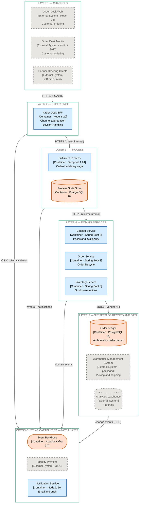

# Section 4: Meta Architecture - ENTERPRISE 5-Layer Model

<!-- ARCHITECTURE_TYPE: ENTERPRISE -->

**Purpose**: Define the layered architecture model that organizes system components according to their responsibilities and functions.

This template follows the **ENTERPRISE 5-Layer Model**, a domain-neutral layered model for enterprise systems in any industry — retail, insurance, government, logistics, healthcare, banking. It separates touchpoints, experience, process orchestration, business capabilities and systems of record, and treats integration, identity, observability and shared platform services as cross-cutting capabilities rather than as a layer.

**No industry standard is mandated.** When the project carries a business-capability alignment (for example `BIAN_ALIGNMENT.md`), a Domain Service MAY carry the capability it implements as a tag. The tag is optional; a domain service without one is complete.

**Language**: the layer names below have an English and a Spanish visible form. When `doc_language: es`, write the Spanish visible names in headings, tables and diagrams. Every marker (`<!-- ARCHITECTURE_TYPE: ENTERPRISE -->`), anchor comment, layer id (`L1` … `L5`, `C6`), table column header and `classDef` name stays English in both languages.

---

## Layers Overview

| Layer | Visible name (`en`) | Visible name (`es`) | Function |
|-------|---------------------|---------------------|----------|
| **L1** | Channels | Canales | Every touchpoint: web, mobile, partner / B2B APIs consumed by third parties, agent and back-office desktops, file and batch intake |
| **L2** | Experience | Experiencia | Per-channel adaptation: backends-for-frontends, micro-frontends, API composition, session and presentation logic — no business rules |
| **L3** | Process | Procesos | Orchestration of use cases and long-running business processes: workflow engines, sagas, process managers — owns process state, never business entities |
| **L4** | Domain Services | Servicios de Dominio | Business capabilities as bounded contexts — each owns its data and invariants and exposes APIs and events |
| **L5** | Systems of Record & Data | Sistemas de Registro y Datos | Core, packaged and SaaS platforms, the authoritative stores, the data platform (warehouse, lake, streaming store) |

**Cross-cutting capabilities (not a layer)** — Capacidades Transversales:

| Capability | Visible name (`es`) | Covers |
|------------|---------------------|--------|
| Integration | Integración | API management / gateway, event backbone / broker, managed file transfer, adapters to systems of record |
| Identity & Security | Identidad y Seguridad | Identity provider, token issuance and validation, secrets, keys, policy enforcement |
| Observability | Observabilidad | Logs, metrics, traces, alerting, audit trail |
| Shared Platform Services | Servicios de Plataforma Compartidos | Notifications, document generation and storage, business rules, scheduling |

### Dependency Rule

1. A layer calls **only the layer directly below it** or a cross-cutting capability.
2. **Skipping a layer is an exception**, stated in the layer section with the ADR that accepts it (for example, an Experience component reading reference data from a Domain Service without a process).
3. **Systems of Record never call up.** A change in a system of record reaches the upper layers as an event published through the Integration capability.
4. Responses flow back up the path the request took; events flow through the event backbone, never as a call into a higher layer.

### § 4.1 Layer Table (machine-read shape)

`docs/03-architecture-layers.md` § 4.1 carries one row per layer, in order, and the tooling (`arch-facts.js`, `scene-from-docs.js`, the command center) reads it by column header. Write it in exactly this shape:

| Layer | Function | Containers | Inside boundary |
|-------|----------|------------|-----------------|
| **L1 — Channels** | Touchpoints | — | No |
| **L2 — Experience** | Per-channel adaptation | `[canonical container names, comma-separated]` | Yes |
| **L3 — Process** | Use-case and process orchestration | `[canonical container names]` | Yes |
| **L4 — Domain Services** | Business capabilities | `[canonical container names]` | Yes |
| **L5 — Systems of Record & Data** | Authoritative stores and platforms | `[owned stores, or —]` | Yes / No |
| **C6 — Cross-Cutting Capabilities** | Integration, identity, observability, shared services | `[owned cross-cutting containers, or —]` | Yes / No |

- The first cell starts with the id (`L1` … `L5`, `C6`), then an em dash, then the visible name in `doc_language` (`**L1 — Canales**` under `es`).
- `C6` is the one row that is not a layer: it gives the cross-cutting containers a place in the table and a floor in the command center. It takes no part in the dependency rule.
- `Inside boundary` is `No` when every element on the row is an external system; name those systems in the Components subsection of the layer.
- Use canonical full names, as the component file's H1 gives them. Never abbreviate.

---

## Layer Documentation Template

For each layer, document the following information:

### Layer 1: Channels

**Purpose**: Give every user, partner and upstream system its entry point into the platform.

**Components**:
- Channel 1: [Name, kind (web, mobile, partner API consumer, agent desktop, file intake) and audience]
- Channel 2: [Name, kind and audience]
- Channel 3: [Name, kind and audience]

**C4 placement**: channels are usually **C4 L1 systems or external actors**, not containers of this system. Name each as an external system or person; a channel is a container here only when this system builds and deploys it.

**Technologies**:
- Primary: [Main technology stack, when the channel is in scope]
- Supporting: [Additional technologies, frameworks]

**Key Responsibilities**:
- [responsibility 1 — e.g. capture the user's intent and identity]
- [responsibility 2 — e.g. render results in the channel's format and locale]
- [responsibility 3]

**Communication Patterns**:
- Inbound: [How users and partners reach the channel]
- Outbound: [Calls to Layer 2 (Experience); partner APIs through the Integration capability]
- Protocols: [HTTPS/REST, GraphQL, SFTP, AS2, etc.]

**Non-Functional Requirements**:
- Performance: [Latency, throughput requirements]
- Availability: [SLA, uptime requirements]
- Scalability: [Concurrent users, partner call volume]

---

### Layer 2: Experience

**Purpose**: Adapt the platform to each channel without holding business rules.

**Components**:
- Backend-for-Frontend: [Name, channel served]
- Micro-frontend / shell: [Name, journeys composed]
- API composition: [Name, calls aggregated]

**Technologies**:
- Primary: [Main technology stack]
- Supporting: [Session store, feature flags, design system]

**Key Responsibilities**:
- Shape requests and responses for one channel
- Compose calls to Layer 3 (Process) into one response
- Manage session and presentation state
- Apply channel-level validation (format, completeness), never business validation

**Communication Patterns**:
- Inbound: [From Layer 1 (Channels)]
- Outbound: [To Layer 3 (Process); identity checks through the Identity & Security capability]
- Protocols: [REST, GraphQL, WebSocket, etc.]

**Non-Functional Requirements**:
- Performance: [Response time targets per channel]
- Availability: [High availability requirements]
- Scalability: [Horizontal scaling approach]

---

### Layer 3: Process

**Purpose**: Orchestrate use cases and long-running business processes across domain services.

**Components**:
- Process manager / saga orchestrator: [Name, use cases run]
- Workflow engine: [Name, processes modelled]
- Process state store: [Name, what it holds]

**Technologies**:
- Primary: [Workflow / orchestration technology]
- Supporting: [Process state store, timers, human-task inbox]

**Key Responsibilities**:
- Run each use case step by step against Layer 4 (Domain Services)
- Own **process state** (step reached, correlation ids, deadlines), never business entities
- Coordinate compensation when a step fails
- Handle human tasks, timers and long waits
- Expose one entry point per process and report its outcome

**Communication Patterns**:
- Inbound: [From Layer 2 (Experience); process-starting events from the event backbone]
- Outbound: [To Layer 4 (Domain Services); events through the Integration capability]
- Protocols: [Sync calls, commands, events]

**Non-Functional Requirements**:
- Performance: [Process step latency, end-to-end process duration]
- Availability: [Recovery of in-flight processes]
- Scalability: [Concurrent process instances]

---

### Layer 4: Domain Services

**Purpose**: Implement the business capabilities as bounded contexts, each owning its data and invariants.

**Components**:
- Domain service 1: [Name, bounded context, entities owned]
- Domain service 2: [Name, bounded context, entities owned]
- Domain service 3: [Name, bounded context, entities owned]

**Domain Service Template** (use for each domain service):
- **Bounded Context**: [The capability and the language it owns — e.g. "Catalog: products, prices, availability windows"]
- **Owned Data**: [Entities and the store that holds them — no other service writes them]
- **Invariants**: [Rules this service enforces on every write — e.g. "a price has one currency and a validity window"]
- **APIs**: [Operations exposed to Layer 3 and, by ADR exception, to Layer 2]
- **Events Published**: [Domain events and their topics]
- **Systems of Record Reached**: [Layer 5 systems reached, and through which adapter]
- **Capability Tag** (optional): [The capability this service implements in an alignment the project carries — e.g. a BIAN Service Domain from `BIAN_ALIGNMENT.md`. Omit the line when the project carries no alignment]

**Example**:
- **Bounded Context**: Catalog — products, prices, availability windows
- **Owned Data**: Product, PriceList, AvailabilityWindow in Catalog DB
- **Invariants**: one active price list per market; a product without an availability window is not orderable
- **APIs**: getProduct, searchProducts, quotePrice
- **Events Published**: `catalog.product-changed`, `catalog.price-changed`
- **Systems of Record Reached**: Product Information Management (packaged) through the PIM adapter
- **Capability Tag** (optional): omitted — the project carries no alignment

**Technologies**:
- Primary: [Service framework]
- Supporting: [Databases, caching, messaging]

**Key Responsibilities**:
- Enforce the invariants of the bounded context
- Own and persist the context's data — one writer per entity
- Publish a domain event for every state change other contexts need
- Shield upper layers from the shape of systems of record (anti-corruption)

**Communication Patterns**:
- Inbound: [From Layer 3 (Process)]
- Outbound: [To Layer 5 (Systems of Record & Data) through adapters; events through the Integration capability]
- Protocols: [REST, gRPC, domain events]

**Non-Functional Requirements**:
- Performance: [Service response time]
- Availability: [Per-context availability targets]
- Scalability: [Per-context scaling strategy]

---

### Layer 5: Systems of Record & Data

**Purpose**: Hold the authoritative records and the data platform the enterprise runs on.

**Systems**:
- Core / packaged platform: [Name, vendor, version — e.g. ERP, warehouse management, policy administration]
- SaaS platform: [Name, provider, what it is authoritative for]
- Authoritative store owned by this system: [Name, engine, what it records]
- Data platform: [Warehouse, lake or streaming store, and what lands there]

**Technologies**:
- Primary: [Platforms, databases]
- Supporting: [Change data capture, ETL / ELT, interfaces]

**Key Responsibilities**:
- Keep the authoritative record for each entity it holds
- Serve reads and writes only to Layer 4 (Domain Services) or the Integration capability's adapters
- Publish changes as events or change-data streams, never as calls upward
- Feed the data platform for analytics and reporting

**Communication Patterns**:
- Inbound: [From Layer 4 adapters or the Integration capability]
- Outbound: [Change events and data replication through the Integration capability]
- Protocols: [Vendor APIs, SQL, files, CDC]

**Modernization Strategy**:
- Current State: [Assessment of current systems]
- Target State: [Modernization goals]
- Migration Approach: [Strangler, replatform, replace by SaaS, retire]
- Gradual Evolution: [How each system is replaced behind the Domain Services layer while operations continue]

**Non-Functional Requirements**:
- Performance: [Transaction rate, batch windows]
- Availability: [Uptime and maintenance windows]
- Scalability: [Capacity planning]

---

### Cross-Cutting Capabilities

**Purpose**: Provide capabilities any layer may call, without forming a layer of their own.

Document each capability in use with this shape:

**[Capability — Integration | Identity & Security | Observability | Shared Platform Services]**:
- **Components**: [Name, technology — e.g. API gateway, event backbone, identity provider, notification service]
- **Owned by this system**: [Yes, a container here | No, an external platform]
- **Used by**: [Layers and components that call it]
- **Key Responsibilities**: [2–4 bullets]
- **Non-Functional Requirements**: [Availability, throughput, retention]

**C4 rules**:
- An **API gateway** is deployment infrastructure: it appears on the connection it fronts (`(via <gateway>)` in the description, `· Via <gateway>` in the label in governed mode), never as an L2 container in the logical model.
- An **event broker** is a container only when this system owns and operates it; a shared enterprise broker is named on the connection, like the gateway.
- Shared platform services (notifications, documents, rules, scheduling) are containers when this system builds them, external systems when another team runs them.

---

## Example Implementation

### Layer 4: Domain Services

**Purpose**: Hold the ordering capabilities of an online retailer as bounded contexts.

**Components**:
- Catalog Service: products, prices and availability windows
- Order Service: orders, order lines and their lifecycle
- Inventory Service: stock positions and reservations per warehouse

**Technologies**:
- Primary: Java 21, Spring Boot 3.3
- Supporting: PostgreSQL 16 (one database per service), Redis 7 (price cache), Apache Kafka 3.7 (domain events)

**Key Responsibilities**:
- Catalog Service quotes the price in force for a product and market
- Order Service accepts an order only when every line has a valid price and a reservation
- Inventory Service never lets a reservation exceed the available stock
- Each service publishes a domain event on every state change

**Communication Patterns**:
- Inbound: commands and queries from Fulfilment Process (Layer 3)
- Outbound: Order Ledger (Layer 5) through the ledger adapter, Warehouse Management System (Layer 5) through the Integration capability
- Protocols: HTTPS/REST inside the cluster, Kafka events for state changes

**Non-Functional Requirements**:
- Performance: p95 under 150 ms for quotePrice and reserveStock
- Availability: 99.9% per service
- Scalability: 2 to 8 replicas per service on CPU and request rate

---

## Architecture Diagram (Mermaid)

**Purpose**: Visualize the layer structure, component placement, and the calls between layers.

**Diagram Note**: Diagram 1 (Logical View) draws each layer as a `subgraph` band and joins **bands, never nodes**. Component-to-component wiring belongs in Diagram 4 (Detailed View). Under `doc_language: es`, the band titles take the Spanish visible names; the band ids stay `L1` … `L5`, `C6`.

### ENTERPRISE Architecture Diagram Example

The following diagram shows the five layers and the cross-cutting band for a synthetic retailer ordering platform:

````markdown
#### Diagram: Logical View


````

### Legend

**Edges**:
- **Band-to-band arrows (`-->`)**: a synchronous runtime call or an event flow from components of one band to components of the other; the label carries protocol and network context in free prose
- **Edges into `C6`**: calls to a cross-cutting capability, from any layer — the band is drawn last because it is reached from several layers, not because it sits below Layer 5
- **`L5 --> C6`** is the only edge out of Layer 5: systems of record publish changes through the event backbone and never call a higher layer

**Colors** — assigned by **drawing role only**, never by layer, criticality, or trust zone:
- **No fill, aqua stroke** (`zone`): layer band (`subgraph`) — bands carry no fill because Mermaid paints cluster rectangles after edges, so an opaque fill washes out every edge label inside the band
- **Blue** (`unit`): any component in scope — BFF, process manager, domain service, notification service
- **Orange** (`store`): any data holder in scope — process state store, owned ledger, event backbone
- **Grey, dashed** (`ext`): channels, packaged and SaaS systems of record, external identity provider, any platform another team runs

Shape carries what a fourth hue would have: cylinder `[( )]` for stores, stadium `([ ])` for topics and brokers.

**Strip the colour and the diagram must say exactly what it said** — the layering survives because the bands do.

### Customization Instructions

To customize this diagram for your specific architecture:

1. **Update Layer Components**: Replace the example components with your actual containers, by canonical full name (`component-cli.ts list`)
2. **Update Edge Labels**: Write the protocol and network context of each band-to-band edge in free prose
3. **Keep the bands**: all five layer bands are drawn even when a band holds only external systems; drop `C6` only when no cross-cutting capability is in use
4. **Do NOT adjust colors**: the four `classDef` roles are fixed across every architecture type and both themes — emit them verbatim. Assign each new node to `unit`, `store`, or `ext`, and each new `subgraph` to `zone`
5. **No node-to-node edges**: an edge between two components belongs in Diagram 4 (Detailed View)
6. **Line breaks are `\n`**: never `<br/>`, no `;` inside a label, no emoji

**For detailed diagram creation and update instructions**, see [MERMAID_DIAGRAMS_GUIDE.md](../MERMAID_DIAGRAMS_GUIDE.md) and `references/DIAGRAM-GENERATION-GUIDE.md` § Diagram 1.

---

## Guidelines

1. **All 5 layers are required** in ENTERPRISE architecture; a layer this system does not build is still documented, naming the external systems that occupy it
2. **Document layers in order**: Channels → Experience → Process → Domain Services → Systems of Record & Data, then the Cross-Cutting Capabilities
3. **Each layer must include all subsections**: Purpose, Components (or Systems), Technologies, Key Responsibilities, Communication Patterns, Non-Functional Requirements
4. **Dependency rule**: a layer calls only the layer below it or a cross-cutting capability; every skipped layer is stated with its ADR
5. **Systems of Record never call up**: their changes reach upper layers as events through the Integration capability
6. **Process owns process state, Domain Services own entities**: a process store that holds business entities is a defect
7. **Capability tags are optional**: tag a Domain Service with the capability it implements only when the project carries an alignment; never invent a tag
8. **Cross-cutting is not a layer**: document it after the five layers, and draw the API gateway on connections, never as a container
9. **Modernization strategy**: Layer 5 (Systems of Record & Data) states the plan for each system being replaced
10. **Visible names follow `doc_language`**: Spanish visible names under `es`, English anchors, markers and ids in both

---

## Validation Checklist

- [ ] All 5 layers documented (Channels, Experience, Process, Domain Services, Systems of Record & Data)
- [ ] Cross-cutting capabilities documented after the layers, marked as not a layer
- [ ] § 4.1 layer table carries `Layer`, `Function`, `Containers` and `Inside boundary` columns, one row per layer plus `C6`
- [ ] Each layer has all required subsections
- [ ] Channels named as external systems or persons unless this system builds them
- [ ] Every skipped layer has an ADR reference
- [ ] No upward call from Layer 5; changes published as events
- [ ] Each Domain Service names its bounded context, owned data, invariants and events
- [ ] Capability tags present only where the project carries an alignment
- [ ] API gateway shown on connections, not as a container; broker a container only when owned
- [ ] Technologies specified for each layer
- [ ] Non-functional requirements quantified (not just placeholders)
- [ ] Modernization strategy included in Layer 5 (Systems of Record & Data)
- [ ] Visible layer names in `doc_language`; anchors, markers and ids in English
- [ ] Architecture diagram included (Mermaid `flowchart TB`, band-to-band edges, four-role palette)
